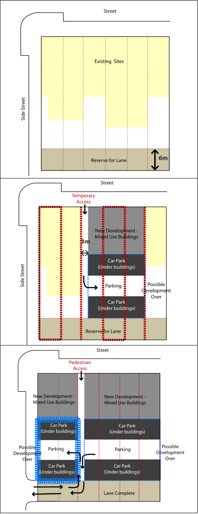

## SECTION 4–LANES

#### Explanation

Where sites are to be redeveloped and a new lane is identified over private land, the creation of the lane is required even if the lane cannot be immediately utilised.

#### Objectives

O1 To create a new lane system that will improve streetscape and pedestrian safety, and encourage active street frontages.

#### Development controls

4.1 Where site(s) are required to provide a new lane, an area of land at least 6m wide is required for the lane. This land can be taken into account for the purposes of calculating setbacks.

4.2 Sites must amalgamate to create the lane to get full development potential.

4.3 Where the lane results in the severing of land, concessions will be available to compensate for offset the loss of development potential through the development process.

4.4 Sites with no connection to the lane system must provide a temporary 3m wide access from the street. This can be converted to a pedestrian accessway once the lane is connected to the street.

4.5 The land forming the lane must be subdivided and dedicated to Council prior to release of any Occupation Certificate (including an interim certificate).

4.6 The developer will be responsible for either construction of the lane to Council’s specifications or paying a developer contribution for its construction. If the lane is not immediately required then the land must be suitably paved. If not immediately required the land can also be leased from Council for a nominal amount and used for car parking or other suitable purposes.

Figure 4a: Land prior to lane formation

Figure 4b: Creation of temporary access street

Figure 4c: Finalisation of new lane

> [Picture on page 10: a picture, saved as a picture (images/ch-06-03-campsie-town-centre-page-10-4.gif, 150 dpi).]
