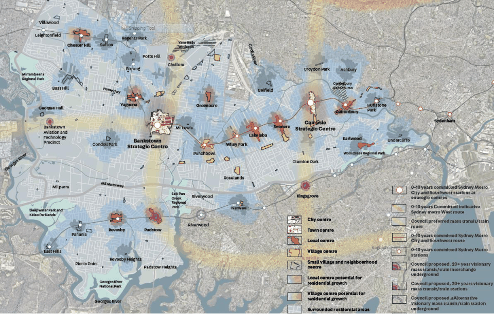

## Chapter 7 Commercial Centres

### 7.1 General Requirements

June 2023 (Amended August 2025)

Welcome to the

### City of Canterbury-Bankstown

#### Great Cities

We believe in creating vibrant, dynamic, and diverse communities that offer opportunities for people to connect, pursue their passions, and contribute to the world around them.

#### Naturally Green

We protect and prioritise nature in and around our city to enhance environmental sustainability and improve the quality of life for our residents.

#### Design Excellence

We encourage buildings, spaces, and objects that are both beautiful and practical, enhancing the beauty, accessibility, and safety of our built environment.

#### People First

We prioritise the needs, preferences, and aspirations of our community in all aspects of urban planning and design, creating supportive and enriching places people love.

#### Community

We engage with our community to ensure their needs and aspirations are reflected in the outcome, creating sustainable, resilient, vibrant, diverse, and inclusive places.

#### Sustainability

We seek designs that reduce negative impacts on the environment while also promoting social and economic well-being.

#### Net-Zero

We encourage our community to design buildings and places that produce as much renewable energy as they consume, reducing greenhouse gas emissions, lowering energy bills, and increasing resilience to environmental shocks and stresses.

#### Join us in creating a City that's liveable, loveable, and sustainable for all!

#### CONTENTS

Section 1 – Introduction ......................................................................................................... 4

Section 2 – Active street frontages ........................................................................................ 6

Section 3 – Facade design ...................................................................................................... 9

Section 4 – Visual bulk ......................................................................................................... 12

Section 5 – Corner buildings ................................................................................................ 15

Section 6 – Roof design ........................................................................................................ 16

Section 7 – Materials and finishes ....................................................................................... 18

Section 8 – Awning design ................................................................................................... 19

Section 9 – General design and amenity ............................................................................. 21

## SECTION 1–INTRODUCTION

#### Explanation

The suburbs in Canterbury-Bankstown are structured around the commercial centres that offer urban services and business opportunities. The character, size and function of each centre is different creating a diversity of urban and suburban places. The focus for all centres is commercial and street-facing retail space.

Connective City 2036 identifies the centres hierarchy, which includes strategic centres, local centres, village and small village centres, and neighbourhood centres. The centres hierarchy helps to plan for growth and to inform land uses and built form.

For example, strategic centres provide regional urban services to a metropolitan catchment and are the key focus for jobs, civic and cultural activities and housing. Local centres and village centres are connected to good public transport and provide urban services to residents in surrounding suburbs. Small village centres and neighbourhood centres meet the daily shopping needs of residents in the local area.

> [Picture on page 4: a picture, saved as a picture (images/ch-07-01-general-requirements-page-4-15.gif, 150 dpi).]

Figure 1a: Centres hierarchy (Connective City 2036, City Directions)

Key actions of Connective City 2036 include:

• To promote centres as great urban places that match a character and feel defined by the community.

• To provide residents with access to employment, retail and commercial services.

• To support growth with high quality design and improved infrastructure.

• To improve pedestrian amenity particularly within centre main streets.

The Canterbury-Bankstown Local Environmental Plan 2023 and Canterbury-Bankstown Development Control Plan 2023 combine to implement Connective City 2036.

The Canterbury-Bankstown Local Environmental Plan 2023 is Council's principal planning document to regulate effective and orderly development in Canterbury-Bankstown. The LEP provides objectives, zones and development standards such as lot sizes, floor space ratios and building heights.

The Canterbury-Bankstown Development Control Plan 2023 supports the LEP by providing additional objectives and development controls to enhance the function, design and amenity of the centres. According to the NSW Government Architect Office, good design is not just how a place looks, but how it works and feels for people. Good design creates better places that in turn maximise public value and contribute to the well-being of individuals and the community (Implementing Good Design Guideline).

#### Objectives

O1 To ensure development is compatible with the centres hierarchy and desired character of the centres.

O2 To promote good design and amenity of the built environment.

O3 To enhance the amenity for people who work in, live in and visit the centres.

O4 To facilitate ecologically sustainable development.

O5 To provide a high quality and activated public domain with good solar access.

## SECTION 2–ACTIVE STREET FRONTAGES

#### Explanation

Active street frontages enable a visual connection between the outside and inside of buildings. It enhances the pedestrian experience and provides safe, lively street edges.

Good design ensures active street frontages encourage pedestrian movement, particularly within centre main streets. Active street frontages should incorporate clear glazing to allow views into shops when they are open and also at night when they are closed. The effect of security roller doors tends to create the perceptions and potential of an unsafe environment.

Good design also ensures sites facilities (such as utilities, building services and substations) unify the development appearance and enhance the desired street character.

#### Objectives

O1 To ensure development integrates with the public domain and contributes to an active pedestrian orientated environment and passive surveillance.

O2 To strengthen the pedestrian amenity by requiring good physical and visual connections between buildings and the street.

O3 To provide a strong street address.

O4 To integrate site facilities with the building form to avoid adverse visual impacts on the public domain.

O5 To make vehicle access to buildings more compatible with pedestrian and cyclist movements and the public domain.

#### Development controls

#### Building design (active street frontages)

2.1 The ground floor design must incorporate active street frontages particularly where addressing main streets, public open space and pedestrian links.
