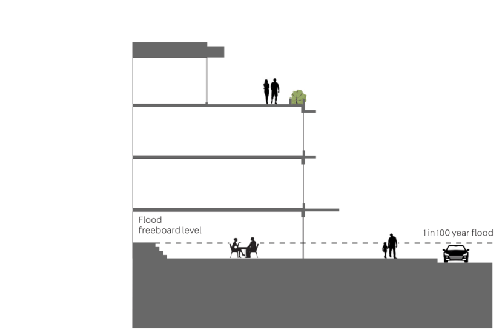

### 2.2 The design of active street frontages must include:

(a) a minimum 80% glazing (including doors);

(b) well-detailed shopfronts with pedestrian entries at least every 10m–15m;

(c) zero setback to the front building line (however this may incorporate indented entries or bays where consistent with the existing street character);

(d) high quality external materials;

(e) openable facades encouraging natural ventilation where possible;

(f) outdoor dining where possible.

2.3 The design of active street frontages must not incorporate security roller doors and window bars.

2.4 Ground floor business and office uses must utilise internal fitouts for privacy. The use of frosted screens or opaque glass for privacy is discouraged.

2.5 The ground floor entries to retail, commercial, community and residential uses are to have the same finished floor level as the adjacent footpath and are to be accessible directly from the street. Ground floor entries which have a finished floor level above or below the adjacent footpath are discouraged.

2.6 Where the finished floor level is raised due to flood impacts, the active street frontage must incorporate universal access between the street and ground floor uses, or accommodate level changes within the building.

> [Picture on page 7: a picture, saved as a picture (images/ch-07-01-general-requirements-page-7-12.gif, 150 dpi).]

Figure 2a: Accommodate level changes within the building

#### Building design (car parking)

2.7 Vehicle access to off-street parking and loading bays is to be from a secondary street or rear lane.

2.8 Where sites adjoin a rear lane, Council may allow above ground car parking at the rear of the site provided that:

(a) the car park occupies only the rear of the first storey (i.e. the ground floor) and second storey; and

(b) the car park must be setback a minimum 18m from the front building line to allow the gross floor area at the front of the building to be used for retail, commercial, community and residential; and

(c) the building design must promote natural surveillance on the lane.

2.9 For sites that do not adjoin a secondary street or rear lane, off-street parking and loading bays are to locate in the basement level or sleeved at ground level. Vehicle access is to be no more than a single driveway from the primary street and must ensure that:

(a) the vehicle footpath crossing is as narrow as possible;

(b) car park entries, driveways and loading docks are not located at the corners of street intersections.

#### Building design (pedestrian entrances)

2.10 Entrances must locate on the primary street.

2.11 Residential entrances must be secure and separate from non-residential entrances.

#### Building design (utilities and building services)

2.12 Development must show the location and design of utilities and building services (such as waste storage areas, plant rooms, hydrants, mechanical ventilation stacks, exhaust stacks, equipment and the like) on the plans.

2.13 Development must locate utilities and building services on the secondary street or rear lane. Where this is not possible, development must integrate utilities and building services with the building design and conceal the utilities and building services from public view.

#### Building design (substations)

2.14 Development must show the location and design of substations on the plans.

2.15 Development must locate substations underground. Where this is not possible, development must integrate substations with the building design and conceal the substations from public view.

2.16 Substations must not locate forward of the front building line.

## SECTION 3–FACADE DESIGN

#### Explanation

Facades have an important role in defining the street and other public domain areas. Good design improves the visual quality and attractiveness of centres. It achieves a built form that has good proportions and a balanced composition of elements, reflecting the fine grain and character of centres.

#### Objectives

O1 To achieve high quality facade designs.

O2 To integrate facade designs with the building form.

O3 To encourage a diversity of facades that contribute to the character of centres.

O4 To minimise the effect of blank walls.

O5 To minimise the reflection of sunlight from buildings to surrounding areas and buildings.

O6 To ensure building materials do not lead to hazardous, undesirable or uncomfortable glare to pedestrians, motorists or occupants of surrounding buildings.

#### Development controls
