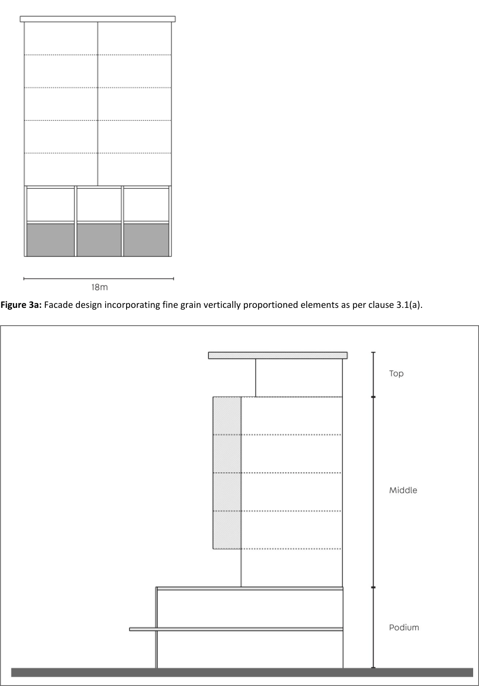

### 3.2 Facade designs may include but are not limited to:

(a) Articulating building entries.

(b) Distinguishing between the base, middle and top sections of the facade.

(c) Expressing the building towers above the podium through a change in facade details, materials and colour.

(d) Selecting balcony types that respond to the building orientation and proximity to public domain.

(e) Using architectural features such as awnings to give a human scale at street level.

(f) Recessing elements such as windows or balconies to create visual depth in the facade.

(g) Emphasising the difference between solid and void to create a sense of shadow and light.

(h) Using any other architectural elements to Council's satisfaction.

3.3 Building designs and window openings should be vertically proportioned in height, form and articulation.

3.4 Facade designs must comprise high quality materials and finishes.

3.5 Building services such as downpipes and balcony drainage must integrate with the facade design.

3.6 The design of balcony balustrades on the lower levels may be predominantly solid and/or opaque to provide privacy to residents and to screen drying areas.

#### Blank walls

3.7 Large areas of blank, minimally or poorly articulated walls are not acceptable. Measures to avoid this may include windows, awnings, sun shading devices, pergolas, green walls, public art or a recognisable increased setback to the upper storey.

3.8 Blank walls are not permitted where facing the public domain.

3.9 The maximum length of any blank wall must not exceed 5m.

3.10 The maximum height of a blank wall must not exceed 3m.

3.11 Where adjacent development is unlikely to occur in the short term, blank side walls should include public art or murals.

#### Solar light reflectivity (glare)

3.12 New buildings with four or more storeys must submit a Reflectivity Report that analyses potential solar light reflectivity and resulting glare from the proposed development on pedestrians, motorists and surrounding areas.

3.13 Solar light reflectivity from building materials used on facades must not exceed 20% at the angle of incidence.

> [Picture on page 11: a picture, saved as a picture (images/ch-07-01-general-requirements-page-11-1.gif, 150 dpi).]

Figure 3a: Facade design incorporating fine grain vertically proportioned elements as per clause 3.1(a).

Figure 3b: Podium, middle and top

## SECTION 4–VISUAL BULK

#### Explanation

Sites in centres have a typical street frontage of 6m–8m, which is considered to be ‘fine grain’. The redevelopment of these sites may involve site amalgamation to achieve better design and basement parking outcomes. However, when a single development site has a 40m wide street frontage or greater, development may be perceived as ‘bulky’ when viewed from the street.

Visual bulk is a term that refers to a building design that is visually overwhelming when viewed from the street (or other public domain area) and does not fit in well with neighbouring properties and existing development. This section assists to minimise the impact of visual bulk when viewed from the street, consistent with the desired character of centres.

#### Objectives

O1 To minimise visual bulk of development on large sites.

O2 To ensure development contributes a fine grain to the character of centres.

O3 To avoid long expanses of tower buildings.

O4 To minimise overshadowing of the public domain and other buildings.

#### Development controls

#### All sites

4.1 Building designs are to comprise a podium with tower buildings above as shown in Figure 4a. The podium height must be the street wall height.
