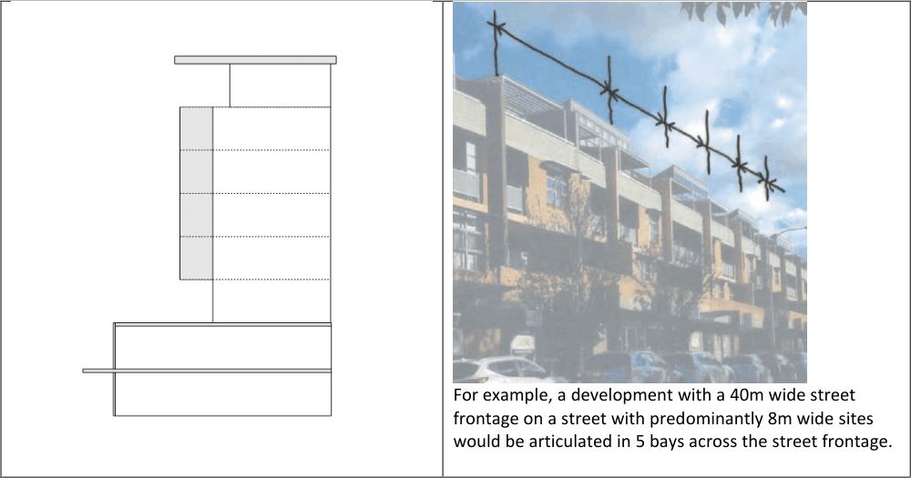
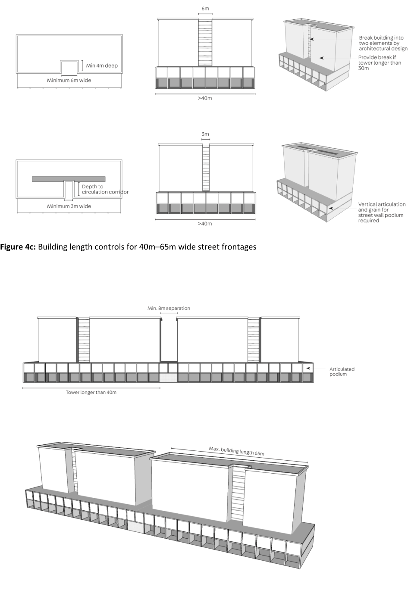
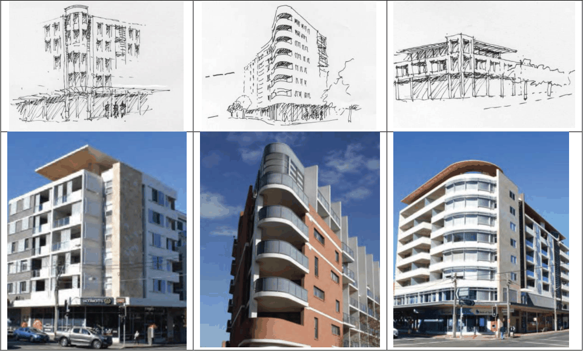

### 4.2 The vertical articulation dimensions are:

(a) the facade design of the podium is to reflect the fine grain that is in accordance with, or similar to, that of the local streetscape; or

(b) where there is no prevailing fine grain streetscape, the minimum vertical articulation dimension is 8m for the podium. The minimum vertical articulation dimension for tower buildings above the podium is 10m, which reflects the average width of an apartment.

4.3 Avoid uninterrupted or uniform building facades without articulation, such as blank walls, walls with minimal openings and glass curtain walls.

> [Picture on page 13: a picture, saved as a picture (images/ch-07-01-general-requirements-page-13-1.gif, 150 dpi).]
> Words printed on the picture (title and legend, copied from the PDF):
> For example, a development with a 40m wide street
> frontage on a street with predominantly 8m wide sites
> would be articulated in 5 bays across the street frontage.

Figure 4a: Podium with tower building above

Figure 4b: Contemporary example of realising ‘grain’ in building length by vertical articulation as per clause 4.2(a).

#### Sites with a 40–65m wide street frontage

4.4 In addition to clauses 4.1–4.3, the tower buildings must be separated into at least two distinct building elements as shown in Figure 4c. The minimum separation distance between the two distinct building elements may be in the form of:

(a) a 6m wide recess along the street frontage which is setback a minimum 4m from the building line; or

(b) a minimum break of 3m that continues to the circulation corridor, unless otherwise required by the building separation controls under the State Environment Planning Policy (Housing) 2021 (Chapter 4).

#### Sites with a street frontage greater than 65m

4.5 In addition to clauses 4.1–4.3, the tower buildings must be separated into at least two distinct building elements as shown in Figure 4d:

(a) The maximum length of a tower building is 65m.

(b) The tower building must be wholly separated from other towers by a minimum distance of 8m or in accordance with the building separation controls under the State Environment Planning Policy (Housing) 2021 (Chapter 4). The walls of towers abutting the separation distance should not be blank but given detailed design consideration to create visual interest.

> [Picture on page 14: a picture, saved as a picture (images/ch-07-01-general-requirements-page-14-1.gif, 150 dpi).]

Figure 4c: Building length controls for 40m–65m wide street frontages

Figure 4d: Building length controls for greater than 65m wide street frontages

## SECTION 5–CORNER BUILDINGS

#### Explanation

Corner buildings are highly visible from the street and provide opportunities for improved legibility of centres, distinctive architectural expression and good design outcomes.

#### Objectives

O1 To ensure corner buildings define the street edge through good design.

#### Development controls

5.1 Development on corner sites must ensure the building design incorporates one or more of the following elements at the street corner:

(a) architectural roof feature;

(b) stepping down or recessing of the built form from the corner;

(c) splayed treatments;

(d) use of materials/colours;

(e) any other architectural elements to Council's satisfaction.

> [Picture on page 15: a picture, saved as a picture (images/ch-07-01-general-requirements-page-15-15.gif, 150 dpi).]

Figure 5a: Architectural roof

feature

Figure 5b: Splayed treatments Figure 5c: Different setback for the

top floor

## SECTION 6–ROOF DESIGNS

#### Explanation

Roof forms in centres are largely concealed by parapets as seen from streets and other public domain areas. Common forms are skillion roofs sloping to the rear or, for larger buildings, a simple hip roof. The design and articulation of the roof form is an important contribution to good design.

#### Objectives

O1 To integrate roof designs with the building form.

#### Development controls

6.1 Development must incorporate a high quality roof design that:

(a) achieves a unique and contemporary architectural appearance; and

(b) combines high quality materials and finishes.

6.2 Attics are not permitted.

6.3 Pitched roofs should use light coloured metal decking to improve energy performance. Pitched roofs to the street facade are not permitted.

6.4 Plant and service equipment must be concealed or satisfactorily screened from public view.
