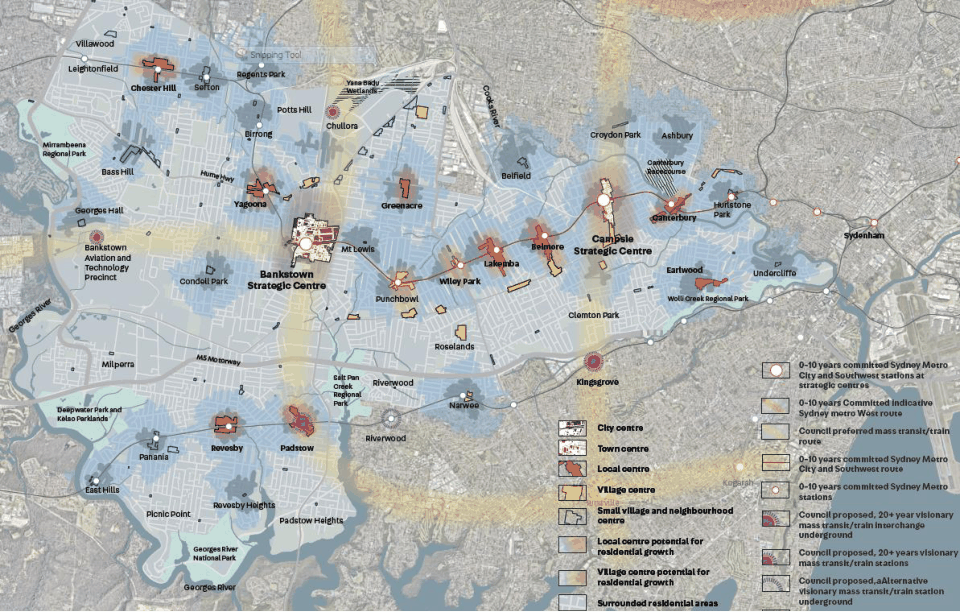
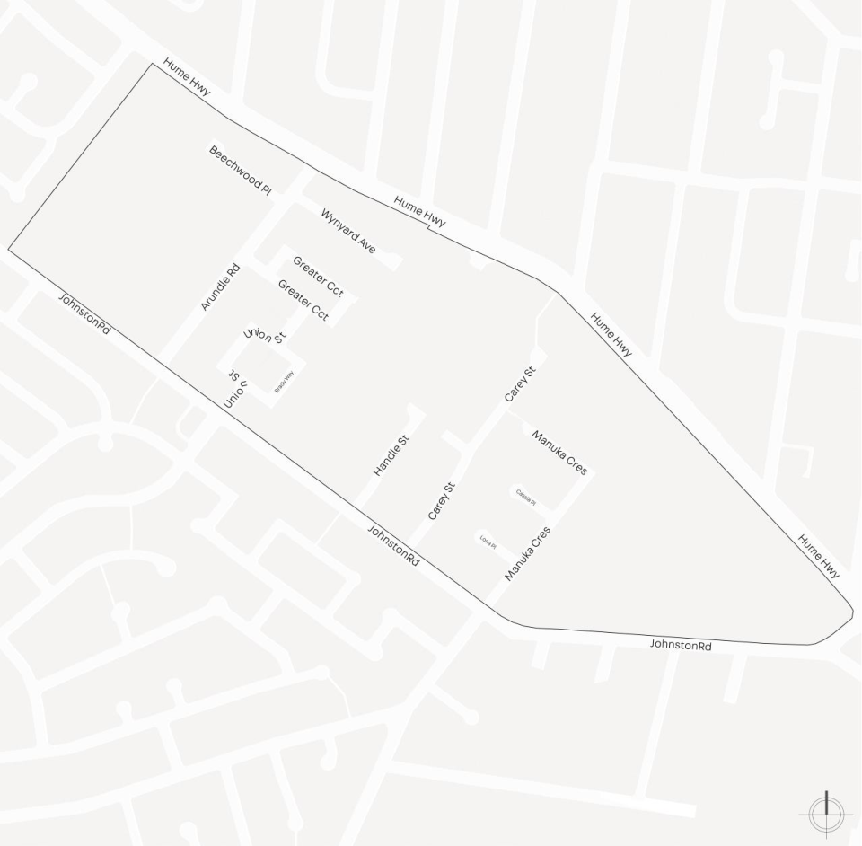

## Chapter 7 Commercial Centres

### 7.2 City West

⎯ Bass Hill ⎯ Birrong ⎯ Chester Hill ⎯ Condell Park ⎯ East Hills ⎯ Georges Hall ⎯ Greenacre ⎯ Padstow

### ⎯ Panania ⎯ Revesby ⎯ Sefton ⎯ Yagoona

June 2023 (Amended August 2025)

Welcome to the

### City of Canterbury-Bankstown

#### Great Cities

We believe in creating vibrant, dynamic, and diverse communities that offer opportunities for people to connect, pursue their passions, and contribute to the world around them.

#### Naturally Green

We protect and prioritise nature in and around our city to enhance environmental sustainability and improve the quality of life for our residents.

#### Design Excellence

We encourage buildings, spaces, and objects that are both beautiful and practical, enhancing the beauty, accessibility, and safety of our built environment.

#### People First

We prioritise the needs, preferences, and aspirations of our community in all aspects of urban planning and design, creating supportive and enriching places people love.

#### Community

We engage with our community to ensure their needs and aspirations are reflected in the outcome, creating sustainable, resilient, vibrant, diverse, and inclusive places.

#### Sustainability

We seek designs that reduce negative impacts on the environment while also promoting social and economic well-being.

#### Net-Zero

We encourage our community to design buildings and places that produce as much renewable energy as they consume, reducing greenhouse gas emissions, lowering energy bills, and increasing resilience to environmental shocks and stresses.

#### Join us in creating a City that's liveable, loveable, and sustainable for all!

#### CONTENTS

Section 1 – Introduction ......................................................................................................... 4

Section 2 – Bass Hill Small Village Centre .............................................................................. 6

Section 3 – Birrong Small Village Centre .............................................................................. 17

Section 4 – Chester Hill Local Centre ................................................................................... 22

Section 5 – Condell Park Small Village Centre ..................................................................... 26

Section 6 – East Hills Small Village Centre ........................................................................... 29

Section 7 – Georges Hall Small Village Centre ..................................................................... 33

Section 8 – Greenacre Local Centre ..................................................................................... 36

Section 9 – Padstow Local Centre ........................................................................................ 42

Section 10 – Panania Small Village Centre ........................................................................... 50

Section 11 – Revesby Local Centre ...................................................................................... 54

Section 12 – Sefton Small Village Centre ............................................................................. 62

Section 13 – Yagoona Local Centre ...................................................................................... 65

## SECTION 1–INTRODUCTION

#### Explanation

The suburbs in Canterbury-Bankstown are structured around the commercial centres that offer urban services and business opportunities. The character, size and function of each centre is different creating a diversity of urban and suburban places. The focus for all centres is commercial and street-facing retail space.

Connective City 2036 identifies the centres hierarchy, which includes strategic centres, local centres, village and small village centres, and neighbourhood centres. The centres hierarchy helps to plan for growth and to inform land uses and built form.

For example, strategic centres provide regional urban services to a metropolitan catchment and are the key focus for jobs, civic and cultural activities and housing. Local centres and village centres are connected to good public transport and provide urban services to residents in surrounding suburbs. Small village centres and neighbourhood centres meet the daily shopping needs of residents in the local area.

> [Picture on page 4: a picture, saved as a picture (images/ch-07-02-city-west-bass-hill-birrong-page-4-15.gif, 150 dpi).]

Figure 1a: Centres hierarchy (Connective City 2036, City Directions)

Key actions of Connective City 2036 include:

• To integrate the Local Area Plans into the planning framework. The Local Area Plans are land use strategies that plan for growth in Bass Hill, Birrong, Chester Hill, Condell Park, East Hills, Georges Hall, Greenacre, Padstow, Panania, Revesby, Sefton and Yagoona, consistent with strategic directions and desired character outcomes.

• To promote centres as great urban places that match a character and feel defined by the community.

• To provide residents with access to employment, retail and commercial services.

• To support growth with high quality design and improved infrastructure.

• To improve pedestrian amenity particularly within centre main streets.

The Canterbury-Bankstown Local Environmental Plan 2023 and Canterbury-Bankstown Development Control Plan 2023 combine to implement Connective City 2036.

The Canterbury-Bankstown Local Environmental Plan 2023 is Council's principal planning document to regulate effective and orderly development in Canterbury-Bankstown. The LEP provides objectives, zones and development standards such as lot sizes, floor space ratios and building heights.

The Canterbury-Bankstown Development Control Plan 2023 supports the LEP by providing additional objectives and development controls to enhance the function, design and amenity of the centres in Bass Hill, Birrong, Chester Hill, Condell Park, East Hills, Georges Hall, Greenacre, Padstow, Panania, Revesby, Sefton and Yagoona.

Good design provides a solid basis for a high quality, comfortable environment for people. It achieves:

• A building form that is consistent with the zone objectives to provide a range of commercial, entertainment and community uses and employment opportunities.

• A building form that is appropriate to the desired character of the street and surrounding buildings.

• A building form that defines the public domain, provides internal amenity and considers neighbours’ amenity.

As part of the design process, applicants must note that a building envelope is not a building, but a three dimensional shape that may determine the bulk and siting of a building. After allowing for building articulation and other development controls, the achievable floor space of a development is likely to be less than the building envelope.

#### Objectives

O1 To ensure development is compatible with the centres hierarchy planning framework.

O2 To enhance the amenity for people who live in, work in and visit the centres.

O3 To provide a high quality and activated public domain with good solar access.

O4 To facilitate ecologically sustainable development.

O5 To provide an appropriate interface to adjacent uses.

O6 To provide specific guidelines for key development sites.

## SECTION 2–BASS HILL SMALL VILLAGE CENTRE

#### Explanation

Connective City 2036 recognises Bass Hill as a small village centre within the centres hierarchy. It provides urban services to meet the daily and weekly shopping needs of residents in surrounding suburbs. Section 2 applies to land shown in Figure 2a.

> [Picture on page 6: a picture, saved as a picture (images/ch-07-02-city-west-bass-hill-birrong-page-6-6.gif, 150 dpi).]

Figure 2a: Land Application Map

#### Desired character
