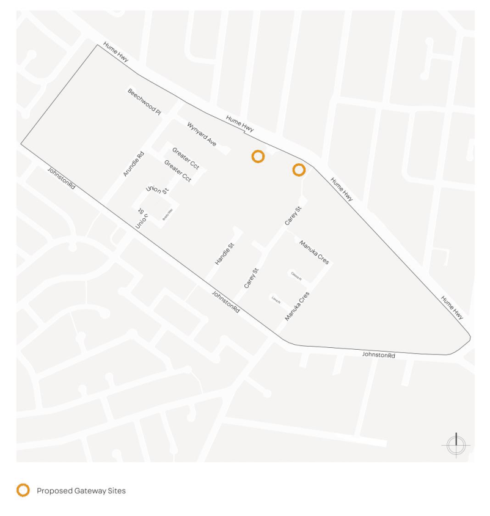
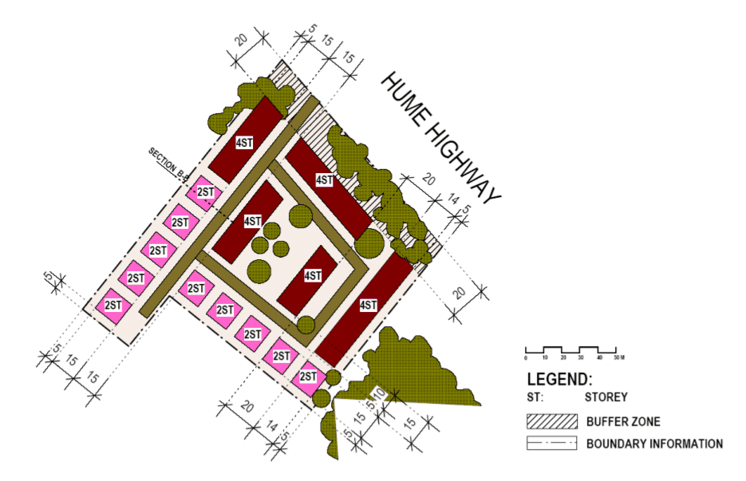
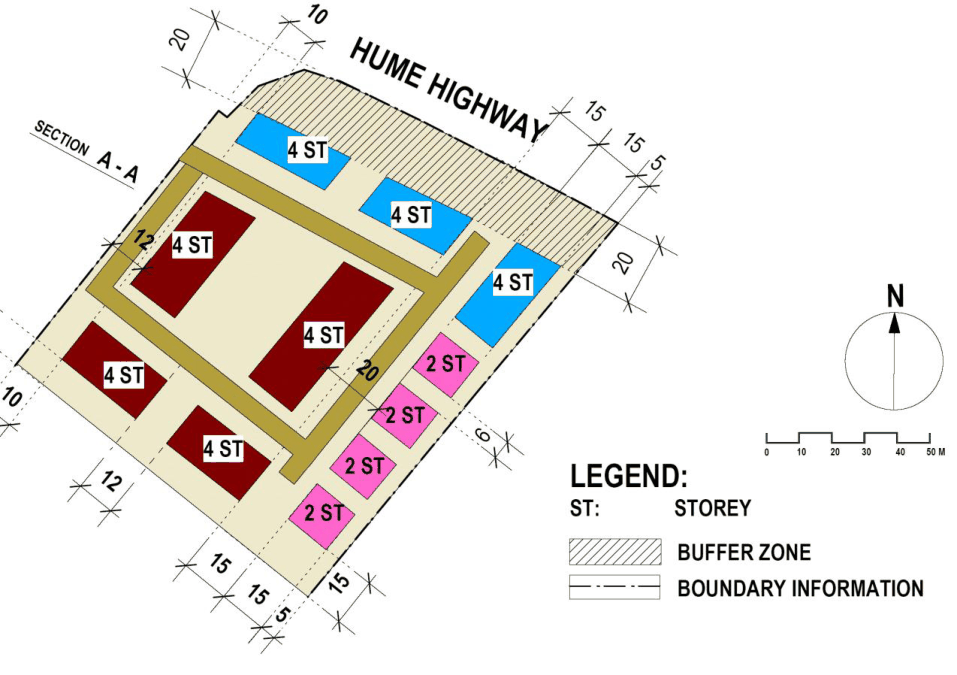
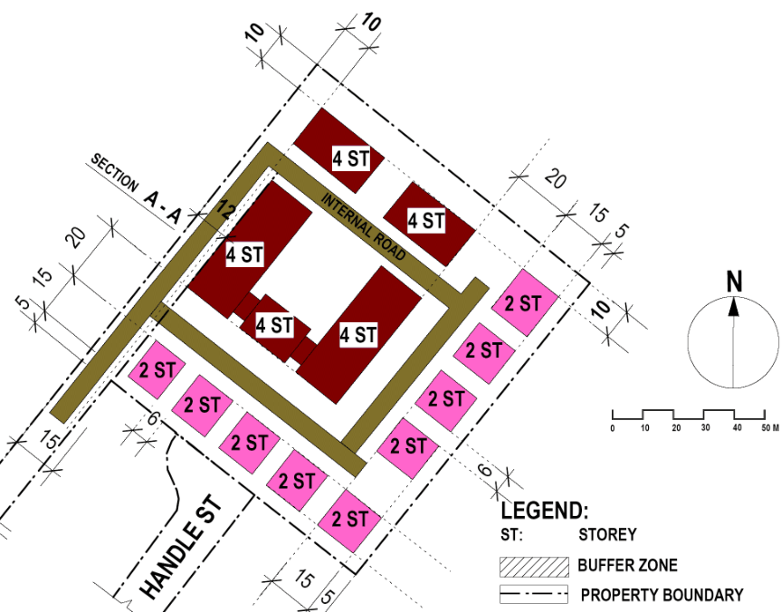
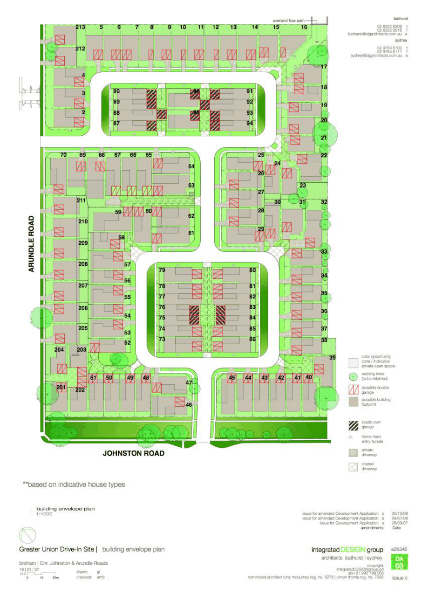
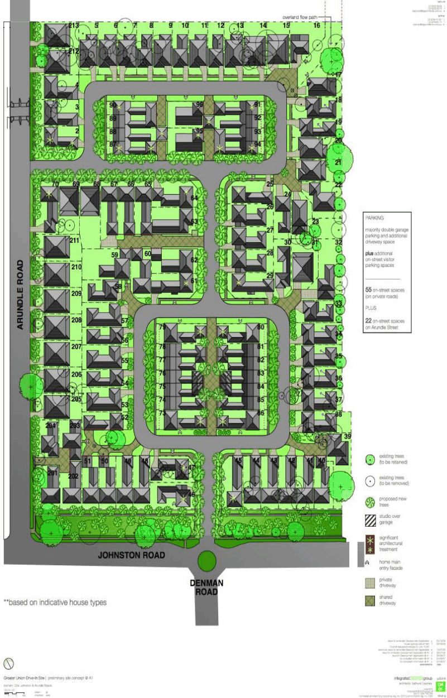
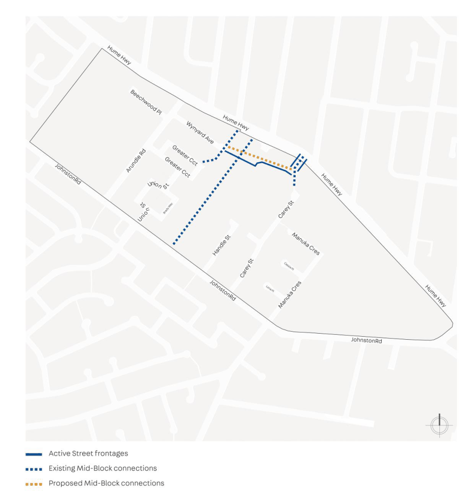
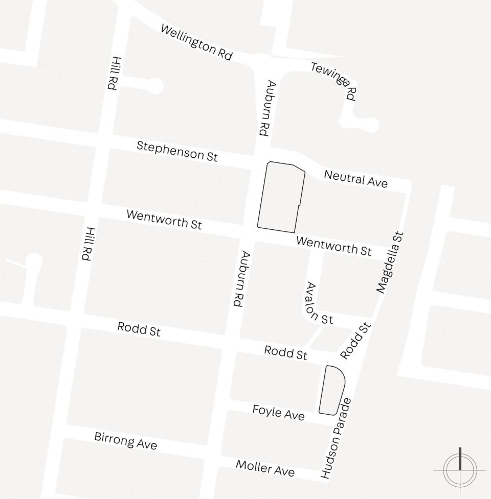

### 2.2 Development at gateway sites as shown in Figure 2c must:

(a) ensure the building facade incorporates one of the following corner elements at the street corner:

(i) an architectural roof feature at the street corner that emphasises the corner element; or

(ii) provide a different setback for the top floor at the street corner by emphasising the corner element; or

(iii) provide a different architectural treatment to the building facade at the street corner to emphasise the corner element; and

(b) ensure the car parking area and outdoor display area are not visible to the street, or do not present as blank walls to the street.

> [Picture on page 9: a picture, saved as a picture (images/ch-07-02-city-west-bass-hill-birrong-page-9-1.gif, 150 dpi).]

Figure 2c: Gateway sites

#### Site specific controls: 713–727 Hume Highway, Bass Hill

2.3 Council may apply the storey limit (not including basements) shown in Figure 2d to the sites at 713–727 Hume Highway, Bass Hill only if it is satisfied that:

(a) development will consolidate all the lots into a single site; and

(b) development within 20m of the southern and western boundaries of the site does not exceed two storeys (not including the building at the north-west corner of the site); and

(c) development in the remaining area of the site does not exceed five storeys. Council does not allow development with four or more storeys to have attics.

If in Council's opinion a development does not satisfy this clause, a two storey limit will apply to each lot.

2.4 Development must comply with the minimum setbacks shown in Figure 2d and must ensure:

(a) dwellings are setback a minimum 20m from the Hume Highway boundary of the site; and

(b) development provides appropriate solar access to the existing dwellings that adjoin the side and rear boundaries of the site.

2.5 Development must provide a minimum 20m wide landscape buffer zone to the Hume Highway boundary of the site to enhance the Remembrance Driveway landscape corridor.

2.6 Development must provide a minimum 5m wide landscape buffer zone to the eastern boundary of the site to minimise any impact on Carysfield Park. The landscape buffer zone may include private open spaces.

2.7 Vehicle access to the site may be permitted from the Hume Highway, but is not permitted from Manuka Crescent.

> [Picture on page 10: a picture, saved as a picture (images/ch-07-02-city-west-bass-hill-birrong-page-10-9.gif, 150 dpi).]

Figure 2d: Proposed storey limit and setback controls for development that consolidates the lots at 713–727 Hume Highway, Bass Hill into a single site.

#### Site specific controls: 731–737 and 753 Hume Highway, Bass Hill

2.8 The minimum setback to the primary street frontage for the sites at 731–737 and 753 Hume Highway, Bass Hill is 5m. The front setback must contain a landscape buffer zone that forms part of the Remembrance Driveway landscape corridor.

2.9 In determining the setbacks to the secondary street frontage and the side and rear boundaries of the sites, Council must take into consideration the following matters:

(a) whether the proposed setbacks respond to site conditions; and

(b) whether the proposed setbacks are compatible with the surrounding context and the desired character of the small village centre; and

(c) whether the proposed setbacks comply with the Apartment Design Guide.

2.10 For the site at 737 Hume Highway, Bass Hill, the minimum setback to the Carey Pathway is 2m with no dividing fence. The intended outcome is to create a wide pedestrian accessway with active frontages.

#### Site specific controls: 739 Hume Highway, Bass Hill within Zone E1 Local Centre

2.11 Development must comply with the storey limit (not including basements) shown in Figure 2e and must ensure:

(a) development within 20m of the eastern boundary of the site does not exceed two storeys; and

(b) development in the remaining area of the site does not exceed four storeys. Council does not allow development with four storeys to have attics.

2.12 Development must comply with the minimum setbacks shown in Figure 2e and must ensure:

(a) dwellings are setback a minimum 20m from the Hume Highway boundary of the site; and

(b) development provides appropriate solar access to the existing dwellings that adjoin the eastern boundary of the site.

2.13 Development must provide a minimum 20m wide landscape buffer zone to the Hume Highway boundary of the site to enhance the Remembrance Driveway landscape corridor.

2.14 Vehicle access to the part of the site within Zone E1 Local Centre may be permitted from the Hume Highway, but is not permitted from:

(a) the access handle to Johnston Road; or

(b) Handle Street.

> [Picture on page 11: a picture, saved as a picture (images/ch-07-02-city-west-bass-hill-birrong-page-11-21.gif, 150 dpi).]

Figure 2e: Proposed storey limit and setback controls for mixed use development at the part of the site at 739 Hume Highway, Bass Hill that is within Zone E1 Local Centre.

Site specific controls: 739 Hume Highway, Bass Hill within Zone R4 High Density Residential

2.15 Development must comply with the storey limit (not including basements) shown in Figure 2f and must ensure:

(a) development within 20m of the southern and eastern boundaries of the site does not exceed two storeys; and

(b) development in the remaining area of the site does not exceed four storeys. Council does not allow development with four storeys to have attics.

2.16 Development must comply with the minimum setbacks shown in Figure 2f and must ensure a development provides appropriate solar access to the existing dwellings that adjoin the southern and eastern boundaries of the site.

2.17 Vehicle access to the part of the site that is within Zone R4 High Density Residential may be permitted from the access handle to Johnston Road, but is not permitted from Handle Street.

> [Picture on page 12: a picture, saved as a picture (images/ch-07-02-city-west-bass-hill-birrong-page-12-15.gif, 150 dpi).]

Figure 2f: Proposed storey limit and setback controls for development on the part of the site at 739 Hume Highway, Bass Hill that is within Zone R4 High Density Residential.

#### Site specific controls: Former Bass Hill Drive-In Theatre Site, Bass Hill

2.18 The distribution of the open space and residential dwelling types must be generally in accordance with that shown in Figure 2g.

2.19 Development on the 11m wide access handle fronting the Hume Highway must be designed in consultation with Council. This land is not considered suitable for separate residential development.

2.20 Development that requires ‘significant architectural treatment’ as shown in Figure 2h must:

(a) incorporate particular architectural features in the external treatment such as entry corner features, stronger roof elements, feature stone walls, prominent veranda elements, domestic character above garages and the like; and

(b) ensure the architectural features are appropriate to the situation such as marking the head of a vista or marking an intersection.

2.21 Development must comply with the setback and building envelope controls in Appendix 2.

2.22 Buildings may be built to the side boundaries in accordance with Appendix 2 provided:

(a) living areas adjoining the property boundary are able to receive ample direct sunlight and ventilation; and

(b) adjoining sites will not be affected and management of property on common boundaries minimise neighbour conflict.

2.23 Development must provide private open space in accordance with the following controls:

(a) Sites that are greater than 300m2 in area must provide a minimum 80m2 of private open space. This can be provided as two separate spaces provided:

(i) each space contains an area greater than 35m2 and a minimum width of 3.5m throughout; and

(ii) the remaining contributory spaces must have a minimum width of 2m.

(b) Sites that are 300m2 or less in area must provide a minimum 60m2 of private open space. This can be provided as two separate spaces provided:

(i) each space contains an area greater than 25m2 and a minimum width of 3.5m throughout; and

(ii) the remaining contributory spaces must have a minimum width of 2m.

(c) Sites 73 to 96 as shown in Figure 2g may include the space forward of the front building line as private open space provided the maximum height of the front fence is 1.2m.

> [Picture on page 14: a picture, saved as a picture (images/ch-07-02-city-west-bass-hill-birrong-page-14-1.gif, 150 dpi).]

Figure 2g: Development Master Plan

> [Picture on page 15: a picture, saved as a picture (images/ch-07-02-city-west-bass-hill-birrong-page-15-1.gif, 150 dpi).]

Figure 2h: Development that requires significant architectural treatment (shown as an asterisk)

#### Pedestrian access

2.24 Development must retain existing mid-block connections or provide new mid-block connections as shown in Figure 2i to provide a legible pedestrian network that is easy to move around and connections important destinations.

2.25 The minimum width of the proposed mid-block connections is 5m.

2.26 Active street frontages must be provided to the ground floor of the main street as identified in Figure 2i.

> [Picture on page 16: a picture, saved as a picture (images/ch-07-02-city-west-bass-hill-birrong-page-16-8.gif, 150 dpi).]

Figure 2i: Active street frontages and mid-block connections

## SECTION 3–BIRRONG SMALL VILLAGE CENTRE

#### Explanation

Connective City 2036 recognises Birrong as a small village centre within the centres hierarchy. It provides urban services to meet the daily and weekly shopping needs of residents in surrounding suburbs. Section 3 applies to land shown in Figure 3a.

> [Picture on page 17: a picture, saved as a picture (images/ch-07-02-city-west-bass-hill-birrong-page-17-6.gif, 150 dpi).]

Figure 3a: Land Application Map

#### Desired character

The Birrong Small Village Centre will continue to function as a local shopping and commuting precinct servicing the day-to-day needs of residents.

The Auburn Road local shops will be the focal point for activity, a place of shopping, a place of social interaction, a place that will capitalise on the residents and commuters passing through daily. The accessible railway station will be the focal point for commuting, a great public space which connects both sides of the railway line. Low-rise buildings will create a sense of enclosure, human scale, order, comfort and enjoyment for people walking in the small village centre.

The local streets will be a tranquil place where cars travel slowly, making it easier to cross the street and creating a pleasant place to walk, sit and talk. The urban spaces and street trees will create a ‘sense of place’ for the small village centre.

There are two precincts of distinctive functional and physical character within the small village centre as shown in Figure 3b, which offer an effective base to implement the desired character and development controls at the local level.
