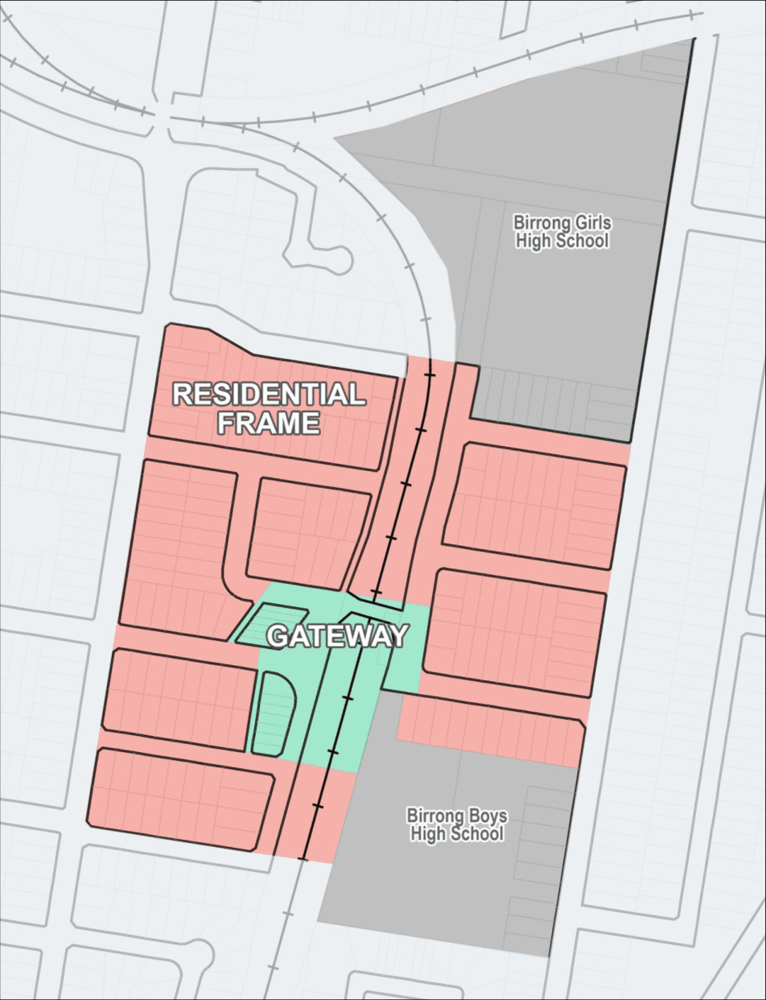

#### C2 Residential Frame

The Residential Frame precinct is a liveable neighbourhood which marks the fringe of the small village centre. This compact place will accommodate a mix of living choices that respond to local needs. A place where many, from young families to seniors are making their homes within a short walking distance of the railway station. The low-rise housing will provide an appropriate built form transition to the low-rise houses in the surrounding suburban neighbourhood.

The Residential Frame precinct is also a place of green streets. Street trees will define the public domain and strengthen the centre’s ‘neighbourhood’ character, which is valued by the community and one of the reasons people live and spend time in the small village centre. The leafy streets will be a place where cars travel slowly, making it easier to cross the street and a pleasant place to walk and cycle.

> [Picture on page 19: a picture, saved as a picture (images/ch-07-02-city-west-bass-hill-birrong-page-19-1.gif, 150 dpi).]

Figure 3b: Precinct Plan (Source: North Central Local Area Plan)

#### Objectives

O1 To ensure development is compatible with the desired character of the centre and maintains a pedestrian scale to the street.

O2 To achieve good design in terms of building form, bulk, architectural treatment, visual amenity and landscape.

O3 To provide storey limits.

O4 To require a continuous built edge to the street at locations where it is essential to have active street frontages.

O5 To ensure the building form and design provide appropriate amenity to residents.

O6 To minimise overshadowing particularly from upper levels.

O7 To ensure development is compatible with the prevailing suburban character and amenity of neighbouring residential areas.

O8 To improve the legibility of the centre by defining important corners and prominent sites.

#### Development controls

#### Storey limits

3.1 Development must comply with the storey limit that corresponds with the maximum building height shown for the site on the Height of Building Map as follows:

| Maximum building height as shown on the Height of Buildings Map (Canterbury-Bankstown LEP 2023) | Storey limit (not including basements) |
|---|---|
| 14m | 4 storeys (no attic) |
| 20m | 6 storeys (no attic) |

Note: Architectural roof features that exceed the maximum building height may be permitted under the Canterbury-Bankstown Local Environmental Plan 2023 (clause 5.6) to Council’s satisfaction, otherwise the roof features must comply with the maximum building height.

#### Setbacks
