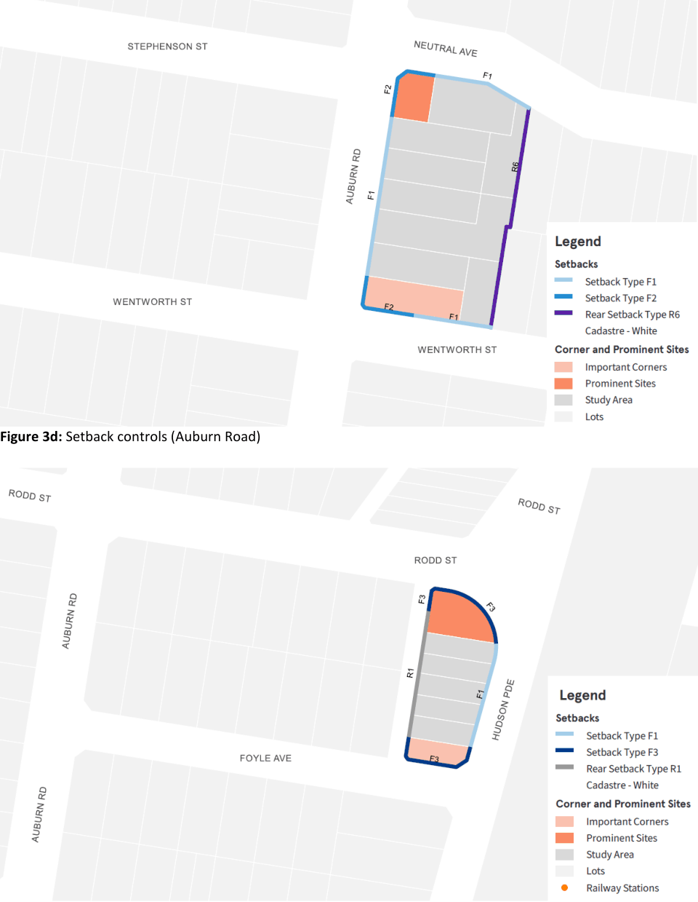
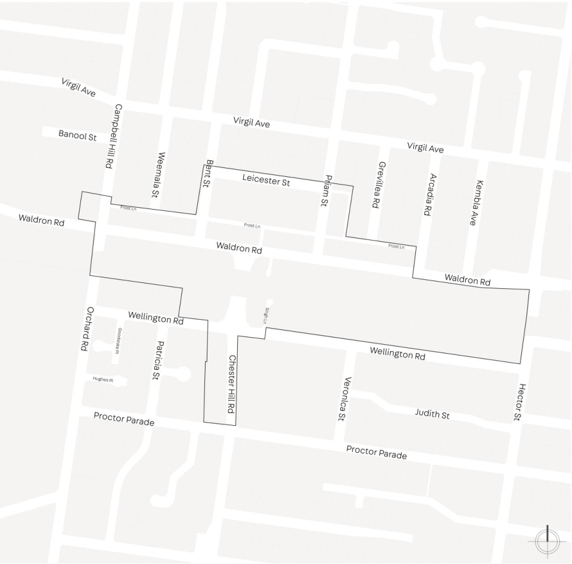

### 3.2 Development must:

(a) comply with the minimum setbacks shown in Figures 3d and 3e and Appendix 1;

(b) comply with Setback Type S1 to maintain continuous street walls unless otherwise indicated in Figures 3d and 3e and Appendix 1;

(c) provide a two storey street wall to the primary and secondary street frontages.

> [Picture on page 21: a picture, saved as a picture (images/ch-07-02-city-west-bass-hill-birrong-page-21-1.gif, 150 dpi).]

Figure 3d: Setback controls (Auburn Road)

Figure 3e: Setback controls (Hudson Parade)

## SECTION 4–CHESTER HILL LOCAL CENTRE

#### Explanation

Connective City 2036 recognises Chester Hill as a local centre within the centres hierarchy. It provides urban and community services to a large suburban population, and connects to good public transport. Section 4 applies to land shown in Figure 4a.

> [Picture on page 22: a picture, saved as a picture (images/ch-07-02-city-west-bass-hill-birrong-page-22-6.gif, 150 dpi).]

Figure 4a: Land Application Map

#### Desired character
