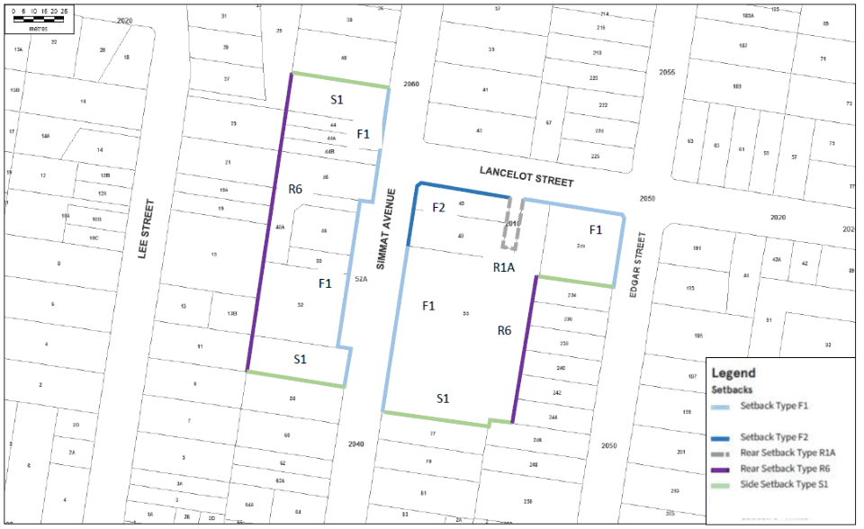
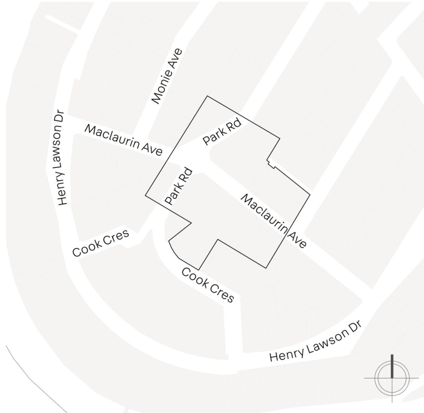

### 5.2 Development must:

(a) comply with the minimum setbacks shown in Figure 5c and Appendix 1;

(b) comply with Setback Type S1 to maintain continuous street walls unless otherwise indicated in Figure 5c and Appendix 1;

(c) provide a two storey street wall to the primary and secondary street frontages.

> [Picture on page 28: a picture, saved as a picture (images/ch-07-02-city-west-bass-hill-birrong-page-28-1.gif, 150 dpi).]

Figure 5c: Setback controls

## SECTION 6–EAST HILLS SMALL VILLAGE CENTRE

#### Explanation

Connective City 2036 recognises East Hills as a small village centre within the centres hierarchy. It provides urban services to meet the daily and weekly shopping needs of residents in surrounding suburbs. Section 6 applies to land shown in Figure 6a.

> [Picture on page 29: a picture, saved as a picture (images/ch-07-02-city-west-bass-hill-birrong-page-29-6.gif, 150 dpi).]

Figure 6a: Land Application Map

#### Desired character

The East Hills Small Village Centre will continue to function as a local shopping and commuting precinct servicing the day-to-day needs of residents with excellent access to high quality open space and the Georges River.

Active street frontages at the Maclaurin Avenue shops will create a vibrant streetscape. The local streets will be a tranquil place where cars travel slowly, making it easier to cross the street and creating a pleasant place to walk, sit and talk. Low-rise buildings will create a sense of enclosure, human scale, order, comfort and enjoyment for people walking in the small village centre. The urban spaces and street trees will create a ‘sense of place’ for the small village centre.

While there are two precincts of distinctive functional and physical character within the local centre as shown in Figure 6b, this section is specific to the Gateway Precinct. This precinct offers an effective base to implement the desired character and development controls at the local level.
