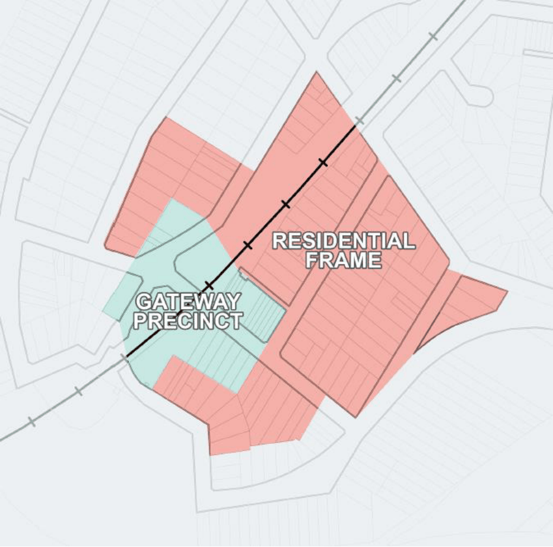

#### C1 Gateway Precinct

Maclaurin Avenue and the accessible railway station are the local magnet, a place that provides a strong, distinctive and centrally located ‘heart’ for the small village centre. The gateway is also a central place of activity, a place where people can play, relax and socialise in Maclaurin Avenue and at parks located along the Georges River.

> [Picture on page 30: a picture, saved as a picture (images/ch-07-02-city-west-bass-hill-birrong-page-30-10.gif, 150 dpi).]

Figure 6b: Precinct Plan (Source: South West Local Area Plan)

#### Objectives

O1 To ensure development is compatible with the desired character of the centre and maintains a pedestrian scale to the street.

O2 To achieve good design in terms of building form, bulk, architectural treatment, visual amenity and landscape.

O3 To provide storey limits.

O4 To require a continuous built edge to the street at locations where it is essential to have active street frontages.

O5 To ensure the building form and design provide appropriate amenity to residents.

O6 To minimise overshadowing particularly from upper levels.

O7 To ensure development is compatible with the prevailing suburban character and amenity of neighbouring residential areas.

O8 To improve the legibility of the centre by defining important corners and prominent sites.

#### Development controls

#### Storey limit

6.1 Development must comply with the storey limit that corresponds with the maximum building height shown for the site on the Height of Building Map as follows:

| Maximum building height as shown on the Height of Buildings Map (Canterbury-Bankstown LEP 2023) | Storey limit (not including basements) |
|---|---|
| 14m | 4 storeys (no attic) |
| 20m | 6 storeys (no attic) |

Note: Architectural roof features that exceed the maximum building height may be permitted under the Canterbury-Bankstown Local Environmental Plan 2023 (clause 5.6) to Council’s satisfaction, otherwise the roof features must comply with the maximum building height.

#### Setbacks
