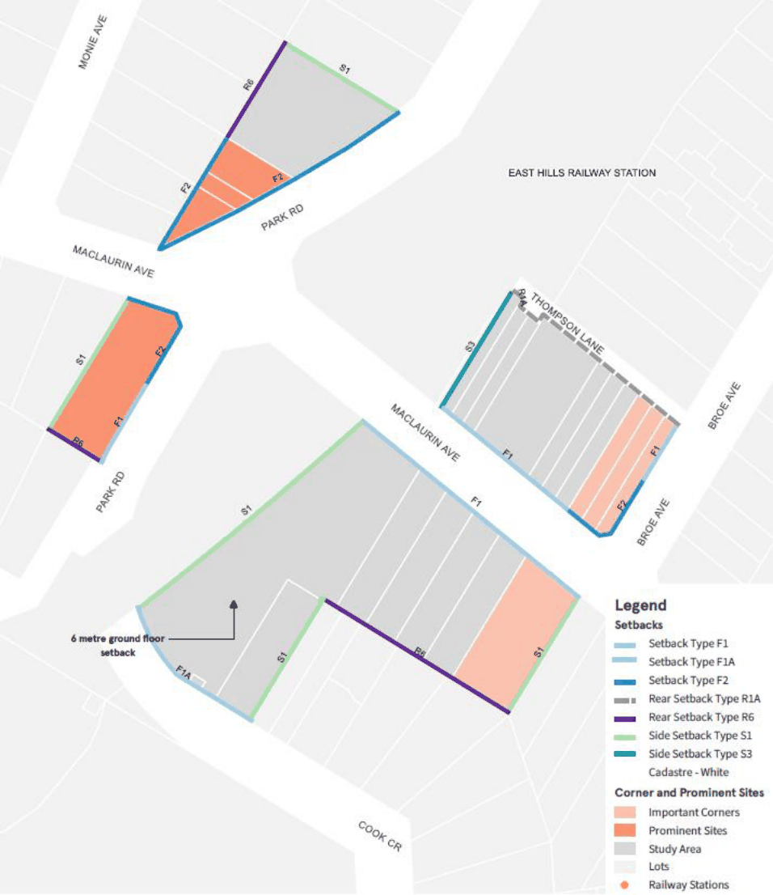
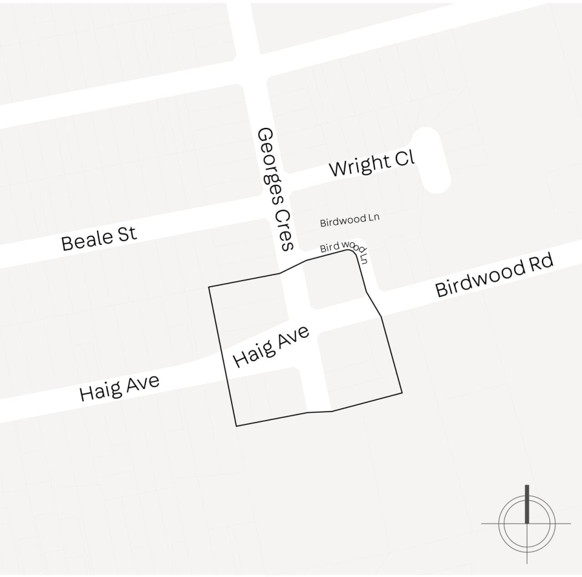

### 6.2 Development must:

(a) comply with the minimum setbacks shown in Figure 6d and Appendix 1;

(b) comply with Setback Type S1 to maintain continuous street walls unless otherwise indicated in Figure 6d and Appendix 1;

(c) provide a two storey street wall to the primary and secondary street frontages.

> [Picture on page 32: a picture, saved as a picture (images/ch-07-02-city-west-bass-hill-birrong-page-32-1.gif, 150 dpi).]

Figure 6c: Setback controls

## SECTION 7–GEORGES HALL SMALL VILLAGE CENTRE

#### Explanation

Connective City 2036 recognises Georges Hall as a small village centre within the centres hierarchy. It provides urban services to meet the daily and weekly shopping needs of residents in surrounding suburbs. Section 7 applies to land shown in Figure 7a.

> [Picture on page 33: a picture, saved as a picture (images/ch-07-02-city-west-bass-hill-birrong-page-33-6.gif, 150 dpi).]

Figure 7a: Land Application Map

#### Desired character
