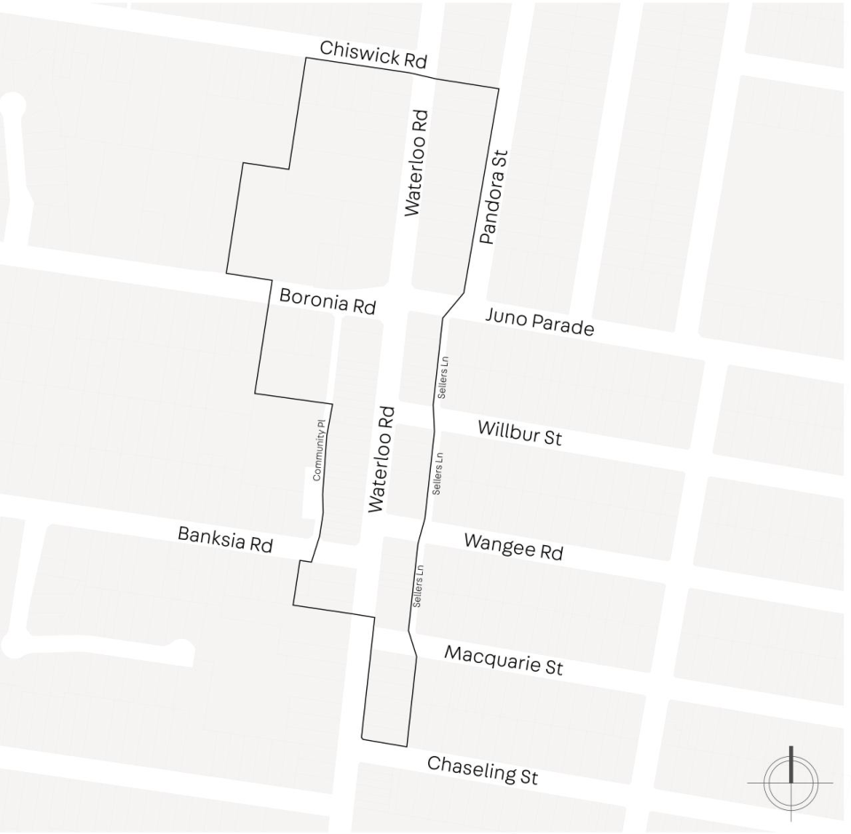

#### C1 Georges Hall Small Village Centre

The Georges Hall Small Village Centre will continue to function as a small shopping precinct servicing the day-to-day needs of residents, a relaxing place where residents can catch up with neighbours and have a chat over coffee. The built form will maintain the low density neighbourhood character of the surrounding residential area.

#### Objectives

O1 To ensure development is compatible with the desired character of the centre and maintains a pedestrian scale to the street.

O2 To achieve good design in terms of building form, bulk, architectural treatment, visual amenity and landscape.

O3 To provide storey limits.

O4 To require a continuous built edge to the street at locations where it is essential to have active street frontages.

O5 To ensure the building form and design provide appropriate amenity to residents.

O6 To minimise overshadowing particularly from upper levels.

O7 To ensure development is compatible with the prevailing suburban character and amenity of neighbouring residential areas.

#### Development controls

#### Storey limit (not including basements)

7.1 Development must comply with the storey limit that corresponds with the maximum building height shown for the site on the Height of Building Map as follows:

| Maximum building height as shown on the Height of Buildings Map (Canterbury-Bankstown LEP 2023) | Storey limit (not including basements) |
|---|---|
| 14m | 4 storeys (no attic) |

Note: Architectural roof features that exceed the maximum building height may be permitted under the Canterbury-Bankstown Local Environmental Plan 2023 (clause 5.6) to Council’s satisfaction, otherwise the roof features must comply with the maximum building height.

#### Street setbacks

7.2 The minimum setback to the primary and secondary street frontages of the site is zero setback for the basement level, the first storey (i.e. the ground floor), and the second storey.

#### Side and rear setbacks

7.3 Where development is adjacent to residential zoned land, Council may increase the minimum setbacks to the side and rear boundaries.

7.4 For blank building walls with no window or balcony, the minimum setback to the side and rear boundaries of the site is zero setback for the basement level, the first storey (i.e. the ground floor), and the second storey.

7.5 The maximum depth for cross-through dwellings (i.e. single or dual aspect dwellings where the side building walls do not contain a window or balcony) is 14m.

7.6 For building walls with a window or balcony in commercial development, shop top housing, and mixed use development that contains dwellings, the minimum setbacks to the side and rear boundaries of the site are:

(a) 3m for the first storey (i.e. the ground floor). Council may allow a setback less than 3m provided it complies with the Building Code of Australia; and

(b) 3m for the second storey.

7.7 For building walls with a window or balcony in residential flat buildings, the minimum setback to the side and rear boundaries of the site is 5m for all storeys.

#### Setbacks within the site

7.8 The minimum setbacks between two or more habitable buildings on the site are:

(a) 9m between the external enclosing walls of dwellings; and

(b) 6m between the balconies, above ground decks, and the like of dwellings.

## SECTION 8–GREENACRE LOCAL CENTRE

#### Explanation

Connective City 2036 recognises Greenacre as a local centre within the centres hierarchy. It provides urban and community services to a large suburban population, and connects to good public transport. Section 8 applies to land shown in Figure 8a.

> [Picture on page 36: a picture, saved as a picture (images/ch-07-02-city-west-bass-hill-birrong-page-36-6.gif, 150 dpi).]

Figure 8a: Land Application Map

#### Desired character

The Greenacre Local Centre will continue to function as a successful and bustling centre that is commercially viable, well designed, reflecting the unique characteristics of the place, and recognised by the community as the ‘heart’ of the local area.

Community Place is the central point from which the local centre radiates, an enlivened mixed use destination that meets the needs of the growing community and is a catalyst for investment. Community Place will be home to a modern multi-purpose community facility, a place for people to come together for events and social activities.

The main street (Waterloo Road) is an attractive and bustling place. A place of local jobs, a place of shopping, a place of dining and social interaction, a place of walking. The main street will be a place where cars travel slowly, making it easier to cross the street and creating a pleasant place to walk, sit and talk. Active street frontages will create a vibrant streetscape where there is day and evening activity, and where shops and restaurants will stay open longer.

Low and medium-rise buildings at appropriate locations will create a sense of enclosure, human scale, order, comfort and enjoyment for people walking in the local centre. Leafy streets will connect people to the low-rise liveable neighbourhoods and provide a stunning platform from which to journey into the local centre. Roberts Park will provide a conveniently located community hub for youth and sporting activities.

While there are four precincts of distinctive functional and physical character within the local centre as shown in Figure 8b, this section is specific to the Main Street. This precinct offers an effective base to implement the desired character and development controls at the local level.
