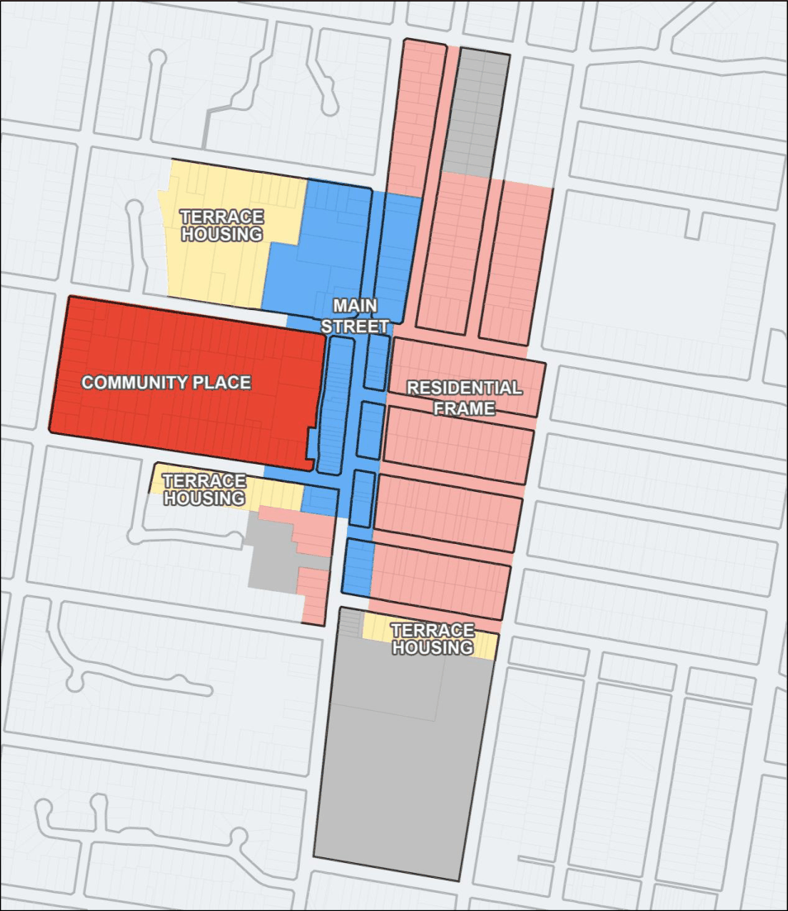

#### C1 Main Street

The Main Street (Waterloo Road) is a place that connects people, business, public transport and key destinations. Active street frontages along the main street will create a vibrant streetscape where there is day and evening activity, and where shops and restaurants will stay open longer. The main street will be a place where cars travel slowly, making it easier to cross the street and creating a pleasant place to walk, sit and talk.

The main street will be a place of well-proportioned, human scale buildings that contribute to the sense of comfort and village feel. Based on the urban design analysis, the main street of a local centre is comprised of buildings that create a dense urban form, generally of a similar height and not more than six storeys.

This continuous urban form helps define the streets and public spaces. It is recognised the development of the local centre will occur over time, resulting in a rich mixture of old and new buildings with contrasting building heights and architectural styles.

> [Picture on page 38: a picture, saved as a picture (images/ch-07-02-city-west-bass-hill-birrong-page-38-1.gif, 150 dpi).]

Figure 8b: Precinct Plan (Source: North East Local Area Plan)

#### Objectives

O1 To ensure development is compatible with the desired character of the centre and maintains a pedestrian scale to the street.

O2 To achieve good design in terms of building form, bulk, architectural treatment, visual amenity and landscape.

O3 To provide storey limits.

O4 To require a continuous built edge to the street at locations where it is essential to have active street frontages.

O5 To ensure the building form and design provide appropriate amenity to residents.

O6 To minimise overshadowing particularly from upper levels.

O7 To ensure development is compatible with the prevailing suburban character and amenity of neighbouring residential areas.

O8 To improve the legibility of the centre by defining important corners and prominent sites.

O9 To improve pedestrian access by providing new mid-block connections and enhancing existing links as redevelopment occurs.

#### Development controls

#### Storey limit

8.1 Development must comply with the storey limit that corresponds with the maximum building height shown for the site on the Height of Building Map as follows:

| Maximum building height as shown on the Height of Buildings Map (Canterbury-Bankstown LEP 2023) | Storey limit (not including basements) |
|---|---|
| 14m | 4 storeys (no attic) |
| 20m | 6 storeys (no attic) |

Note: Architectural roof features that exceed the maximum building height may be permitted under the Canterbury-Bankstown Local Environmental Plan 2023 (clause 5.6) to Council’s satisfaction, otherwise the roof features must comply with the maximum building height.

#### Setbacks
