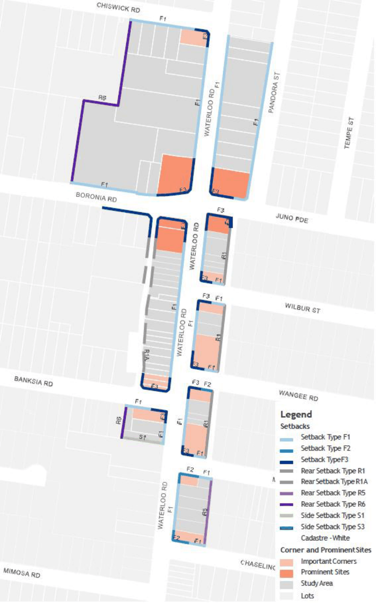
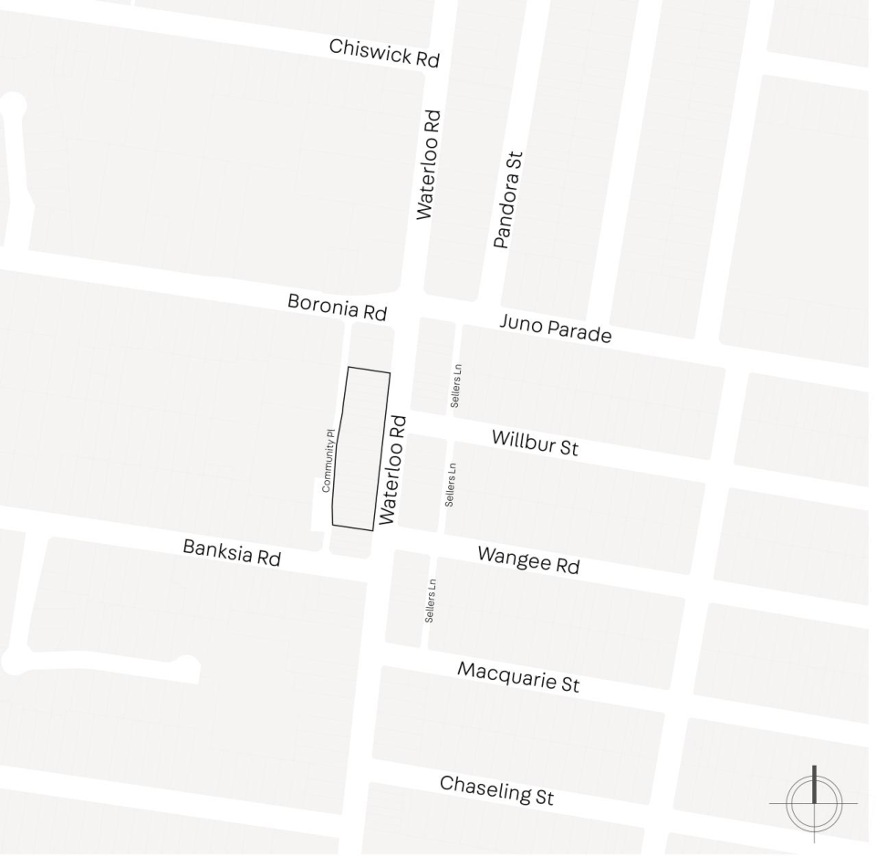
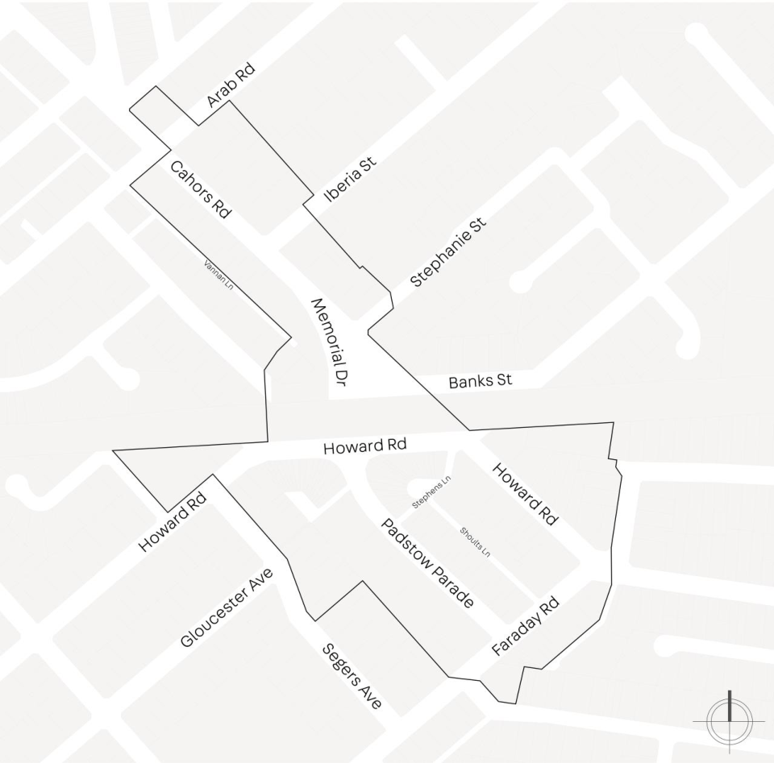

### 8.2 Development must:

(a) comply with the minimum setbacks shown in Figure 8d and Appendix 1;

(b) comply with Setback Type S1 to maintain continuous street walls unless otherwise indicated in Figure 8d and Appendix 1;

(c) provide a two storey street wall to the primary and secondary street frontages.

#### Mid-block connections

8.3 Development must retain existing mid-block connections or provide new mid-block connections as shown in Figure 8e to provide a legible pedestrian network that is easy to move around and connects important destinations.

> [Picture on page 40: a picture, saved as a picture (images/ch-07-02-city-west-bass-hill-birrong-page-40-1.gif, 150 dpi).]

Figure 8d: Setback controls

> [Picture on page 41: a picture, saved as a picture (images/ch-07-02-city-west-bass-hill-birrong-page-41-1.gif, 150 dpi).]

Figure 8e: Mid-block connections

## SECTION 9–PADSTOW LOCAL CENTRE

#### Explanation

Connective City 2036 recognises Padstow as a local centre within the centres hierarchy. It provides urban and community services to a large suburban population, and connects to good public transport. Section 9 applies to land shown in Figure 9a.

> [Picture on page 42: a picture, saved as a picture (images/ch-07-02-city-west-bass-hill-birrong-page-42-6.gif, 150 dpi).]

Figure 9a: Land Application Map

#### Desired character

The Padstow Local Centre will continue to function as a successful and bustling centre that is commercially viable, well designed, reflecting the unique characteristics of the place, and recognised by the community as one of the twin ‘hearts’ of the local area alongside the Revesby Local Centre.

Carl Little Reserve is the central point from which the local centre radiates, an enlivened mixed use destination that meets the needs of the growing community and is a catalyst for investment. Carl Little Reserve will be home to a modern multi-purpose community facility and civic space, a place for people to come together for events and social activities.

The Southern Commercial Core precinct is the local retail magnet with the anchor supermarket. Active street frontages along the main streets (Howard Road, Padstow Parade and Cahors Road) will create a vibrant streetscape where there is day and evening activity, and where shops and restaurants will stay open longer. The streets will be a place where cars travel slowly, making it easier to cross the street and creating a pleasant place to walk, sit and talk. The traditional terrace shops and historic shopfronts will continue to reflect the unique characteristics of the place.

Low and medium-rise buildings at appropriate locations will create a sense of enclosure, human scale, order, comfort and enjoyment for people walking in the local centre. Leafy streets will connect people to the low-rise liveable neighbourhoods and provide a stunning platform from which to journey into the local centre.

While there are four precincts of distinctive functional and physical character within the local centre as shown in Figure 9b, this section is specific to the Northern and Southern Commercial Cores and Residential Frame. These precincts offer an effective base to implement the desired character and development controls at the local level.
