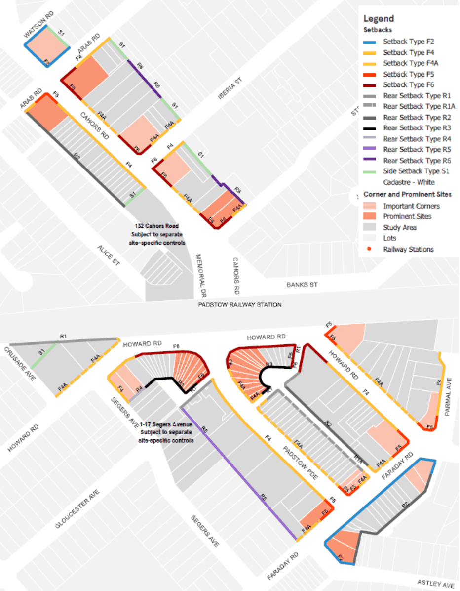
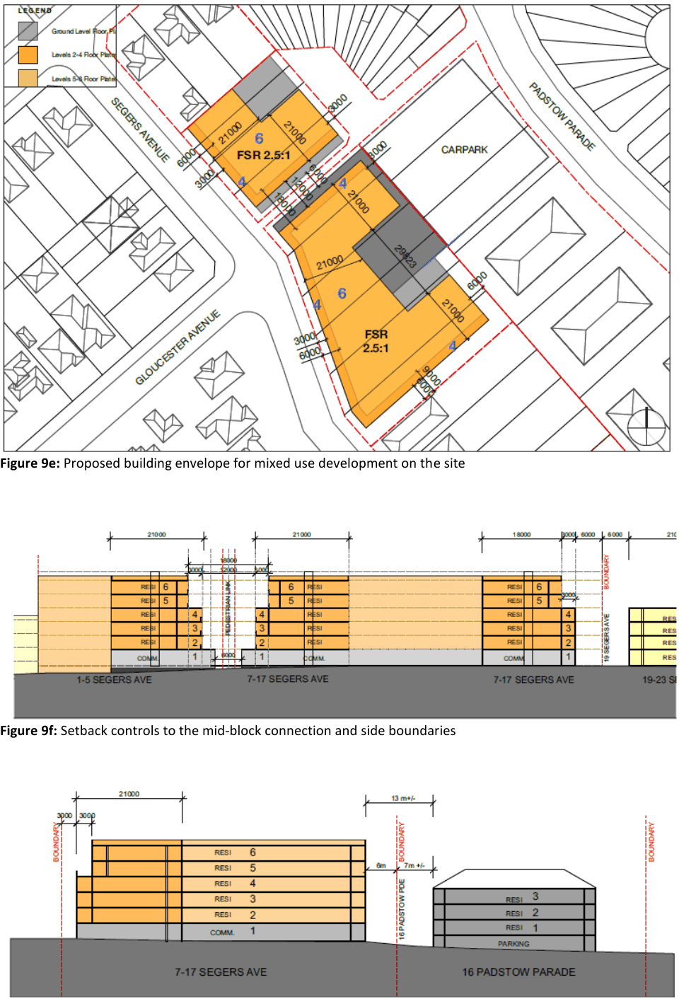
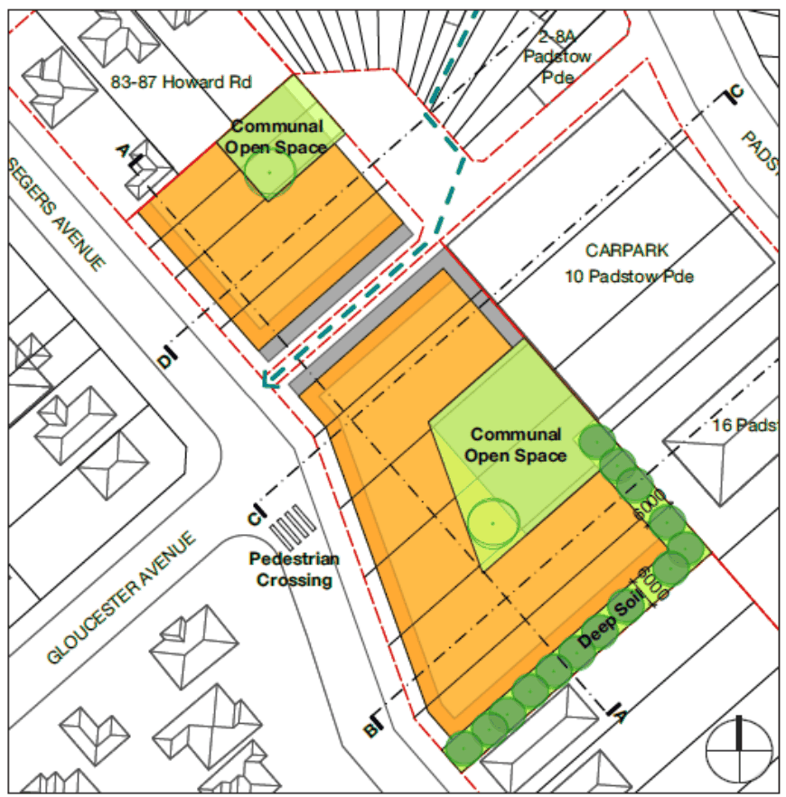
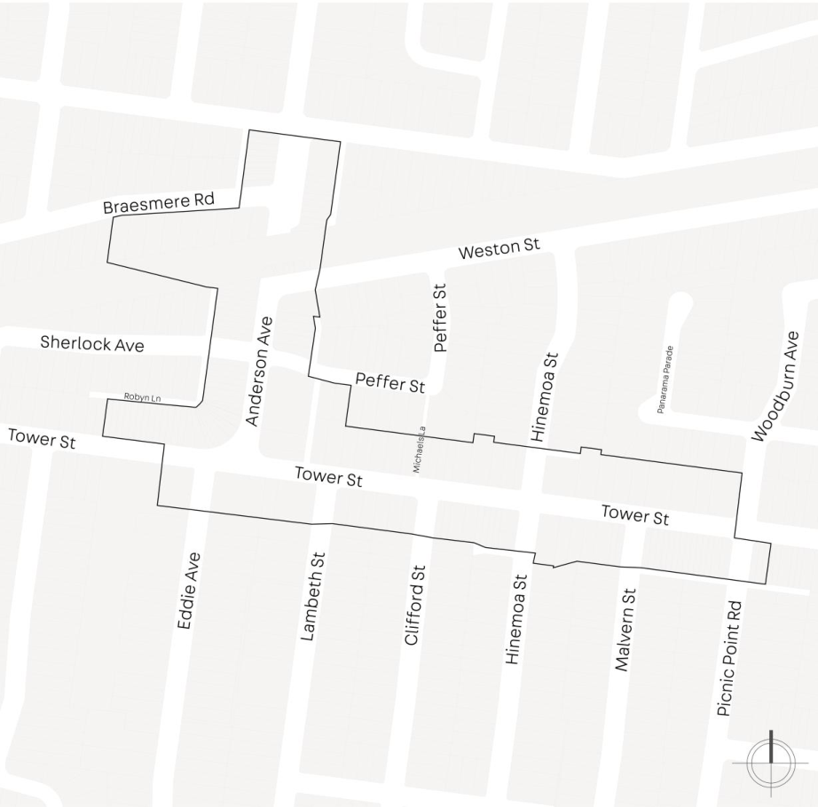

### 9.2 Development must:

(a) comply with the minimum setbacks shown in Figure 9d and Appendix 1;

(b) comply with Setback Type S1 to maintain continuous street walls unless otherwise indicated in Figure 9d and Appendix 1;

(c) provide a four storey street wall to the primary and secondary street frontages.

> [Picture on page 46: a picture, saved as a picture (images/ch-07-02-city-west-bass-hill-birrong-page-46-7.gif, 150 dpi).]

Figure 9d: Setback controls

#### Site specific controls: 1–17 Segers Avenue, Padstow

9.3 Development must comply with the minimum setbacks shown in Figures 9e–9g with the intended outcomes of:

(a) retaining this key development site as a single site;

(b) ensuring the form and separation of buildings on this key development site contribute to a high quality urban environment;

(c) widening the existing mid-block connection at 5C Segers Avenue (between Segers Avenue and Padstow Parade) to a minimum 6m at ground level. This mid-block connection is essential to creating a pedestrian network that connects the site and neighbouring residential areas to the railway station;

(d) limiting the ground floor to commercial uses. Active street frontages must locate along Segers Avenue and the mid-block connection;

(e) limiting the ground floor to servicing access only. Car parking should be limited to the basement levels to better activate the ground floor.

Despite Figures 9e–9g, should the development of 7–17 Segers Avenue occur prior to the development of 1–5 Segers Avenue, Council may require the development at 7– 17 Segers Avenue to increase the minimum setback to 5C Segers Avenue to accommodate the minimum 6m wide pathway.

9.4 Development must comply generally with the communal open space layout shown in Figure 9h, with the intended outcomes of:

(a) creating a transition between Zone E1 Local Centre and Zone R4 High Density Residential;

(b) protecting the amenity of Zone R4 High Density Residential; and

(c) providing a minimum 6m wide deep soil zone along the southern and eastern boundaries where it interfaces with Zone R4 High Density Residential. The deep soil zone should be planted with canopy trees.

#### Site specific controls: 71–87 Howard Road, Padstow

9.5 Despite clause 9.2, Council may require development at 71–87 Howard Road, Padstow to provide a new rear lane at least 6m wide. The new rear lane will provide vehicle access from Padstow Lane to Segers Avenue. The intended outcome is to create a new lane system that will improve streetscape and pedestrian safety, and encourage active street frontages. This land can be taken into account for the purposes of calculating setbacks.

> [Picture on page 48: a picture, saved as a picture (images/ch-07-02-city-west-bass-hill-birrong-page-48-1.gif, 150 dpi).]

Figure 9e: Proposed building envelope for mixed use development on the site

Figure 9f: Setback controls to the mid-block connection and side boundaries

Figure 9g: Setback controls to the street and rear boundaries

> [Picture on page 49: a picture, saved as a picture (images/ch-07-02-city-west-bass-hill-birrong-page-49-1.gif, 150 dpi).]

Figure 9h: Indicative communal open space layout and deep soil zone

## SECTION 10–PANANIA SMALL VILLAGE CENTRE

#### Explanation

Connective City 2036 recognises Panania as a small village centre within the centres hierarchy. It provides urban services to meet the daily and weekly shopping needs of residents in surrounding suburbs. Section 10 applies to land shown in Figure 10a.

> [Picture on page 50: a picture, saved as a picture (images/ch-07-02-city-west-bass-hill-birrong-page-50-6.gif, 150 dpi).]

Figure 10a: Land Application Map

#### Desired character

The Panania Small Village Centre will continue to function as a successful and bustling convenience centre built around a high quality and central community space.

The commercial core will create an active, urban experience with a combination of business and community facilities that will capitalise on the residents, visitors and commuters passing through daily. The people focussed streets will be an invitation to explore the commercial core and provide a place for community interaction.

Medium and medium-high rise buildings at appropriate locations will create a sense of enclosure, human scale, order, comfort and enjoyment for people walking in the commercial core. Leafy streets will connect people to the low-rise liveable neighbourhoods and provide a platform from which to journey into the centre.

While there are four precincts of distinctive functional and physical character within the local centre as shown in Figure 10b, this section is specific to the Commercial Core and Commercial Fringe. These precincts offer an effective base to implement the desired character and development controls at the local level.
