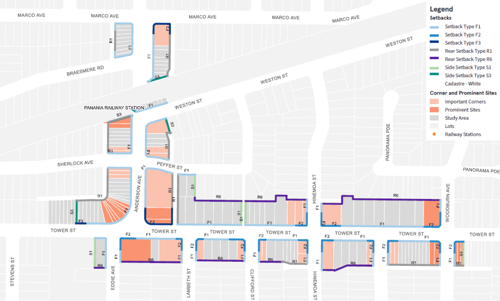
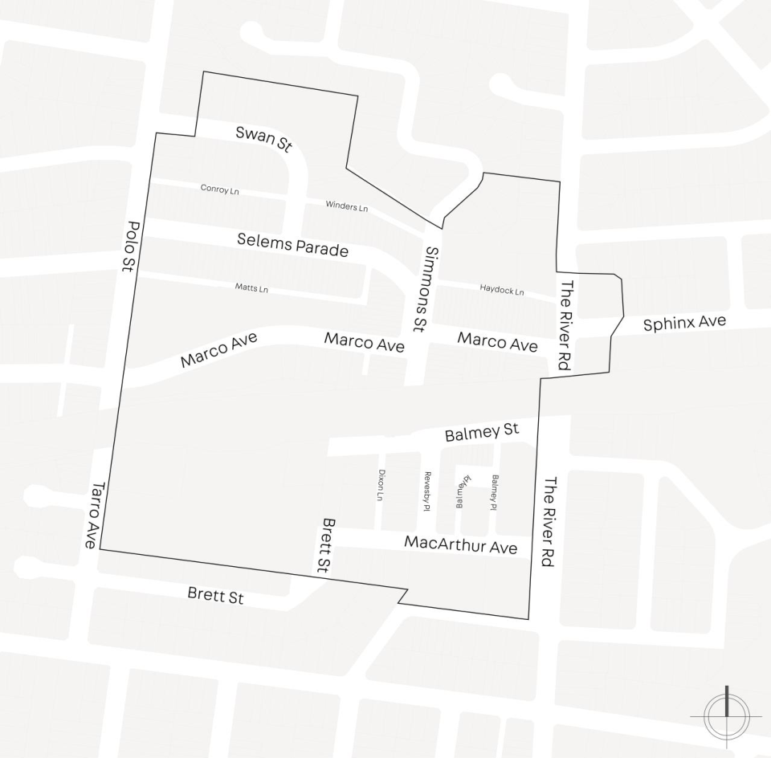

### 10.2 Development must:

(a) comply with the minimum setbacks shown in Figure 10d and Appendix 1;

(b) comply with Setback Type S1 to maintain continuous street walls unless otherwise indicated in Figure 10d and Appendix 1;

(c) provide a two storey street wall to the primary and secondary street frontages.

> [Picture on page 53: a picture, saved as a picture (images/ch-07-02-city-west-bass-hill-birrong-page-53-15.gif, 150 dpi).]

Figure 10d: Setback controls

## SECTION 11–REVESBY LOCAL CENTRE

#### Explanation

Connective City 2036 recognises Revesby as a local centre within the centres hierarchy. It provides urban and community services to a large suburban population, and connects to good public transport. Section 11 applies to land shown in Figure 11a.

> [Picture on page 54: a picture, saved as a picture (images/ch-07-02-city-west-bass-hill-birrong-page-54-6.gif, 150 dpi).]

Figure 11a: Land Application Map

#### Desired character

The Revesby Local Centre will continue to function as a successful and bustling centre that is commercially viable, well designed, reflecting the unique characteristics of the place, and recognised by the community as one of the twin ‘hearts’ of the local area alongside the Padstow Local Centre.

The welcoming and successful central plaza between the railway station and Abel Reserve is the central point from which the local centre radiates. An inviting place where people choose to walk, relax, sit and talk. A flexible place where people can participate in civic life. A distinct place that creates a memorable arrival to the local centre.

The main streets (Marco Avenue, Selems Parade and Revesby Place) are an attractive and bustling place. A place of local jobs, a place of shopping, a place of dining and social interaction, a place of walking. The main streets will be a place where cars travel slowly, making it easier to cross the street and creating a pleasant place to walk, sit and talk. Active street frontages will create a vibrant streetscape where there is day and evening activity, and where shops and restaurants will stay open longer.

Ray McCormack Reserve will be home to a modern multi-purpose community facility, a place for people to come together for events and social activities. Amour Park will provide a conveniently located community hub for youth, sporting and leisure activities.

Low and medium-rise buildings at appropriate locations will create a sense of enclosure, human scale, order, comfort and enjoyment for people walking in the local centre. Leafy streets will connect people to the low-rise liveable neighbourhoods and provide a stunning platform from which to journey into the local centre.

There are three precincts of distinctive functional and physical character within the local centre as shown in Figure 11b, which offer an effective base to implement the desired character and development controls at the local level.
