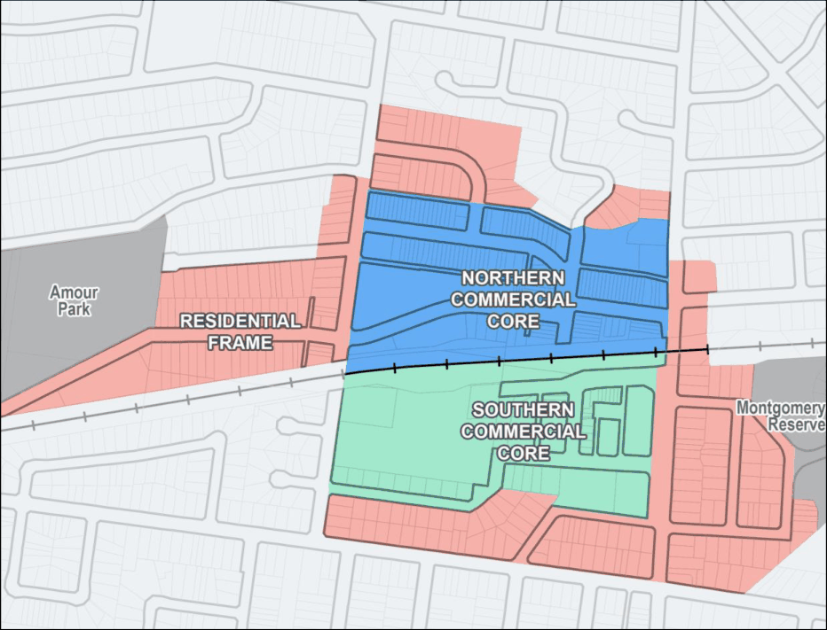

#### C1 Northern Commercial Core

The Northern Commercial Core is the local magnet, a place that provides a strong, distinctive and centrally located ‘heart’ for the local centre. This compact mixed use place is bustling with people and activity between the key destinations, namely the central plaza, railway station, anchor supermarket and Abel Reserve. The central plaza will be a place for people to come together for events and social activities.

Active street frontages along the main streets (Marco Avenue and Selems Parade) will create a vibrant streetscape where there is day and evening activity, and where shops and restaurants will stay open longer. The streets will be a place where cars travel slowly, making it easier to cross the street and creating a pleasant place to walk, sit and talk.

Variety is also the key to economic resilience and this place will be home to a diversity of building forms, with the tallest buildings next to the railway station. It is recognised the development of the local centre will occur over time, resulting in a rich mixture of old and new buildings with contrasting building heights and architectural styles.

> [Picture on page 56: a picture, saved as a picture (images/ch-07-02-city-west-bass-hill-birrong-page-56-1.gif, 150 dpi).]

Figure 11b: Precinct Plan (Source: South East Local Area Plan)
