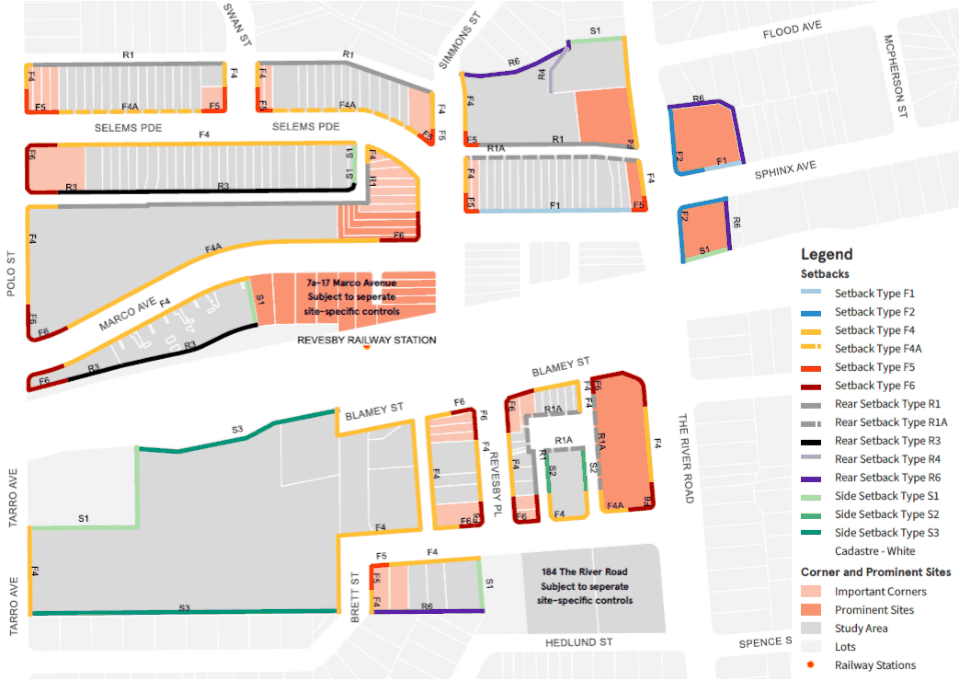
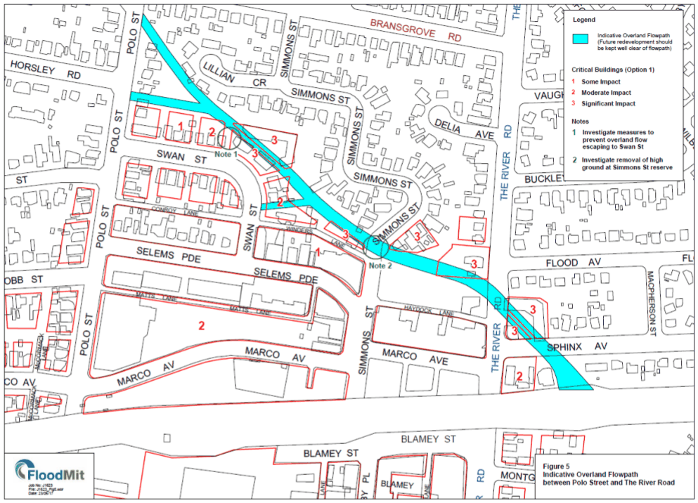
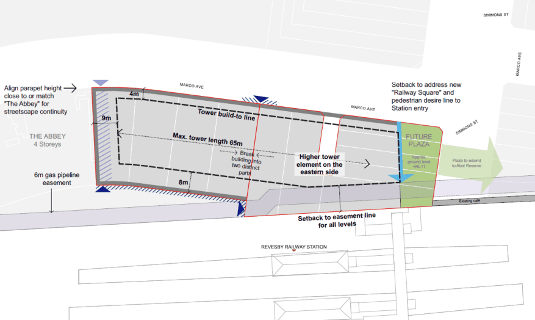
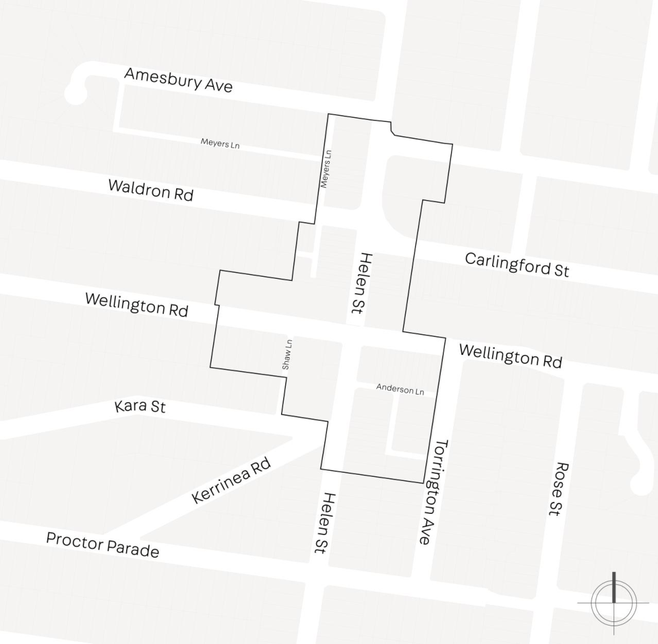

### 11.2 Development must:

(a) comply with the minimum setbacks shown in Figure 11d and Appendix 1;

(b) comply with Setback Type S1 to maintain continuous street walls unless otherwise indicated in Figure 11d and Appendix 1;

(c) provide a four storey street wall to the primary and secondary street frontages.

> [Picture on page 58: a picture, saved as a picture (images/ch-07-02-city-west-bass-hill-birrong-page-58-7.gif, 150 dpi).]

Figure 11d: Setback controls

#### Setbacks to the overland flow path

11.3 Despite clause 11.2, development identified as ‘Critical Buildings’ in Figure 11e must ensure proposed building footprints are kept clear of the overland flow path between Polo Street and The River Road. The intended outcome is to ensure the flow path is continuous and clear of obstructions, and gradually increases in capacity from Polo Street to The River Road.

Figure 11e identifies new building footprints that provide the greatest impact on the existing overland flow path. These buildings are divided into three categories depending on the building location in relation to the existing overland flow path, and the potential impact on flood levels. The ‘Critical Buildings’ categories are:

1 (Some Impact) Buildings are considered to have some impact on flood behaviour.

Development should consider minor modifications to the building footprint to keep clear of the overland flow path between Polo Street and The River Road.

2 (Moderate Impact) Buildings are considered to have a moderate impact on flood behaviour.

Development should consider further modifications to the building footprint to keep clear of the overland flow path between Polo Street and The River Road.

3 (Significant Impact) Buildings are considered to have a significant impact on flood behaviour.

Development will require significant building footprint adjustments to keep clear of the overland flow path between Polo Street and The River Road.

> [Picture on page 59: a picture, saved as a picture (images/ch-07-02-city-west-bass-hill-birrong-page-59-7.gif, 150 dpi).]

Figure 11e: Overland flow path between Polo Street and The River Road

#### Site specific controls: 7A–17 Marco Avenue, Revesby

11.4 Development at 7A–17 Marco Avenue, Revesby must prepare an infrastructure/community needs study and urban design study to determine the building form to Council’s satisfaction based on the following matters:

Urban design principles

(a) Require design excellence for all aspects – urban design, architecture and landscape.

(b) Align the building footprint with the railway station entrance to reflect the pedestrian desire lines approaching from Marco Avenue.

(c) Require active street frontages to Marco Avenue and the new central plaza with awning protection.

(d) Provide the Marco Avenue frontage with a street wall height that closely aligns with The Abbey development to the west.

(e) Express and articulate the building form as a series of distinct volumes, including a podium and tower element(s) to minimise visual bulk.

(f) Require a quality architectural response for important corners, particularly as seen on approach to the site from the east.

(g) Incorporate green roofs and landscaped podium levels.

Podium base

(h) The podium height is to closely align with the development at 21 Marco Avenue, Revesby (known as The Abbey).

(i) The podium base may have a zero setback to the Marco Avenue boundary. Reason: This setback reinforces the street wall established by The Abbey.

(j) The podium base must introduce ‘fine grain’ vertical articulation to reflect the ground floor grain of The Abbey and the Revesby Local Centre in general.

(k) The podium base may further articulate the street wall with recesses for entries to avoid excessively long facades.

Tower building (middle and top)

(l) The maximum length of a tower building is 65m or alternative design provided it minimises visual bulk to Council’s satisfaction. Tower buildings of this length must be wholly separated from other towers in accordance with the building separation controls under the State Environment Planning Policy (Housing) 2021 (Chapter 4).

(m) Tower Building (Middle) – The minimum setback to the Marco Avenue boundary is 4m. Reason: This setback reinforces the street wall and minimises visual bulk as seen from the street.

(n) Tower Building (Top) – The minimum setback of the uppermost level to the Marco Avenue boundary is 7m. Reason: This setback ensures there is a base/middle/top expression to minimise visual bulk as seen from the street.

(o) Structures above the maximum building height must comply with Canterbury- Bankstown Local Environmental Plan 2023 (clause 5.6) in relation to architectural roof features.

Pipeline corridor

(p) Consider the State Environmental Planning Policy (Transport and Infrastructure) 2021 (Division 12A) in relation to development adjacent to a pipeline corridor.

Design Review Panel

(q) The application must be referred to a Design Review Panel.

Site specific controls: 7A–17 Marco Avenue, Revesby incorporating the cul-de-sac road (Marco Avenue)

11.5 In addition to clause 11.4, if the site at 7A–17 Marco Avenue incorporates the cul-de-sac road (Marco Avenue), the infrastructure/community needs study and urban design study must comply with the following matters:

(a) The building form must break into two distinct towers to comply with the maximum 65m building length rule.

(b) The eastern tower is to be expressed as the dominant built form, creating an important architectural landmark that addresses the new central plaza and approaches to the local centre from the east.

> [Picture on page 61: a picture, saved as a picture (images/ch-07-02-city-west-bass-hill-birrong-page-61-1.gif, 150 dpi).]

Figure 11f: Site specific controls if the site at 7A–17 Marco Avenue incorporates the cul-de-sac road (Marco Avenue). Note: Development is subject to Council confirming the extent of the future plaza and other infrastructure requirements.

#### Site specific controls: 11–17 Marco Avenue, Revesby

11.6 Development at 11–17 Marco Avenue, Revesby must comply with clause 11.4 to Council’s satisfaction.

## SECTION 12–SEFTON SMALL VILLAGE CENTRE

#### Explanation

Connective City 2036 recognises Sefton as a small village centre within the centres hierarchy. It provides urban services to meet the daily and weekly shopping needs of residents in surrounding suburbs. Section 12 applies to land shown in Figure 12a.

> [Picture on page 62: a picture, saved as a picture (images/ch-07-02-city-west-bass-hill-birrong-page-62-6.gif, 150 dpi).]

Figure 12a: Land Application Map

#### Desired character
