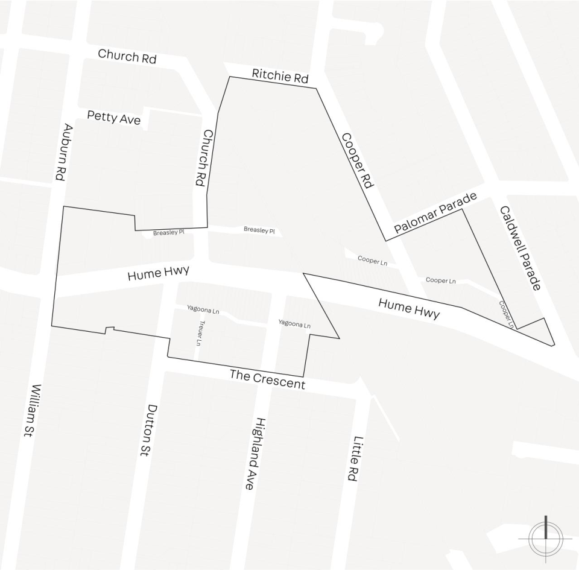

#### C1 Sefton Small Village Centre

The Sefton Small Village Centre will support the residential growth of the Chester Hill Local Centre particularly along Waldron Road, a major public transport corridor. The built form will offer a range of medium and high density living set within a safe and high quality environment, whilst maintaining the low density historic character of Kara Street and Kerrinea Road. The local shops and Birrong Leisure Centre will service the day-to-day needs of residents and workers.

#### Objectives

O1 To ensure development is compatible with the desired character of the centre and maintains a pedestrian scale to the street.

O2 To achieve good design in terms of building form, bulk, architectural treatment, visual amenity and landscape.

O3 To provide storey limits.

O4 To require a continuous built edge to the street at locations where it is essential to have active street frontages.

O5 To ensure the building form and design provide appropriate amenity to residents.

O6 To minimise overshadowing particularly from upper levels.

O7 To ensure development is compatible with the prevailing suburban character and amenity of neighbouring residential areas.

#### Development controls

#### Storey limit

12.1 Development must comply with the storey limit that corresponds with the maximum building height shown for the site on the Height of Building Map as follows:

| Maximum building height as shown on the Height of Buildings Map (Canterbury-Bankstown LEP 2023) | Storey limit (not including basements) |
|---|---|
| 14m | 4 storeys (no attic) |
| 20m | 6 storeys (no attic) |

Note: Architectural roof features that exceed the maximum building height may be permitted under the Canterbury-Bankstown Local Environmental Plan 2023 (clause 5.6) to Council’s satisfaction, otherwise the roof features must comply with the maximum building height.

#### Street setbacks

12.2 The minimum setback to the primary and secondary street frontages of sites within Zone E1 Local Centre are:

(a) zero setback for the basement level, the first storey (i.e. the ground floor) and second storey; and

(b) 5m for the third storey and above.

#### Side setbacks

12.3 The minimum setback to the side boundary of sites within Zone E1 Local Centre is zero setback for all storeys. Where development is adjacent to residential zoned land, Council may increase the minimum setback to the secondary street frontage and side boundary.

#### Rear setbacks

12.4 The minimum setback to the rear boundary of sites within Zone E1 Local Centre are:

(a) zero setback for the first storey (i.e. the ground floor) and second storey where the site adjoins a rear lane; or

(b) 3m for the first storey (i.e. the ground floor) and second storey where the site does not adjoin a rear lane; and

(c) 3m for the third storey and above.

## SECTION 13–YAGOONA LOCAL CENTRE

#### Explanation

Connective City 2036 recognises Yagoona as a local centre within the centres hierarchy. It provides urban and community services to a large suburban population, and connects to good public transport. Section 13 applies to land shown in Figure 13a.

> [Picture on page 65: a picture, saved as a picture (images/ch-07-02-city-west-bass-hill-birrong-page-65-6.gif, 150 dpi).]

Figure 13a: Land Application Map

#### Desired character

The Yagoona Local Centre will continue to function as a successful and bustling centre that is commercially viable, well designed, reflecting the unique characteristics of the place, and recognised by the community as the ‘heart’ of the local area.

The north side of the highway will provide a central place from which the local centre radiates, an enlivened mixed use destination that meets the needs of the growing community and is a catalyst for investment. A central place that connects people, business, public transport and Gazzard Park. A central place where people can feel comfortable to walk, shop and socialise in a series of pleasant spaces away from the noisy highway.

Gazzard Park will be home to a modern multi-purpose community facility, a place that will bring civic pride to the local centre, a place for people to come together for events and social activities, a place where people will enjoy spending time in the village green.

Low and medium-rise buildings at appropriate locations will create a sense of enclosure, human scale, order, comfort and enjoyment for people walking in the local centre. The built form will provide residents with good amenity (noise and air quality). Leafy streets will connect people to the low-rise liveable neighbourhoods and provide a stunning platform from which to journey into the local centre.

While there are four precincts of distinctive functional and physical character within the local centre as shown in Figure 13b, this section is specific to the Village Heart, Commercial Core and Bankstown CBD (Northern Frame). These precincts offer an effective base to implement the desired character and development controls at the local level.
