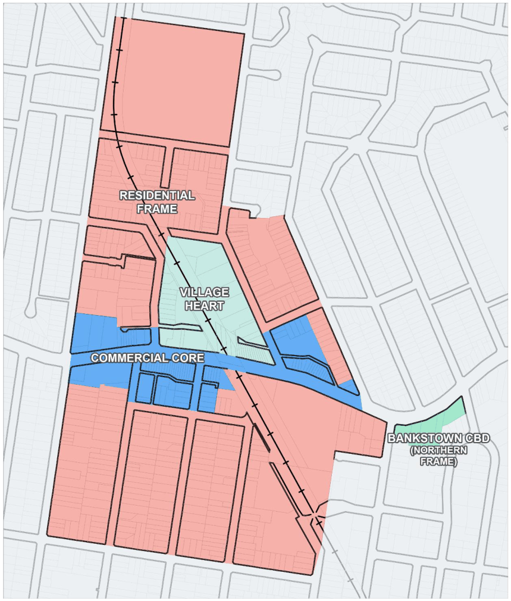

#### C2 Commercial Core

The Commercial Core is a place that connects people, business, public transport and key destinations. Active street frontages at appropriate locations will create a vibrant streetscape. The commercial core will be a place of well-proportioned, human scale buildings that contribute to the sense of comfort and village feel.

Based on the urban design analysis, the commercial core of a local centre is comprised of buildings that create a dense urban form, generally of a similar height and not more than six storeys. This continuous urban form helps define the streets and public spaces.

Appropriate setbacks will provide residents with good amenity (noise and air quality). It is recognised the development of the local centre will occur over time, resulting in a rich mixture of old and new buildings with contrasting building heights and architectural styles.

> [Picture on page 67: a picture, saved as a picture (images/ch-07-02-city-west-bass-hill-birrong-page-67-4.gif, 150 dpi).]

Figure 13b: Precinct Plan (Source: North Central Local Area Plan)
