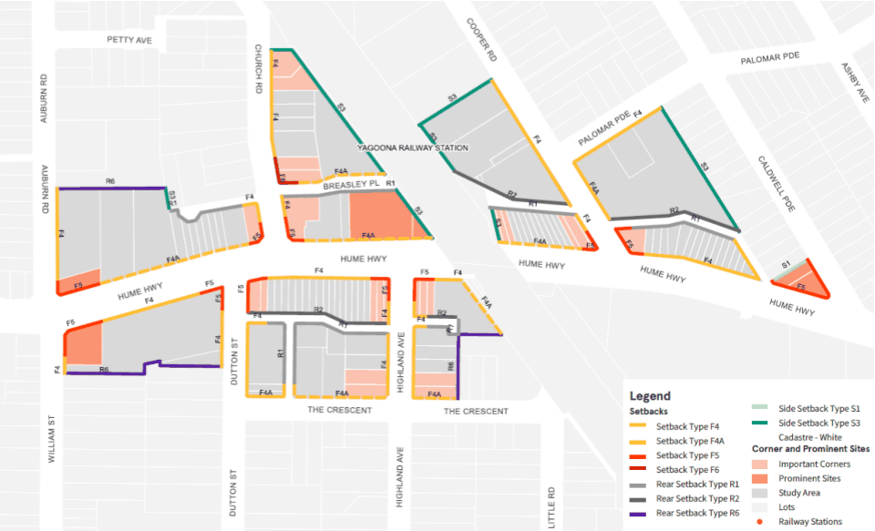
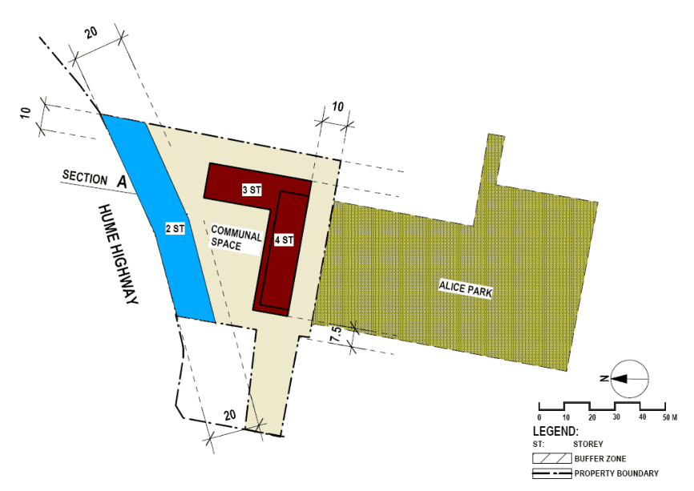

### 13.2 Development must:

(a) comply with the minimum setbacks shown in Figure 13d and Appendix 1;

(b) comply with Setback Type S1 to maintain continuous street walls unless otherwise indicated in Figure 13d and Appendix 1;

(c) provide a four storey street wall to the primary and secondary street frontages.

> [Picture on page 69: a picture, saved as a picture (images/ch-07-02-city-west-bass-hill-birrong-page-69-7.gif, 150 dpi).]

Figure 13d: Setback controls

#### Site specific controls: 399–403 Hume Highway and 81 Brancourt Avenue, Yagoona

13.3 Development must comply with the minimum setbacks shown in Figure 13e and must ensure dwellings are setback a minimum 10m from the Hume Highway boundary of the site.

13.4 Development must incorporate the significance of the heritage item at 401 Hume Highway.

13.5 Vehicle access to the site may be permitted from Brancourt Avenue, but is not permitted from the Hume Highway.

> [Picture on page 70: a picture, saved as a picture (images/ch-07-02-city-west-bass-hill-birrong-page-70-1.gif, 150 dpi).]

Figure 13e: Setback controls for 399–403 Hume Highway and 81 Brancourt Avenue, Yagoona

#### APPENDICES

#### APPENDIX 1–SETBACKS
