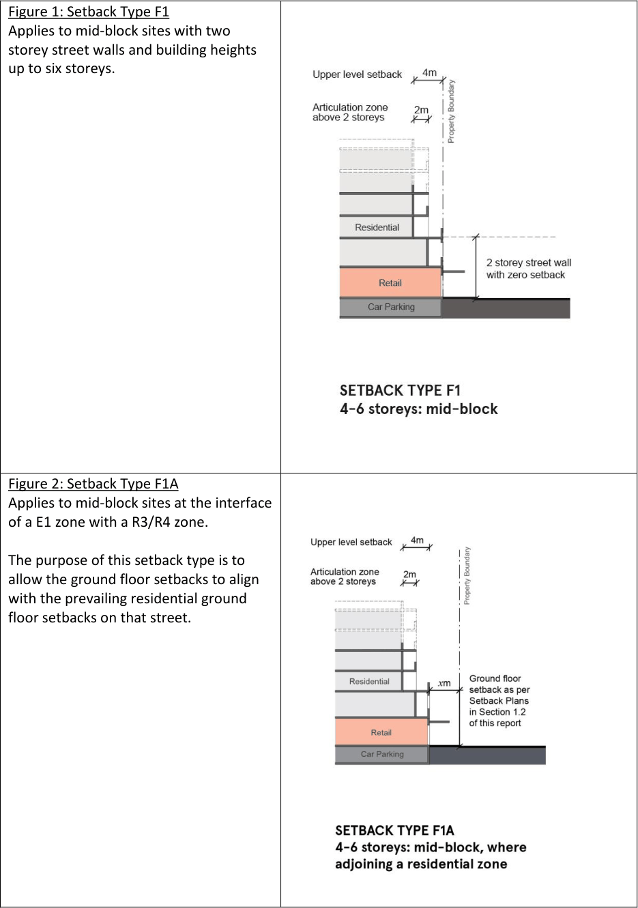
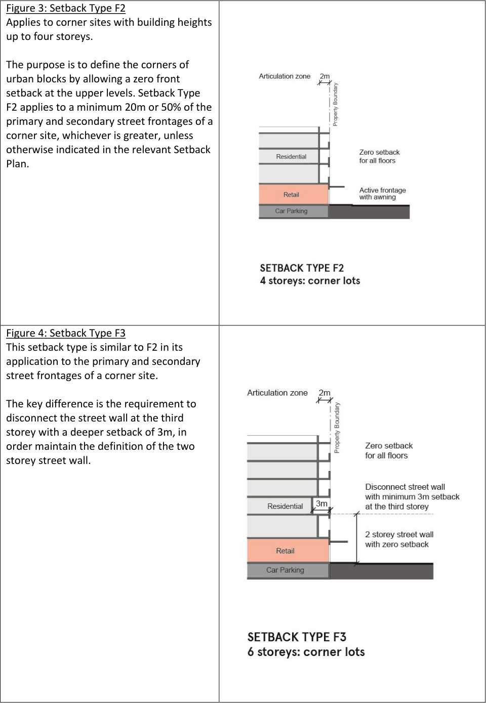

### 1.2 Front setbacks for development with two storey street walls

#### Explanation

Centres such as Birrong, East Hills, Greenacre and Panania have a suburban village feel, and a prevailing one to two storey street wall edge with parapets varying in height along the frontage. This section provides the minimum street wall and upper level setbacks to maintain the suburban, village feel while accommodating building heights up to four to six storeys.

#### Street wall

To reinforce the existing suburban village scale of these centres, development must provide a two storey street wall with a zero ground floor setback. A two storey street wall maintains good height proportions with four storey development (i.e. half the height) and six storey development (i.e. one third of the height).

#### Upper level setbacks

The nominated upper level setback above two storeys is a minimum 4m, which:

• Provides a reasonable depth to articulate upper levels from the two storey podium, taking into consideration the articulation zone.

• Provides a reasonable depth for private terraces on the podium.

• At four to six storeys, minimises overshadowing to neighbouring (opposite) upper level residences.

#### Articulation zone

A minimum 2m articulation zone is required in accordance with the minimum balcony depth for a one to two bedroom apartment as set out in Objective 4E.1 of the Apartment Design Guide. For buildings with a two storey street wall, the articulation zone can be accommodated within the minimum 4m upper level setback.

#### Setback types

> [Picture on page 73: a picture, saved as a picture (images/ch-07-02-city-west-bass-hill-birrong-page-73-2.gif, 150 dpi).]
> Words printed on the picture (title and legend, copied from the PDF):
> Applies to mid-block sites with two
> storey street walls and building heights
> up to six storeys.
> Applies to mid-block sites at the interface
> of a E1 zone with a R3/R4 zone.
> The purpose of this setback type is to
> allow the ground floor setbacks to align
> with the prevailing residential ground
> floor setbacks on that street.

Figure 1: Setback Type F1

Figure 2: Setback Type F1A

> [Picture on page 74: a picture, saved as a picture (images/ch-07-02-city-west-bass-hill-birrong-page-74-1.gif, 150 dpi).]
> Words printed on the picture (title and legend, copied from the PDF):
> Applies to corner sites with building heights
> up to four storeys.
> The purpose is to define the corners of
> urban blocks by allowing a zero front
> setback at the upper levels. Setback Type
> F2 applies to a minimum 20m or 50% of the
> primary and secondary street frontages of a
> corner site, whichever is greater, unless
> otherwise indicated in the relevant Setback
> Plan.
> This setback type is similar to F2 in its
> application to the primary and secondary
> street frontages of a corner site.
> The key difference is the requirement to
> disconnect the street wall at the third
> storey with a deeper setback of 3m, in
> order maintain the definition of the two
> storey street wall.

Figure 3: Setback Type F2

Figure 4: Setback Type F3
