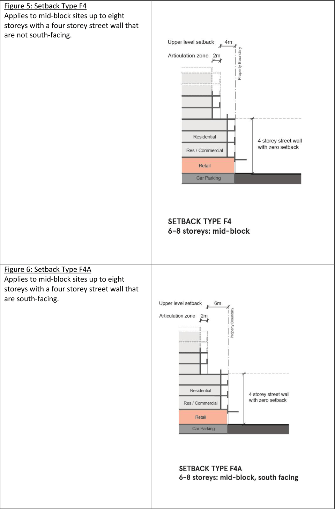
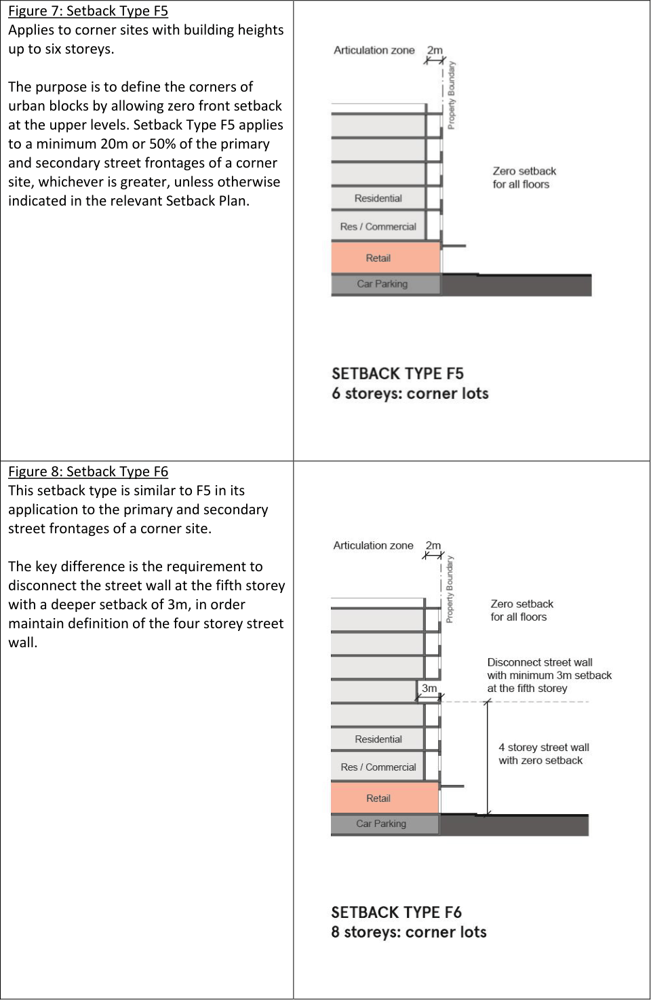

### 1.3 Front setbacks for development with four storey street walls

#### Explanation

Centres such as Padstow, Revesby and Yagoona generally have a one to two storey street wall edge with parapets varying in height along the frontage. This section provides the minimum street wall and upper level setbacks to accommodate a more urban built form with building heights up to eight storeys.

#### Street wall

Development must provide a four storey street wall with a zero ground floor setback. A four storey street wall maintains good height proportions with six storey development (i.e. two thirds of the height) and eight storey development (i.e. half the height). For Yagoona in particular, a four storey street wall would better define the Hume Highway given the scale relationship between buildings and the road corridor.

#### Upper level setbacks

Urban blocks with a generally north-south street and/or lot orientation will generally have good solar access. The minimum upper level setback dimension for north-south oriented sites with a four storey street wall is 4m, which:

• Provides a reasonable depth to articulate upper levels from the two storey podium, taking into consideration the articulation zone.

• Provides a reasonable depth for private terraces on the podium.

• At six to eight storeys, avoids overshadowing to neighbouring (opposite) upper level dwellings.

Urban blocks with a generally east-west or diagonal lot orientation, particularly those that are south-facing, are prone to creating overshadowing impacts. Accordingly, deeper upper level front are required for south-facing sites to assist in minimising adverse overshadowing impacts to the public domain and surrounding properties.

The minimum upper level setback dimension for south-facing sites with a four storey street wall is 6m, which:

• At six storeys, avoids overshadowing to upper level residences to the south. Overshadowing may occur at street level.

• At eight storeys, may overshadow the second storey and lower half of the third storey of buildings to the south.

#### Articulation zone

A minimum 2m articulation zone is required in accordance with the minimum balcony depth for a one to two bedroom apartment as set out in Objective 4E.1 of the Apartment Design Guide. For buildings with a four storey street wall, the articulation zone is to locate behind the setback line to reinforce the street wall and reduce scale.

#### Setback types

> [Picture on page 76: a picture, saved as a picture (images/ch-07-02-city-west-bass-hill-birrong-page-76-2.gif, 150 dpi).]
> Words printed on the picture (title and legend, copied from the PDF):
> Applies to mid-block sites up to eight
> storeys with a four storey street wall that
> are not south-facing.
> Applies to mid-block sites up to eight
> storeys with a four storey street wall that
> are south-facing.

Figure 5: Setback Type F4

Figure 6: Setback Type F4A

> [Picture on page 77: a picture, saved as a picture (images/ch-07-02-city-west-bass-hill-birrong-page-77-1.gif, 150 dpi).]
> Words printed on the picture (title and legend, copied from the PDF):
> Applies to corner sites with building heights
> up to six storeys.
> The purpose is to define the corners of
> urban blocks by allowing zero front setback
> at the upper levels. Setback Type F5 applies
> to a minimum 20m or 50% of the primary
> and secondary street frontages of a corner
> site, whichever is greater, unless otherwise
> indicated in the relevant Setback Plan.
> This setback type is similar to F5 in its
> application to the primary and secondary
> street frontages of a corner site.
> The key difference is the requirement to
> disconnect the street wall at the fifth storey
> with a deeper setback of 3m, in order
> maintain definition of the four storey street
> wall.

Figure 7: Setback Type F5

Figure 8: Setback Type F6
