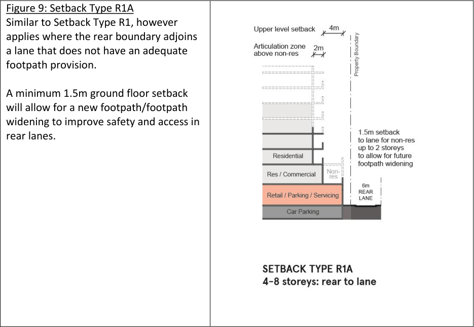
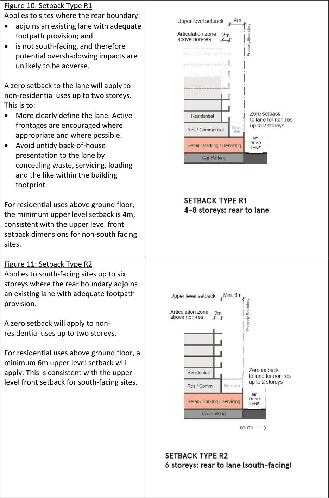
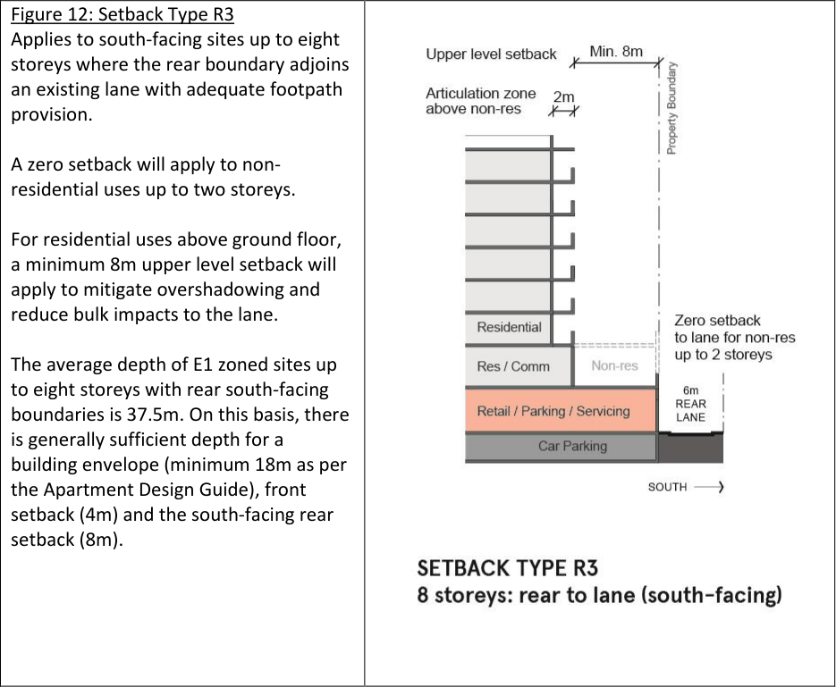

### 1.4 Rear setbacks to lanes

#### Explanation

It is recognised that rear lanes should be used to service sites and to access car parking and utilities (e.g. substations). However, an analysis of existing rear lane conditions observed that lanes are not well defined by built form, and present untidy back-of-house to the public domain (e.g. bins, unkempt driveways, double parked vehicles, poor quality fencing). A number of lanes did not provide footpaths, creating conflicts with vehicles and pedestrians.

This section provides the minimum setbacks applicable to sites where the rear boundary adjoins an existing lane.

#### Articulation zone

A minimum 2m articulation zone is required in accordance with the minimum balcony depth for a one to two bedroom apartment as set out in Objective 4E.1 of the Apartment Design Guide. The articulation zone is to locate behind the upper level setback line to reduce the appearance of bulk and scale as seen from the lane.

#### Setback types

> [Picture on page 78: a picture, saved as a picture (images/ch-07-02-city-west-bass-hill-birrong-page-78-17.gif, 150 dpi).]
> Words printed on the picture (title and legend, copied from the PDF):
> Similar to Setback Type R1, however
> applies where the rear boundary adjoins
> a lane that does not have an adequate
> footpath provision.
> A minimum 1.5m ground floor setback
> will allow for a new footpath/footpath
> widening to improve safety and access in
> rear lanes.

Figure 9: Setback Type R1A

> [Picture on page 79: a picture, saved as a picture (images/ch-07-02-city-west-bass-hill-birrong-page-79-1.gif, 150 dpi).]
> Words printed on the picture (title and legend, copied from the PDF):
> Applies to sites where the rear boundary:
> • adjoins an existing lane with adequate
> footpath provision; and
> • is not south-facing, and therefore
> potential overshadowing impacts are
> unlikely to be adverse.
> A zero setback to the lane will apply to
> non-residential uses up to two storeys.
> This is to:
> • More clearly define the lane. Active
> frontages are encouraged where
> appropriate and where possible.
> • Avoid untidy back-of-house
> presentation to the lane by
> concealing waste, servicing, loading
> and the like within the building
> footprint.
> For residential uses above ground floor,
> the minimum upper level setback is 4m,
> consistent with the upper level front
> setback dimensions for non-south facing
> sites.
> Applies to south-facing sites up to six
> storeys where the rear boundary adjoins
> an existing lane with adequate footpath
> provision.
> A zero setback will apply to non-
> residential uses up to two storeys.
> For residential uses above ground floor, a
> minimum 6m upper level setback will
> apply. This is consistent with the upper
> level front setback for south-facing sites.

Figure 10: Setback Type R1

Figure 11: Setback Type R2

> [Picture on page 80: a picture, saved as a picture (images/ch-07-02-city-west-bass-hill-birrong-page-80-1.gif, 150 dpi).]
> Words printed on the picture (title and legend, copied from the PDF):
> Applies to south-facing sites up to eight
> storeys where the rear boundary adjoins
> an existing lane with adequate footpath
> provision.
> A zero setback will apply to non-
> residential uses up to two storeys.
> For residential uses above ground floor,
> a minimum 8m upper level setback will
> apply to mitigate overshadowing and
> reduce bulk impacts to the lane.
> The average depth of E1 zoned sites up
> to eight storeys with rear south-facing
> boundaries is 37.5m. On this basis, there
> is generally sufficient depth for a
> building envelope (minimum 18m as per
> the Apartment Design Guide), front
> setback (4m) and the south-facing rear
> setback (8m).

Figure 12: Setback Type R3
