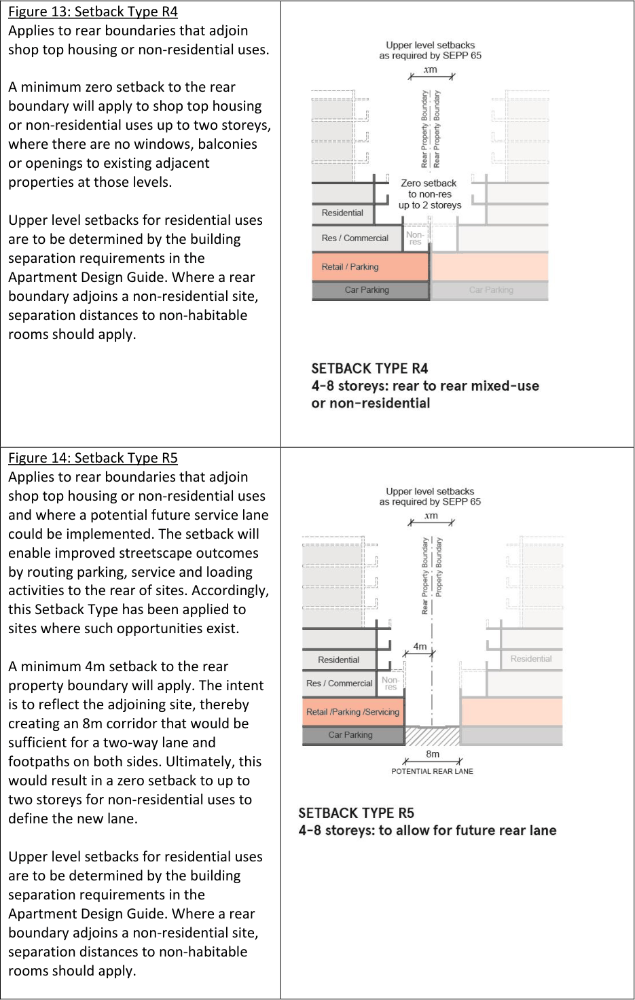
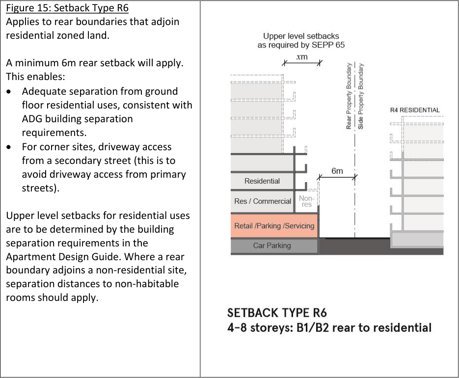

### 1.5 Rear setbacks to adjoining sites

#### Explanation

There are a variety of interface conditions for rear boundaries to adjoining sites. The following interfaces have been observed, for which a specific setback approach should be applied:

• rear boundaries to shop top housing and other non-residential uses;

• rear boundaries to shop top housing and other non-residential uses where a potential future service lane could be implemented; and

• rear boundaries to residential uses.

This section provides the minimum setbacks applicable to sites where the rear boundary adjoins an existing site.

#### Articulation zone

A minimum 2m articulation zone is required in accordance with the minimum balcony depth for a one to two bedroom apartment as set out in Objective 4E.1 of the Apartment Design Guide. The articulation zone is to locate behind the upper level setback line to provide for visual privacy and to reduce the appearance of bulk and scale as seen from adjoining sites.

#### Setback types

> [Picture on page 81: a picture, saved as a picture (images/ch-07-02-city-west-bass-hill-birrong-page-81-2.gif, 150 dpi).]
> Words printed on the picture (title and legend, copied from the PDF):
> Applies to rear boundaries that adjoin
> shop top housing or non-residential uses.
> A minimum zero setback to the rear
> boundary will apply to shop top housing
> or non-residential uses up to two storeys,
> where there are no windows, balconies
> or openings to existing adjacent
> properties at those levels.
> Upper level setbacks for residential uses
> are to be determined by the building
> separation requirements in the
> Apartment Design Guide. Where a rear
> boundary adjoins a non-residential site,
> separation distances to non-habitable
> rooms should apply.
> Applies to rear boundaries that adjoin
> shop top housing or non-residential uses
> and where a potential future service lane
> could be implemented. The setback will
> enable improved streetscape outcomes
> by routing parking, service and loading
> activities to the rear of sites. Accordingly,
> this Setback Type has been applied to
> sites where such opportunities exist.
> A minimum 4m setback to the rear
> property boundary will apply. The intent
> is to reflect the adjoining site, thereby
> creating an 8m corridor that would be
> sufficient for a two-way lane and
> footpaths on both sides. Ultimately, this
> would result in a zero setback to up to
> two storeys for non-residential uses to
> define the new lane.
> Upper level setbacks for residential uses
> are to be determined by the building
> separation requirements in the
> Apartment Design Guide. Where a rear
> boundary adjoins a non-residential site,
> separation distances to non-habitable
> rooms should apply.

Figure 13: Setback Type R4

Figure 14: Setback Type R5

> [Picture on page 82: a picture, saved as a picture (images/ch-07-02-city-west-bass-hill-birrong-page-82-1.gif, 150 dpi).]
> Words printed on the picture (title and legend, copied from the PDF):
> Applies to rear boundaries that adjoin
> residential zoned land.
> A minimum 6m rear setback will apply.
> This enables:
> • Adequate separation from ground
> floor residential uses, consistent with
> ADG building separation
> requirements.
> • For corner sites, driveway access
> from a secondary street (this is to
> avoid driveway access from primary
> streets).
> Upper level setbacks for residential uses
> are to be determined by the building
> separation requirements in the
> Apartment Design Guide. Where a rear
> boundary adjoins a non-residential site,
> separation distances to non-habitable
> rooms should apply.

Figure 15: Setback Type R6
