### 1.6 Side setbacks

#### Explanation

The centres generally have continuous street walls with zero side setbacks up to two storeys. This is an important element that defines the local character and should prevail for new development. However, in some centres such as Greenacre and Padstow, there are existing arcades, lanes and links between buildings that, if formalised and improved, would contribute to a more permeable, safe and active centre. Where properties are adjacent to residential zones or railway corridors, it is desirable to provide space for a pedestrian link.

This section provides the minimum side setbacks applicable to sites within the employment zoned land.

#### Setback types

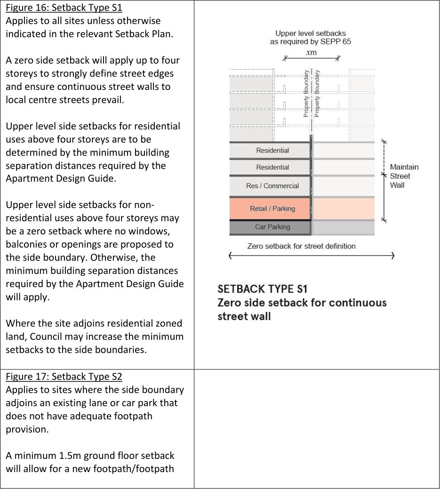

> [Picture on page 83: a picture, saved as a picture (images/ch-07-02-city-west-bass-hill-birrong-page-83-12.gif, 150 dpi).]
> Words printed on the picture (title and legend, copied from the PDF):
> Applies to all sites unless otherwise
> indicated in the relevant Setback Plan.
> A zero side setback will apply up to four
> storeys to strongly define street edges
> and ensure continuous street walls to
> local centre streets prevail.
> Upper level side setbacks for residential
> uses above four storeys are to be
> determined by the minimum building
> separation distances required by the
> Apartment Design Guide.
> Upper level side setbacks for non-
> residential uses above four storeys may
> be a zero setback where no windows,
> balconies or openings are proposed to
> the side boundary. Otherwise, the
> minimum building separation distances
> required by the Apartment Design Guide
> will apply.
> Where the site adjoins residential zoned
> land, Council may increase the minimum
> setbacks to the side boundaries.
> Applies to sites where the side boundary
> adjoins an existing lane or car park that
> does not have adequate footpath
> provision.
> A minimum 1.5m ground floor setback
> will allow for a new footpath/footpath

Figure 16: Setback Type S1

Figure 17: Setback Type S2

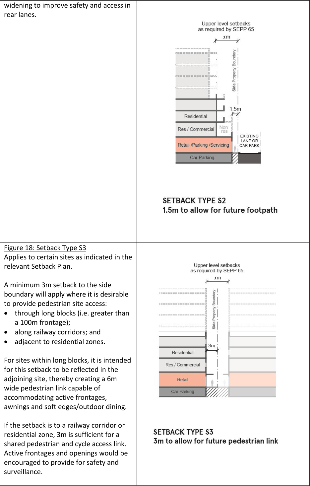

> [Picture on page 84: a picture, saved as a picture (images/ch-07-02-city-west-bass-hill-birrong-page-84-1.gif, 150 dpi).]
> Words printed on the picture (title and legend, copied from the PDF):
> widening to improve safety and access in
> rear lanes.
> Applies to certain sites as indicated in the
> relevant Setback Plan.
> A minimum 3m setback to the side
> boundary will apply where it is desirable
> to provide pedestrian site access:
> • through long blocks (i.e. greater than
> a 100m frontage);
> • along railway corridors; and
> • adjacent to residential zones.
> For sites within long blocks, it is intended
> for this setback to be reflected in the
> adjoining site, thereby creating a 6m
> wide pedestrian link capable of
> accommodating active frontages,
> awnings and soft edges/outdoor dining.
> If the setback is to a railway corridor or
> residential zone, 3m is sufficient for a
> shared pedestrian and cycle access link.
> Active frontages and openings would be
> encouraged to provide for safety and
> surveillance.

Figure 18: Setback Type S3

APPENDIX 2: Building envelope controls for each dwelling on each lot

1\. Council must not grant consent to the erection of a dwelling house unless the proposed lot is at least 7m wide at the front building line.

2\. Council may require one car parking space per dwelling to locate forward of the front building line (in the form of a hardstand) to avoid garages and driveways dominating the front of a dwelling and landscaped area when viewed from the street.

3\. The schedule and diagrams of indicative houses (Types A to J) are for guidance purposes only.

4\. The building envelope controls for each dwelling on each lot are shown in the following table:

| Lot | Minimum lot size (m2) | Maximum gross floor area (m2) | Minimum setback to north boundary (m) | Minimum setback to south boundary (m) | Minimum setback to east boundary (m) | Minimum setback to west boundary (m) | Indicative house | Special requirements |
|---|---|---|---|---|---|---|---|---|
| 2 | 410 | 225 | 1 | 2 | Nil setback | 6 | B2 | No vehicle access to Arundle Road. Dwelling must have minimum 2m setback measured from the landscape easement to the south. |
| 3 | 419 | 293 | 1 | 1 | Nil setback | 6 | B | No vehicle access to Arundle Road. Garage may have nil setback to the south boundary. |
| 4 | 391 | 270 | 1 | 1 | Nil setback | 6 | B |  |
| 5 | 375 | 313 | 7.5 | 4.5 | Nil setback | 1 | D | Tree preservation if possible. Garage must have minimum 5.5m setback to the south boundary. |
| 6 | 375 | 317 | 7.5 | 4.5 | Nil setback | 1 | D | Garage must have minimum 5.5m setback to the south boundary. |

| Lot | Minimum lot size (m2) | Maximum gross floor area (m2) | Minimum setback to north boundary (m) | Minimum setback to south boundary (m) | Minimum setback to east boundary (m) | Minimum setback to west boundary (m) | Indicative house | Special requirements |
|---|---|---|---|---|---|---|---|---|
| 7 | 375 | 317 | 7.5 | 4.5 | Nil setback | 1 | D2 | Tree preservation if possible. Garage must have minimum 5.5m setback to the south boundary. |
| 8 | 315 | 251 | 7.5 | 4.5 | Nil setback | 1 | E | Garage must have minimum 5.5m setback to the south boundary. |
| 9 | 375 | 317 | 7.5 | 4.5 | Nil setback | 1 | D |  |
| 10 | 315 | 266 | 7.5 | 4.5 | Nil setback | 1 | E |  |
| 11 | 376 | 317 | 7.5 | 4.5 | Nil setback | 1 | D |  |
| 12 | 316 | 251 | 7.5 | 4.5 | Nil setback | 1 | E |  |
| 13 | 376 | 317 | 7.5 | 4.5 | Nil setback | 1 | D |  |
| 14 | 451 | 313 | 7.5 | 4.5 | 1 | 1 | A0 | Tree preservation if possible. Garage must have minimum 5.5m setback to south boundary. |
| 15 | 445 | 313 | 7.5 | 4.5 | 1 | 1 | A0 | Tree preservation if possible. Setback to south is measured from street boundary. |
| 16 | 467 | 313 | 7.5 | 3.5 | 1 | 1 | S | – |

| Lot | Minimum lot size (m2) | Maximum gross floor area (m2) | Minimum setback to north boundary (m) | Minimum setback to south boundary (m) | Minimum setback to east boundary (m) | Minimum setback to west boundary (m) | Indicative house | Special requirements |
|---|---|---|---|---|---|---|---|---|
| 17 | 558 | 290 | 1 | 1 | 4 | 4 | S | Tree preservation if possible. Garage must have minimum 5.5m setback to west boundary. |
| 18 | 403 | 281 | 1 | 1 | 4 | 4.5 | F3 | Tree preservation if possible. Garage must have minimum 5.5m setback to west boundary, and may have nil setback to north boundary. |
| 19 | 339 | 236 | 1 | 1 | 4 | 4.5 | F | Garage must have minimum 5.5m setback to west boundary, and may have nil setback to north boundary. |
| 20 | 403 | 322 | Nil setback | 1 | 9 | 4.5 | D | Tree preservation if possible. Garage must have minimum 5.5m setback to west boundary. |
| 21 | 393 | 295 | 1 | 1 | 9 | 4.5 | D2 | Tree preservation if possible. Garage must have minimum 5.5m setback to west boundary, and may have nil setback to north boundary. |
| 22 | 492 | 325 | 1 | 1 | 4 | 4.5 | S | Tree preservation if possible. Garage must have minimum 5.5m setback to west boundary. |
| 23 | 602 | 360 | 4.5 | 3 | 2 | 1 | S | Garage must have minimum 5.5m setback to north boundary. |

| Lot | Minimum lot size (m2) | Maximum gross floor area (m2) | Minimum setback to north boundary (m) | Minimum setback to south boundary (m) | Minimum setback to east boundary (m) | Minimum setback to west boundary (m) | Indicative house | Special requirements |
|---|---|---|---|---|---|---|---|---|
| 24 | 361 | 228 | 3.5 | 4 | 1 | 1 | F | Garage must have minimum 5.5m setback to north boundary. |
| 25 | 379 | 249 | 3.5 | 1 | 1 | 3.5 | C2 | Garage must have minimum 5.5m setback to north boundary, and may have nil setback to south boundary. |
| 26 | 390 | 272 | 1 | 1 | 2 | 3.5 | G | Garage must have minimum 5.5m setback to west boundary, and may have nil setback to south boundary. |
| 27 | 390 | 272 | 1 | 1 | 2 | 3.5 | G |  |
| 28 | 390 | 272 | 1 | 1 | 2 | 3.5 | G |  |
| 29 | 407 | 286 | 1 | 2.5 | Nil setback | 3.5 | C2 | Garage must have minimum 4m setback to south boundary. |
| 30 | 379 | 258 | 2 | 3.5 | 1 | 1 | F2 | Garage must have minimum 5.5m setback to south boundary. |
| 31 | 494 | 330 | 7 | 3.5 | 2 | 1 | A2 | Tree preservation if possible. Garage must have minimum 5.5m setback to south boundary. |
| 32 | 651 | 336 | 1 | 1 | 4 | 1 | S | Tree preservation if possible. Garage must have minimum 5.5m setback to west boundary. |

| Lot | Minimum lot size (m2) | Maximum gross floor area (m2) | Minimum setback to north boundary (m) | Minimum setback to south boundary (m) | Minimum setback to east boundary (m) | Minimum setback to west boundary (m) | Indicative house | Special requirements |
|---|---|---|---|---|---|---|---|---|
| 33 | 380 | 222 | 1 | 1 | 4 | 4.5 | F3 | Tree preservation if possible. Garage must have minimum 5.5m setback to west boundary, and may have nil setback to north boundary. |
| 34 | 380 | 265 | 1 | 1 | 4 | 4.5 | F2 | Tree preservation if possible. Garage must have minimum 5.5m setback to west boundary, and may have nil setback to south boundary. |
| 35 | 380 | 265 | 1 | 1 | 4 | 4.5 | F2 |  |
| 36 | 380 | 265 | 1 | 1 | 4 | 4.5 | F2 |  |
| 37 | 380 | 265 | 1 | 1 | 4 | 4.5 | F2 | Tree preservation if possible. Garage must have minimum 5.5m setback to west boundary, and may have nil setback to south boundary. |
| 38 | 450 | 293 | 1 | 1 | 4 | 4.5 | F2 | Garage must have minimum 5.5m setback to west boundary, and may have nil setback to south boundary. |
| 39 | 586 | 288 | 1 | 15 | 2 | 1 | S1 | Tree preservation if possible. |
| 40 | 488 | 252 | Nil setback | 3.5 | 1.5 | 1 | C | Dwelling front door to face the biodiversity corridor. Garage may have nil setback to west boundary and shared driveway. |

| Lot | Minimum lot size (m2) | Maximum gross floor area (m2) | Minimum setback to north boundary (m) | Minimum setback to south boundary (m) | Minimum setback to east boundary (m) | Minimum setback to west boundary (m) | Indicative house | Special requirements |
|---|---|---|---|---|---|---|---|---|
| 41 | 400 | 240 | Nil setback | 3.5 | 1 | 1 | C | Dwelling front door to face the biodiversity corridor. Garage must have minimum 5m setback to west boundary, and may have nil setback to east boundary and shared driveway. |
| 42 | 345 | 275 | Nil setback | 3.5 | 1 | 1 | C | Dwelling front door to face the biodiversity corridor. Garage must have minimum 5m setback to west boundary, and may have nil setback to east boundary. |
| 43 | 345 | 275 | Nil setback | 3.5 | 1 | 1 | C | Dwelling front door to face the biodiversity corridor. Garage must have minimum 5m setback to west boundary, and may have nil setback to east boundary. |
| 44 | 345 | 275 | Nil setback | 3.5 | 1 | 1 | C | Dwelling front door to face the biodiversity corridor. Garage must have minimum 5m setback to west boundary, and may have nil setback to east boundary. |
| 45 | 403 | 282 | Nil setback | 1.5 | 1 | 3.5 | C2 | Garage may have nil setback to east boundary. |

| Lot | Minimum lot size (m2) | Maximum gross floor area (m2) | Minimum setback to north boundary (m) | Minimum setback to south boundary (m) | Minimum setback to east boundary (m) | Minimum setback to west boundary (m) | Indicative house | Special requirements |
|---|---|---|---|---|---|---|---|---|
| 46 | 439 | 284 | 1 | 1 | 3.5 | 1 | G2 | Dwelling front door to face the biodiversity corridor. Garage must have minimum 5.5m setback to east boundary. |
| 47 | 429 | 299 | 2 | 1 | 3.5 | 1 | B | Garage must have minimum 5.5m setback to north boundary. |
| 48 | 330 | 263 | Nil setback | 3.5 | 1 | 1 | C | Dwelling front door to face the biodiversity corridor. Garage must have minimum 4.5m setback to west boundary, and may have nil setback to east boundary. |
| 49 | 330 | 263 | Nil setback | 3.5 | 1 | 1 | C |  |
| 50 | 425 | 263 | Nil setback | 3.5 | 1 | 1 | C | Dwelling front door to face the biodiversity corridor. Garage must have minimum 4.5m setback to east boundary, and may have nil setback to west boundary. |
| 51 | 535 | 263 | Nil setback | 3.5 | 1 | 1 | C |  |
| 52 | 450 | 239 | 1 | Nil setback | 4.5 | 1.5 | C2 | Dwelling and garage may have nil setback to shared driveway and landscape easement. |
| 53 | 420 | 251 | 1 | 1 | 4.5 | 2 | H | Garage must have minimum 5.5m setback to east boundary. |
| 54 | 300 | 239 | Nil setback | 1 | 4.5 | 2 | F | Garage must have min. 5.5m setback to east boundary. |

| Lot | Minimum lot size (m2) | Maximum gross floor area (m2) | Minimum setback to north boundary (m) | Minimum setback to south boundary (m) | Minimum setback to east boundary (m) | Minimum setback to west boundary (m) | Indicative house | Special requirements |
|---|---|---|---|---|---|---|---|---|
| 55 | 420 | 251 | 1 | 1 | 4.5 | 2 | H | Garage must have min. 5.5m setback to east boundary. |
| 56 | 300 | 239 | Nil setback | 1 | 4.5 | 2 | F |  |
| 57 | 420 | 245 | 1 | 1 | 4.5 | 2 | H |  |
| 58 | 384 | 250 | Nil setback | 1 | 2.5 | 2 | F3 | Garage must have minimum 3.5m setback to east boundary. |
| 59 | 640 | 355 | 4 | 1 | 1 | 4 | S | Dwelling front door to locate on south elevation. Garage may have nil setback to east boundary and shared driveway. |
| 60 | 454 | 252 | 3.5 | 3 | 1 | 1 | B | Garage may have nil setback to shared driveway. |
| 61 | 392 | 275 | Nil setback | 2.5 | 3.5 | 1 | B2 | Garage may have nil setback to west boundary. |
| 62 | 456 | 293 | 1 | 1 | 3.5 | 1 | B | Garage may have nil setback to west boundary and shared driveway. |
| 63 | 476 | 321 | 1 | 1 | 3.5 | 1 | B | Garage may have nil setback west boundary and shared driveway. |

| Lot | Minimum lot size (m2) | Maximum gross floor area (m2) | Minimum setback to north boundary (m) | Minimum setback to south boundary (m) | Minimum setback to east boundary (m) | Minimum setback to west boundary (m) | Indicative house | Special requirements |
|---|---|---|---|---|---|---|---|---|
| 64 | 439 | 307 | 3.5 | Nil setback | 3.5 | 1 | B2 | Garage must have minimum 4.5m setback to north boundary and minimum 1m setback to south boundary. |
| 65 | 393 | 266 | 3.5 | Nil setback | 1 | 1 | CS | No vehicle access to north boundary. Garage may have nil setback to east boundary and shared driveway. |
| 66 | 419 | 266 | 3.5 | Nil setback | 1 | 1 | CS | No vehicle access to north boundary. Garage may have nil setback to east boundary and shared driveway. |
| 67 | 485 | 295 | 3.5 | 8 | 1 | 1 | CS | No vehicle access to north boundary. Garage may have nil setback to east boundary. |
| 68 | 506 | 357 | 3.5 | 6 | 1 | 1 | A0 | Garage must have minimum 5.5m setback to north boundary, and may have nil setback to east boundary. |
| 69 | 396 | 326 | 3.5 | 6 | 1 | 1 | A0 | Garage must have minimum 5.5m setback to north boundary, and may have nil setback to east boundary. |
| 70 | 431 | 272 | 3.5 | 1 | Nil setback | 2.5 | B2 | Garage must have minimum 3.5m setback to west boundary. |

| Lot | Minimum lot size (m2) | Maximum gross floor area (m2) | Minimum setback to north boundary (m) | Minimum setback to south boundary (m) | Minimum setback to east boundary (m) | Minimum setback to west boundary (m) | Indicative house | Special requirements |
|---|---|---|---|---|---|---|---|---|
| 71–72 | – | – | – | – | – | – | – | These allotments do not exist in Figures 17 or 18. |
| 73 | 371 | 295 | 1 | Nil setback | 1 to shared driveway | 5.5 | C2 | Garage must have minimum 1m setback to south boundary. |
| 74 | 275 | 196 | Nil setback | Nil setback | 1 to shared driveway | 5.5 | J | – |
| 75 | 298 | 217 | Nil setback | Nil setback | Nil setback to shared driveway | 5.5 | J2 | May allow studio over garage to provide natural surveillance to lane. |
| 76 | 296 | 217 | Nil setback | Nil setback | Nil setback to shared driveway | 5.5 | J |  |
| 77 | 281 | 196 | Nil setback | Nil setback | 1 to shared driveway | 5.5 | J | – |
| 78 | 266 | 196 | Nil setback | Nil setback | 1 to shared driveway | 5.5 | J | – |
| 79 | 371 | 295 | Nil setback | 1 | 1 to shared driveway | 5.5 | C2 | Garage must have minimum 1m setback to north boundary. |

| Lot | Minimum lot size (m2) | Maximum gross floor area (m2) | Minimum setback to north boundary (m) | Minimum setback to south boundary (m) | Minimum setback to east boundary (m) | Minimum setback to west boundary (m) | Indicative house | Special requirements |
|---|---|---|---|---|---|---|---|---|
| 80 | 371 | 295 | Nil setback | 1 | 5.5 | 1 to shared driveway | C2 | Garage must have minimum 1m setback to north boundary. |
| 81 | 275 | 196 | Nil setback | Nil setback | 5.5 | 1 to shared driveway | J | Garage must have minimum 1m setback to north boundary. |
| 82 | 298 | 196 | Nil setback | Nil setback | 5.5 | 1 to shared driveway | J | – |
| 83 | 296 | 217 | Nil setback | Nil setback | 5.5 | Nil setback to shared driveway | J2 | May allow studio over garage to provide natural surveillance to lane. |
| 84 | 281 | 217 | Nil setback | Nil setback | 5.5 | Nil setback to shared driveway | J2 |  |
| 85 | 266 | 196 | Nil setback | Nil setback | 5.5 | 1 to shared driveway | J | – |
| 86 | 371 | 295 | 1 | Nil setback | 5.5 | 1 to shared driveway | C2 | Garage must have minimum 1m setback to south boundary. |
| 87 | 268 | 224 | Nil setback | Nil setback | Nil setback | 4.5 | J | Garage must have minimum 0.5m setback to south boundary. |

| Lot | Minimum lot size (m2) | Maximum gross floor area (m2) | Minimum setback to north boundary (m) | Minimum setback to south boundary (m) | Minimum setback to east boundary (m) | Minimum setback to west boundary (m) | Indicative house | Special requirements |
|---|---|---|---|---|---|---|---|---|
| 88 | 324 | 280 | Nil setback | Nil setback | Nil setback | 4.5 | J | – |
| 89 | 324 | 224 | Nil setback | Nil setback | Nil setback | 4.5 | J | – |
| 90 | 272 | 224 | Nil setback | Nil setback | Nil setback | 4.5 | J | Garage must have minimum 0.5m setback to north boundary. |
| 91 | 263 | 224 | Nil setback | Nil setback | 4.5 | Nil setback | J | – |
| 92 | 296 | 280 | Nil setback | Nil setback | 4.5 | Nil setback | J | – |
| 93 | 296 | 269 | Nil setback | Nil setback | 4.5 | Nil setback | J | – |
| 94 | 258 | 239 | Nil setback | Nil setback | 4.5 | Nil setback | J | Garage must have minimum 0.5m setback to south boundary. |
| 95 | 382 | 294 | 3.5 | 2 | 1 | 1 | S | Garage must have minimum 1m setback to north boundary. |
| 96 | 385 | 294 | 3.5 | 2 | 1 | 1 | S | Garage must have minimum 1m setback to north boundary. |
| 201 | 385 | 273 | 1 | 3.5 | Nil setback | 4 | B | Consider corner treatment of house as it faces two streets. |

| Lot | Minimum lot size (m2) | Maximum gross floor area (m2) | Minimum setback to north boundary (m) | Minimum setback to south boundary (m) | Minimum setback to east boundary (m) | Minimum setback to west boundary (m) | Indicative house | Special requirements |
|---|---|---|---|---|---|---|---|---|
| 202 | 423 | 269 | Nil setback | 3.5 | 1 | 2 | B | Dwelling front door to face the biodiversity corridor. |
| 203 | 383 | 234 | Nil setback | 1 | 1 | 2 | S1 | Dwelling front door to face east boundary. |
| 204 | 320 | 224 | 1 | 1 | 1 | 4 | S | Garage may have nil setback to east boundary. |
| 205 | 449 | 313 | 1 | 1 | 6 | 5.5 | A | – |
| 206 | 449 | 313 | 1 | 1 | 6 | 5.5 | A2 | – |
| 207 | 449 | 334 | 1 | 1 | 6 | 5.5 | A | – |
| 208 | 449 | 334 | 1 | 1 | 6 | 5.5 | A | – |
| 209 | 449 | 313 | 1 | 1 | 6 | 5.5 | A | – |
| 210 | 449 | 313 | 1 | 1 | 6 | 5.5 | A | – |
| 211 | 447 | 312 | 1 | 1.5 | 6 | 5.5 | A | – |
| 212 | 419 | 313 | 1 | 1 | 6 | 6 | A | – |
| 213 | 420 | 313 | 1 | 1 | 6 | 6 | A | – |

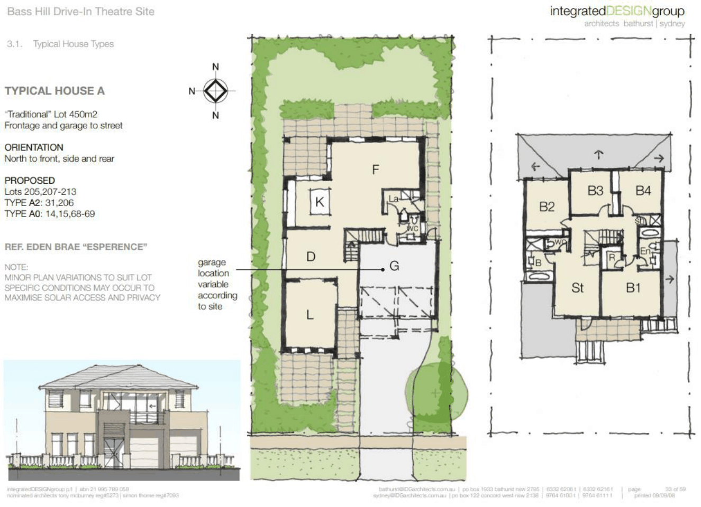

> [Picture on page 98: a picture, saved as a picture (images/ch-07-02-city-west-bass-hill-birrong-page-98-1.gif, 150 dpi).]

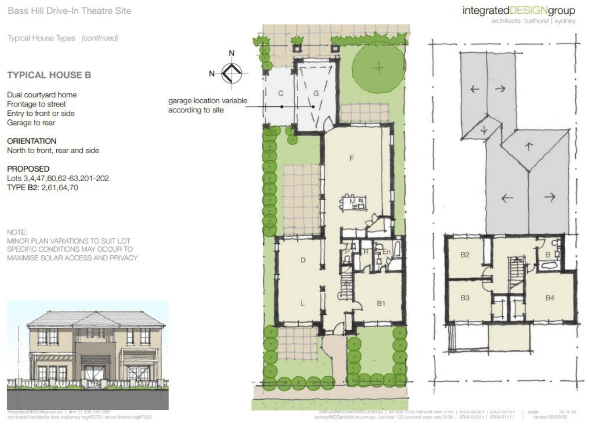

> [Picture on page 99: a picture, saved as a picture (images/ch-07-02-city-west-bass-hill-birrong-page-99-1.gif, 150 dpi).]

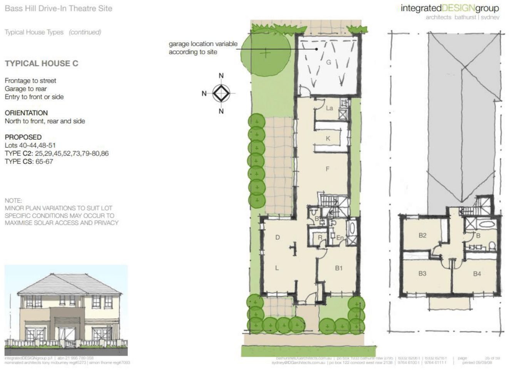

> [Picture on page 100: a picture, saved as a picture (images/ch-07-02-city-west-bass-hill-birrong-page-100-1.gif, 150 dpi).]

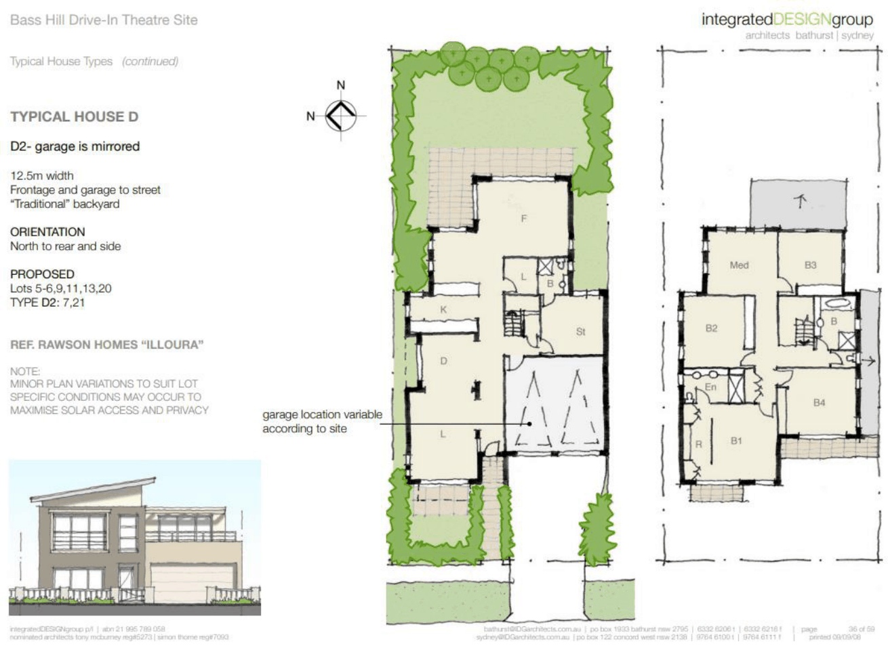

> [Picture on page 101: a picture, saved as a picture (images/ch-07-02-city-west-bass-hill-birrong-page-101-1.gif, 150 dpi).]

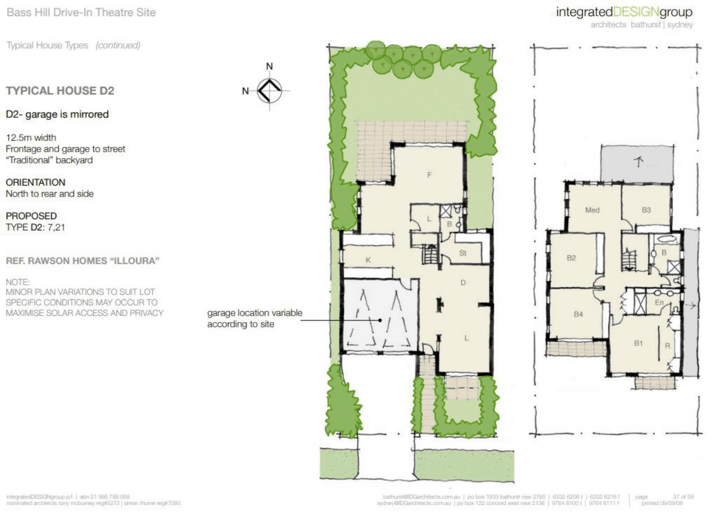

> [Picture on page 102: a picture, saved as a picture (images/ch-07-02-city-west-bass-hill-birrong-page-102-1.gif, 150 dpi).]

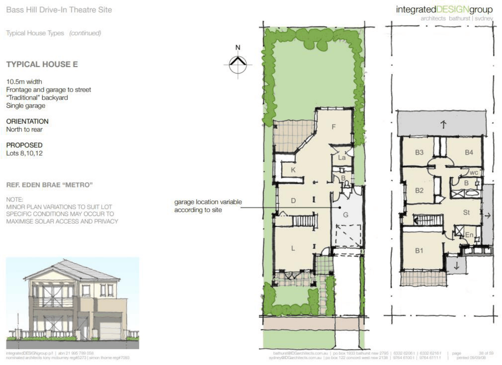

> [Picture on page 103: a picture, saved as a picture (images/ch-07-02-city-west-bass-hill-birrong-page-103-1.gif, 150 dpi).]

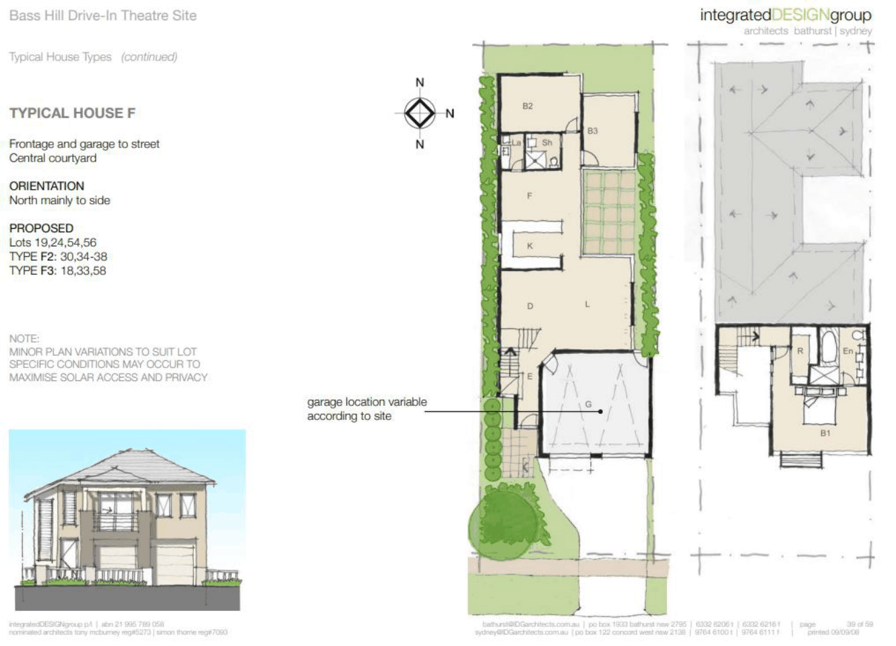

> [Picture on page 104: a picture, saved as a picture (images/ch-07-02-city-west-bass-hill-birrong-page-104-1.gif, 150 dpi).]

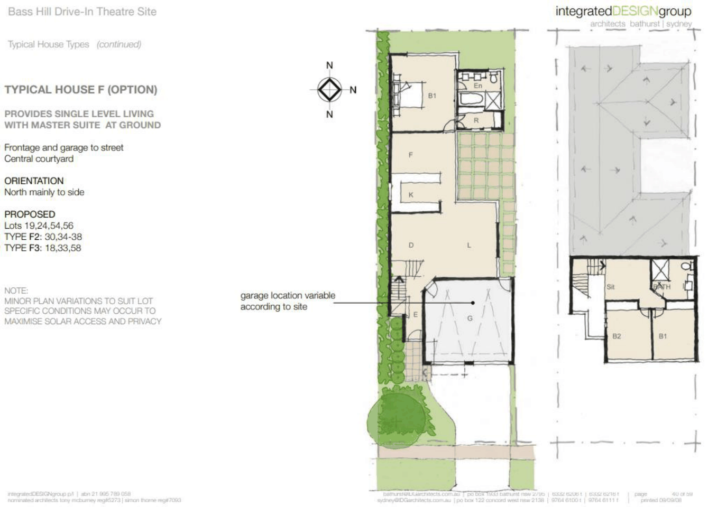

> [Picture on page 105: a picture, saved as a picture (images/ch-07-02-city-west-bass-hill-birrong-page-105-1.gif, 150 dpi).]

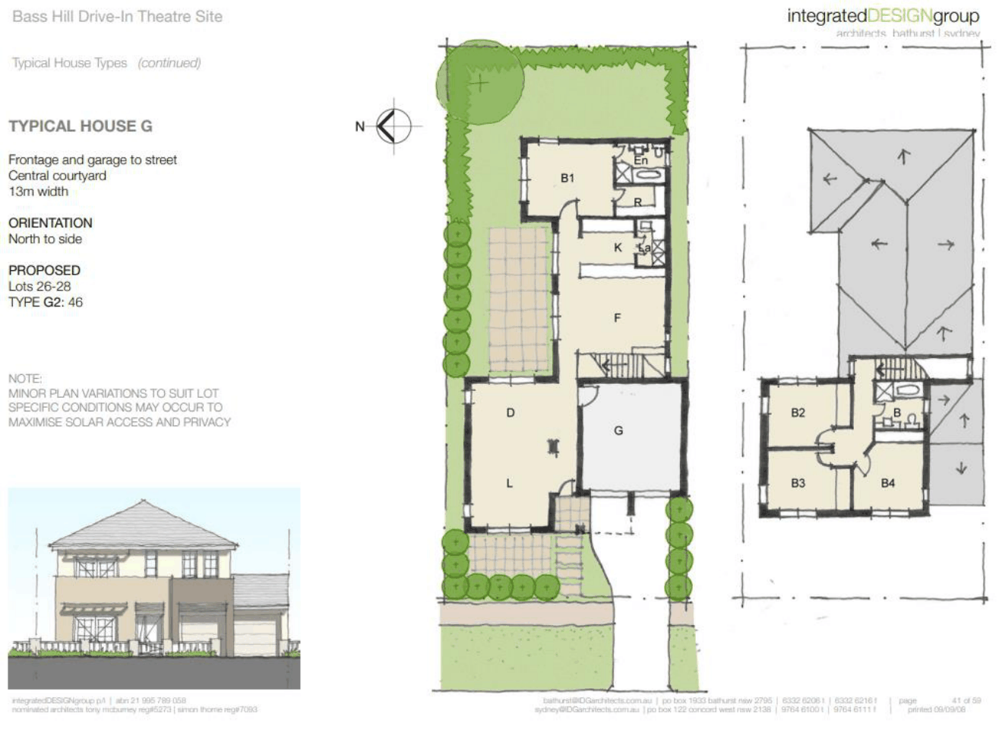

> [Picture on page 106: a picture, saved as a picture (images/ch-07-02-city-west-bass-hill-birrong-page-106-1.gif, 150 dpi).]

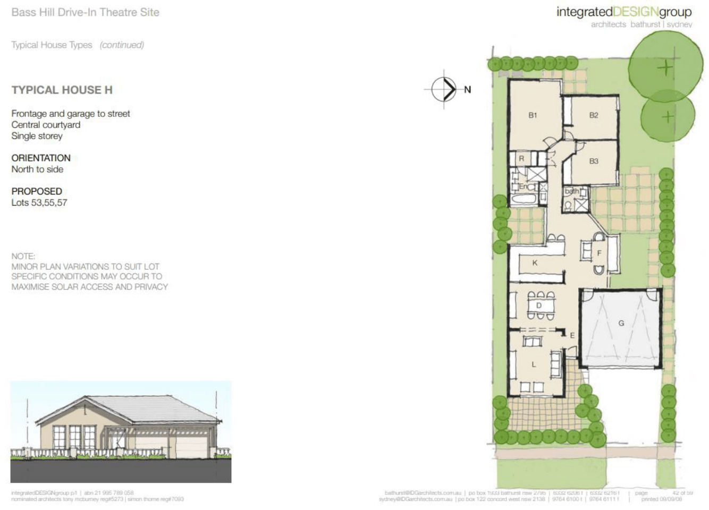

> [Picture on page 107: a picture, saved as a picture (images/ch-07-02-city-west-bass-hill-birrong-page-107-1.gif, 150 dpi).]

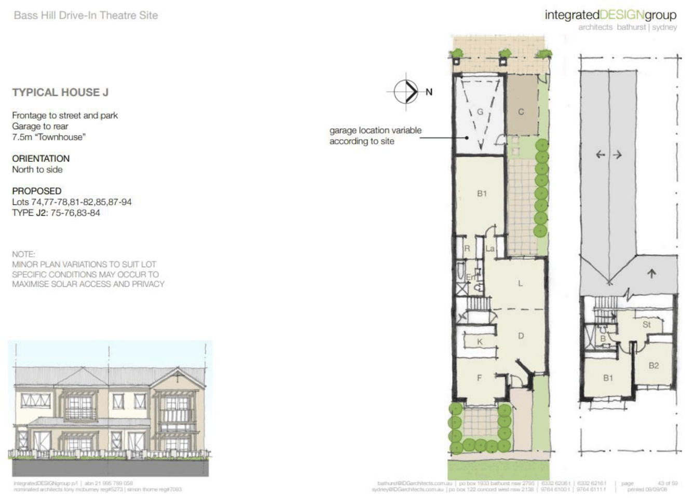

> [Picture on page 108: a picture, saved as a picture (images/ch-07-02-city-west-bass-hill-birrong-page-108-1.gif, 150 dpi).]
