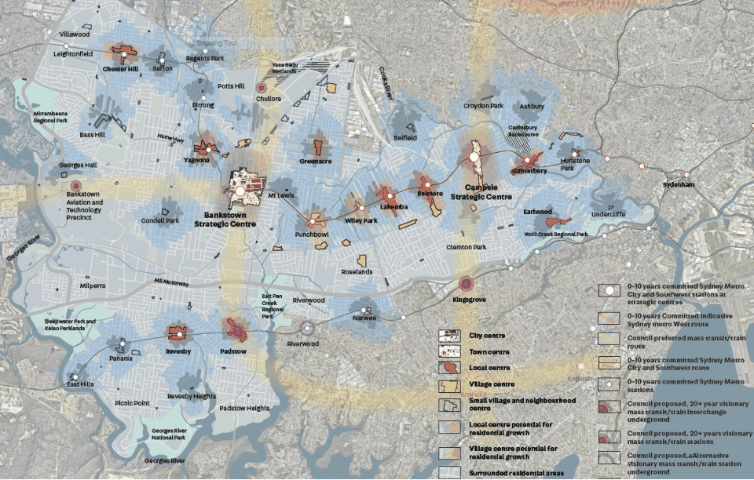
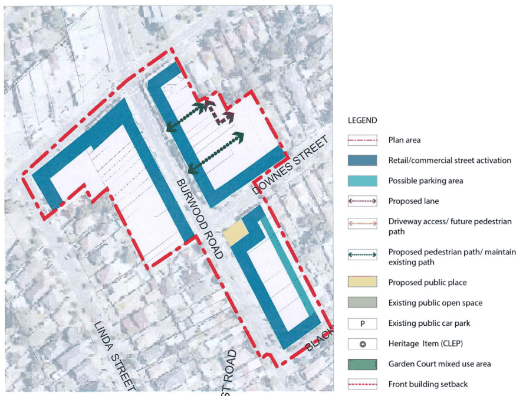
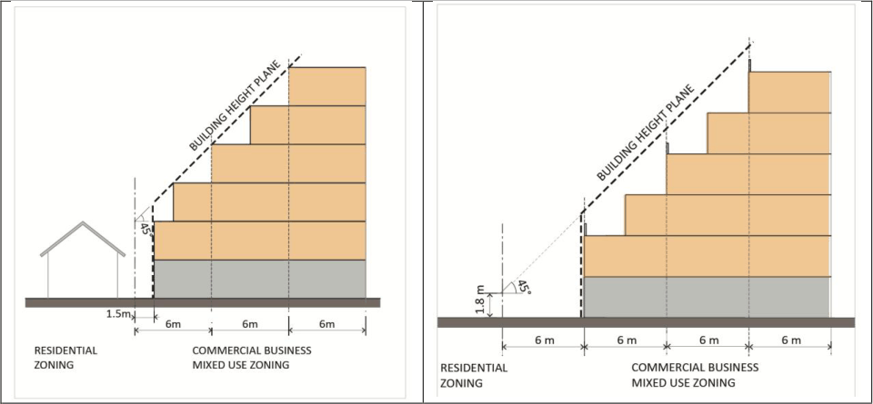
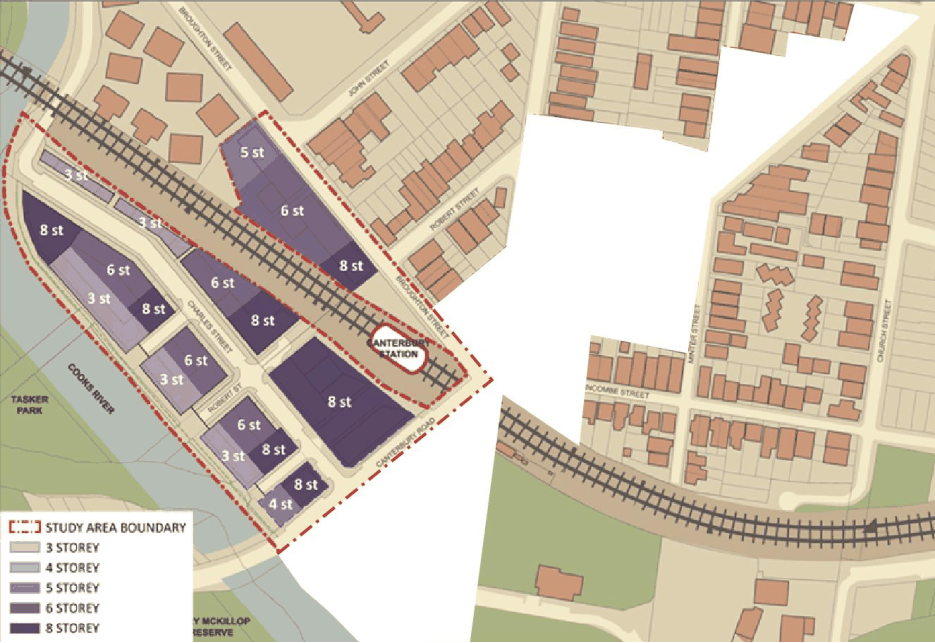

## Chapter 7 Commercial Centres

### 7.3 City East

### ⎯ Belfield ⎯ Canterbury ⎯ Croydon Park ⎯ Earlwood ⎯ Hurlstone Park ⎯ Narwee ⎯ Roselands

June 2023 (Amended April 2026)

Welcome to the

### City of Canterbury-Bankstown

#### Great Cities

We believe in creating vibrant, dynamic, and diverse communities that offer opportunities for people to connect, pursue their passions, and contribute to the world around them.

#### Naturally Green

We protect and prioritise nature in and around our city to enhance environmental sustainability and improve the quality of life for our residents.

#### Design Excellence

We encourage buildings, spaces, and objects that are both beautiful and practical, enhancing the beauty, accessibility, and safety of our built environment.

#### People First

We prioritise the needs, preferences, and aspirations of our community in all aspects of urban planning and design, creating supportive and enriching places people love.

#### Community

We engage with our community to ensure their needs and aspirations are reflected in the outcome, creating sustainable, resilient, vibrant, diverse, and inclusive places.

#### Sustainability

We seek designs that reduce negative impacts on the environment while also promoting social and economic well-being.

#### Net-Zero

We encourage our community to design buildings and places that produce as much renewable energy as they consume, reducing greenhouse gas emissions, lowering energy bills, and increasing resilience to environmental shocks and stresses.

#### Join us in creating a City that's liveable, loveable, and sustainable for all!

#### CONTENTS

Section 1 – Introduction ......................................................................................................... 4

Section 2 – Belfield Small Village Centre ............................................................................... 6

Section 3 – Belmore Local Centre .................................................. (Replaced by Chapter 7.6)

Section 4 – Canterbury Local Centre ...................................................................................... 9

Section 5 – Croydon Park Small Village Centre .................................................................... 14

Section 6 – Earlwood Local Centre ...................................................................................... 17

Section 7 – Hurlstone Park Small Village Centre.................................................................. 20

Section 8 – Lakemba Local Centre ................................................. (Replaced by Chapter 7.6)

Section 9 – Narwee Village Centre ....................................................................................... 23

Section 10 – Punchbowl Village Centre ......................................... (Replaced by Chapter 7.7)

Section 11 – Roselands Village Centre ................................................................................. 26

Section 12 – Wiley Park Village Centre .......................................... (Replaced by Chapter 7.7)

Section 13 – Lanes ................................................................................................................ 30

## SECTION 1–INTRODUCTION

#### Explanation

The suburbs in Canterbury-Bankstown are structured around the commercial centres that offer urban services and business opportunities. The character, size and function of each centre is different creating a diversity of urban and suburban places. The focus for all centres is commercial and street-facing retail space.

Connective City 2036 identifies the centres hierarchy, which includes strategic centres, local centres, village and small village centres, and neighbourhood centres. The centres hierarchy helps to plan for growth and to inform land uses and built form.

For example, strategic centres provide regional urban services to a metropolitan catchment and are the key focus for jobs, civic and cultural activities and housing. Local centres and village centres are connected to good public transport and provide urban services to residents in surrounding suburbs. Small village centres and neighbourhood centres meet the daily shopping needs of residents in the local area.

> [Picture on page 4: a picture, saved as a picture (images/ch-07-03-city-east-belfield-canterbury-page-4-15.gif, 150 dpi).]

Figure 1a: Centres hierarchy (Connective City 2036, City Directions)

Key actions of Connective City 2036 include:

• To promote centres as great urban places that match a character and feel defined by the community.

• To provide residents with access to employment, retail and commercial services.

• To support growth with high quality design and improved infrastructure.

• To improve pedestrian amenity particularly within centre main streets.

The Canterbury-Bankstown Local Environmental Plan 2023 and Canterbury-Bankstown Development Control Plan 2023 combine to implement Connective City 2036. The Canterbury-Bankstown Local Environmental Plan 2023 is Council's principal planning document to regulate effective and orderly development in Canterbury-Bankstown. The LEP provides objectives, zones and development standards such as lot sizes, floor space ratios and building heights.

The Canterbury-Bankstown Development Control Plan 2023 supports the LEP by providing additional objectives and development controls to enhance the function, design and amenity of the centres in Belfield, Belmore, Canterbury, Croydon Park, Earlwood, Hurlstone Park, Lakemba, Narwee, Punchbowl, Roselands and Wiley Park.

Good design provides a solid basis for a high quality, comfortable environment for people. It achieves a building form that is appropriate to the desired character of the street and surrounding buildings. It achieves a building form that defines the public domain, provides internal amenity and considers neighbours’ amenity.

As part of the design process, applicants must note that a building envelope is not a building, but a three dimensional shape that may determine the bulk and siting of a building. After allowing for building articulation and other development controls, the achievable floor space of a development is likely to be less than the building envelope.

#### Objectives

O1 To ensure development is compatible with the centres hierarchy planning framework.

O2 To enhance the amenity for people who live in, work in and visit the centres.

O3 To provide a high quality and activated public domain with good solar access.

O4 To facilitate ecologically sustainable development.

O5 To provide an appropriate interface to adjacent uses.

O6 To provide specific guidelines for key development sites.

## SECTION 2–BELFIELD SMALL VILLAGE CENTRE

#### Explanation

Connective City 2036 recognises Belfield as a small village centre within the centres hierarchy. It provides urban services to meet the daily and weekly shopping needs of residents in surrounding suburbs. Section 2 applies to land shown in Figure 2a.

> [Picture on page 6: a picture, saved as a picture (images/ch-07-03-city-east-belfield-canterbury-page-6-6.gif, 150 dpi).]

Figure 2a: Structure plan

#### Objectives

O1 To improve the structure and function of the centre.

O2 To establish the desired spatial proportions of the street and define the street edge.

O3 To minimise building size and bulk by setting back upper storeys.

O4 To minimise amenity impacts on adjoining sites.

O5 To allow for flexible design and building articulation by permitting minor encroachments.

O6 To ensure efficient vehicular access to parking and servicing and reduce driveway crossings.

O7 To facilitate efficient building envelopes that achieve optimum density.

#### Development controls

#### Structure plan

2.1 Development is to be in accordance to the structure plan shown in Figure 2a. The structure plan contains development controls in relation to parking, laneways, pedestrian pathways, retail/commercial activation locations and other matters. Where sites are to be redeveloped and a new lane is identified over private land, the creation of the lane is required even if the lane cannot be immediately utilised.

#### General

2.2 Where a setback applies, buildings are to provide articulated and varied facades that do not result in a ziggurat appearance (i.e. do not have the form of a terraced structure with successive receding storeys).

#### Front setbacks

2.3 Development must comply with the minimum front setbacks as follows:

| Location | Number of storeys at the street and setback | Upper level (podium) setback |
|---|---|---|
| E1 Zone | 1–3 storeys Build to front boundary | Fourth storey – 3m Greater than four storeys – 5m (all storeys to be setback this distance including the fourth storey) |

#### Side setbacks

setbacks

are not required in the E1 zone when the desired character is for a continuous street frontage.

#### On boundary with residential zone – side setback

2.5 Establish a 45 degree height plane projected at 1.5m from the residential boundary.

2.6 Provide minimum 1.5m setback to the residential zone boundary.

2.7 A two storey limit on the boundary with residential zone applies (refer to Figure 2b).

#### On boundary with residential zone – rear setback

2.8 Establish a 45 degree height plane projected at 6m from the residential zone boundary.

2.9 Provide minimum 6m setback to the residential zone boundary.

2.10 A two storey limit on the boundary with residential zone applies (refer to Figure 2c).

2.11 A setback to a rear lane is not required.

> [Picture on page 8: a picture, saved as a picture (images/ch-07-03-city-east-belfield-canterbury-page-8-4.gif, 150 dpi).]

Figure 2b: Building height plane side

Figure 2c: Building height plane rear

#### Exceptions

2.12 The following minor building elements may project into the minimum side setback area:

(a) roof eaves, awnings, pergolas and patios;

(b) stair or ramp access to the ground floor; and

(c) rainwater tanks.

#### Minimum frontage

2.13 Where redevelopment is proposed in the E1 zone of the LEP, a minimum frontage of at least 18m shall be provided.

## SECTION 4–CANTERBURY LOCAL CENTRE

#### Explanation

Connective City 2036 recognises Canterbury as a local centre within the centres hierarchy. It provides urban and community services to a large suburban population and connects to good public transport. Section 4 applies to land shown as the study area in Figure 4a.

> [Picture on page 9: a picture, saved as a picture (images/ch-07-03-city-east-belfield-canterbury-page-9-6.gif, 150 dpi).]

Figure 4a: Application map

#### Desired character
