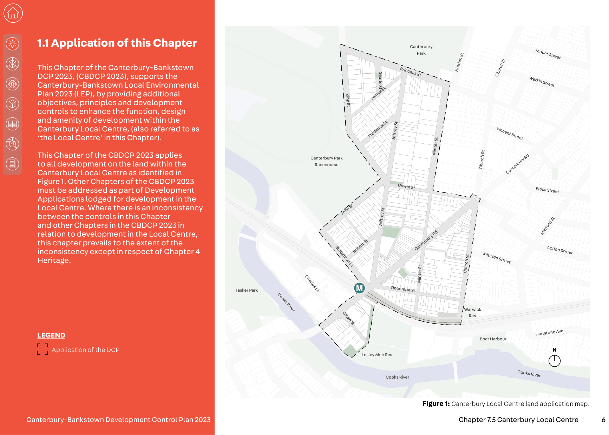

## Section 6 Key Sites

#### 96

KS-1 59A King Street 186-206 Canterbury

100

KS-2 73-87 Jeffrey Street and 67-71A Jeffrey Street

101

KS-3 153-189 Canterbury Road

103

KS-4 186-206 Canterbury Road

104

KS-5 214-224 and 2-8 Close Street

105

KS-6 146-150 Canterbury Road

106

KS-7 17-23 Robert Street and 13 Broughton Street

107

KS-8 9-15 Robert Street

109

KS-9 1-13 Close Street & 244-258 Canterbury Road

110

#### Appendices

#### 113

A1

Definitions

114

A2

Figures List

118

A3

Table List

121

## SECTION 1 INTRODUCTION

1.1 1.2

1.3

Application of this DCP Chapter 6

7

Vision for Canterbury Local

Centre

How to read this DCP Chapter

7

Chapter 7.5 Canterbury Local Centre 5

> [Picture on page 6: a map, saved as a picture (images/ch-07-05-canterbury-page-6-1.gif, 150 dpi); the street names and other small labels are on the picture.]
> Words printed on the picture (title and legend, copied from the PDF):
> This Chapter of the Canterbury-Bankstown
> DCP 2023, (CBDCP 2023), supports the
> Canterbury-Bankstown Local Environmental
> Plan 2023 (LEP), by providing additional
> objectives, principles and development
> controls to enhance the function, design
> and amenity of development within the
> Canterbury Local Centre, (also referred to as
> ‘the Local Centre’ in this Chapter).
> This Chapter of the CBDCP 2023 applies
> to all development on the land within the
> Canterbury Local Centre as identified in
> must be addressed as part of Development
> Applications lodged for development in the
> Local Centre. Where there is an inconsistency
> between the controls in this Chapter
> and other Chapters in the CBDCP 2023 in
> relation to development in the Local Centre,
> this chapter prevails to the extent of the
> inconsistency except in respect of Chapter 4
> Application of the DCP
> Frederick St Jeffrey St
> Lesley Muir Res.
> Chapter 7.5 Canterbury Local Centre 6

Figure 1. Other Chapters of the CBDCP 2023

Figure 1: Canterbury Local Centre land application map.
