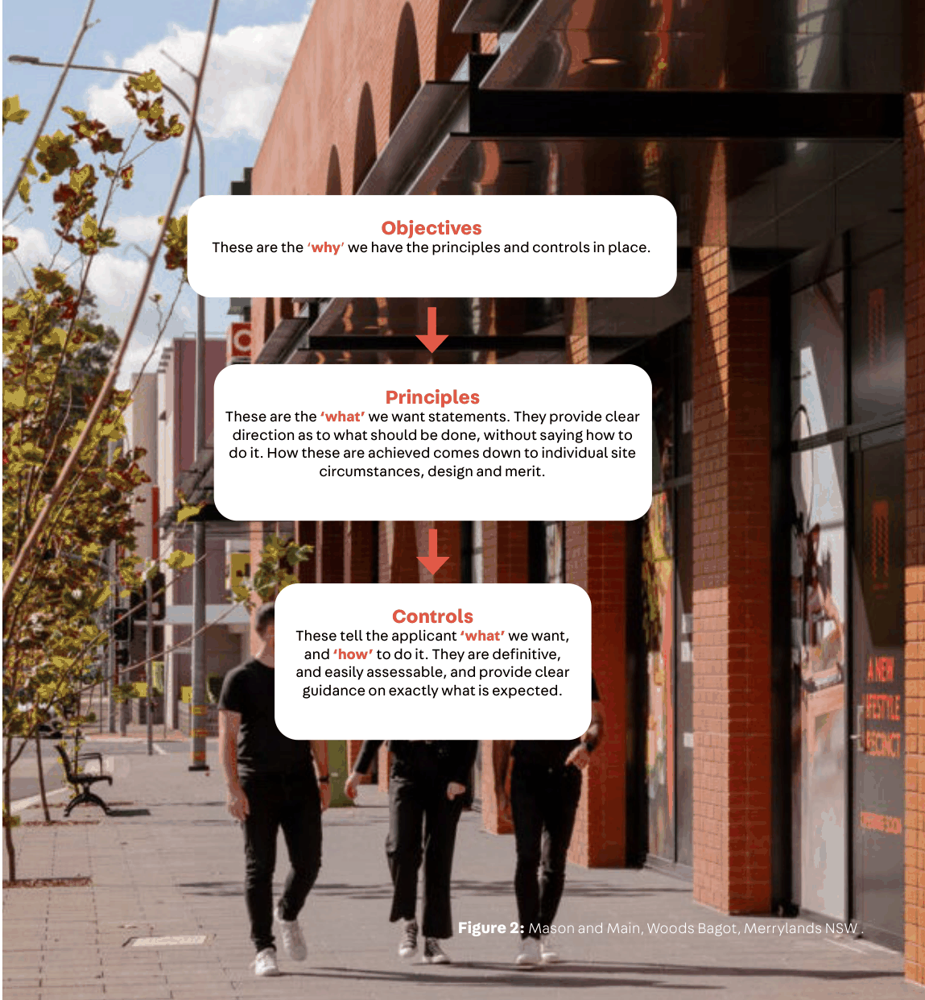

### 1.3 How to read this DCP

### Chapter

This DCP Chapter is structured around

a hierarchy of criteria encompassing

objectives, principles and controls.

The intent is to provide clear, direct and

informative development controls and

design guidance for all new development

in the Canterbury Local Centre. When addressing the criteria, it is

important to consider the purpose of

each step, as outlined on this page.

Collectively these elements create a

comprehensive framework that will

enable Canterbury Local Centre to

deliver high quality renewal opportunities

that align with the vision.

> [Picture on page 7: a picture, saved as a picture (images/ch-07-05-canterbury-page-7-34.gif, 150 dpi).]
> Words printed on the picture (title and legend, copied from the PDF):
> These are the ‘why’ we have the principles and controls in place.
> These are the ‘what’ we want statements. They provide clear
> direction as to what should be done, without saying how to
> do it. How these are achieved comes down to individual site
> circumstances, design and merit.
> These tell the applicant ‘what’ we want,
> and ‘how’ to do it. They are definitive,
> and easily assessable, and provide clear
> guidance on exactly what is expected.

Figure 2: Mason and Main, Woods Bagot, Merrylands NSW .

#### Objectives

#### Principles

#### Controls

## SECTION 2 UNDERSTANDING PLACE

2.1

2.2

2.3

9

Structure Plan for the Local

Centre

11

Character Areas and key street and lanes

Connecting to Country

24

Chapter 7.5 Canterbury Local Centre 8
