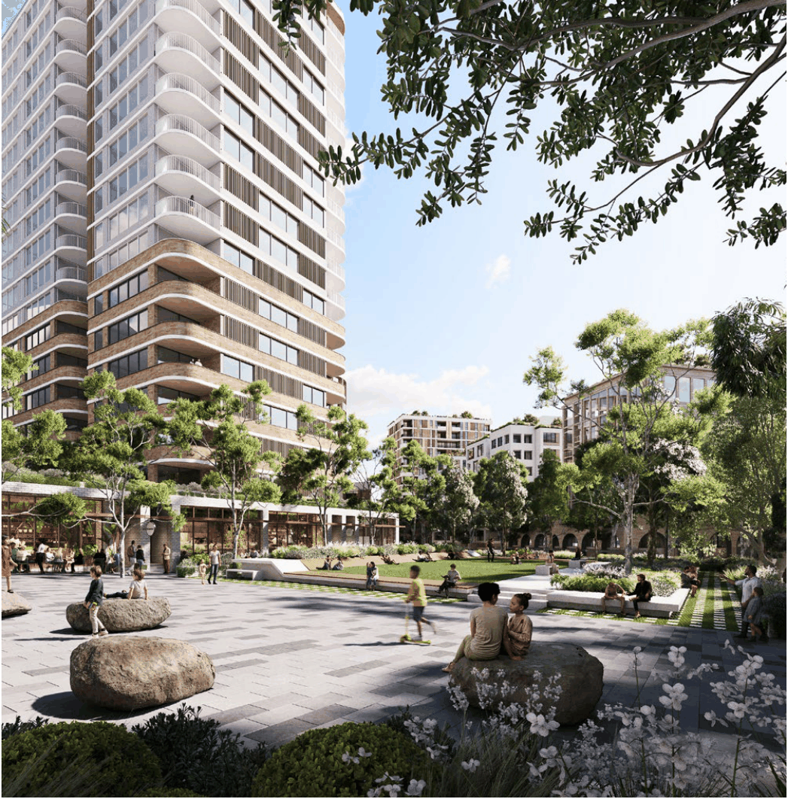
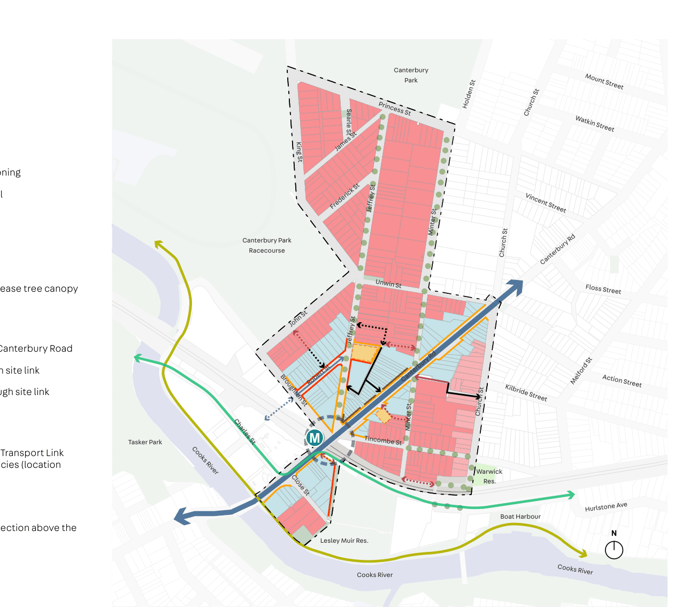
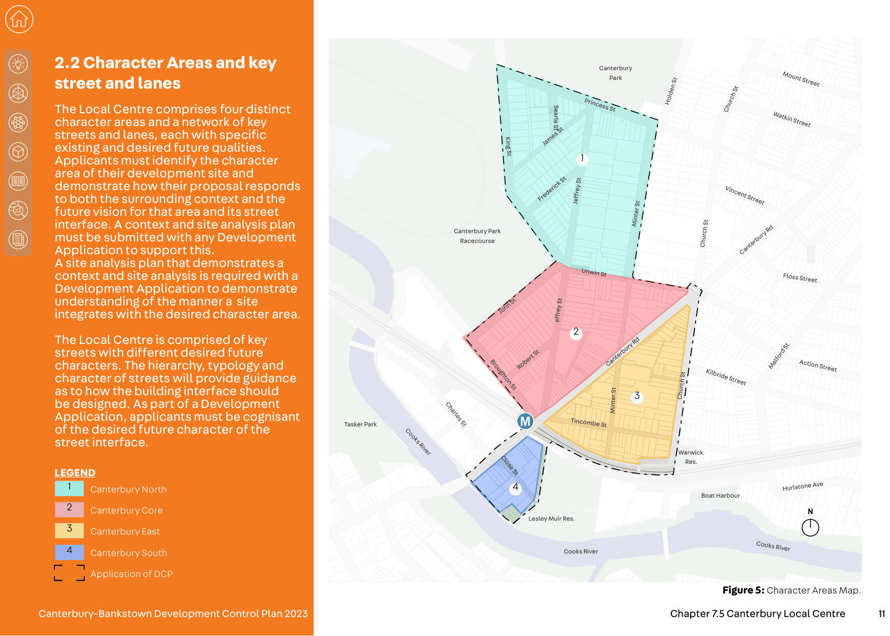

### 2.1 Structure Plan for the Local

### Centre

The Structure Plan provides an overview

of the intended outcomes for the Local

Centre. The Canterbury Local Centre

Phase 1 Report informed the Structure

Plan and based on the analysis of the

opportunities, constraints and potential

built form in Canterbury, consists of the

following key elements:

•	 A new shared civic street with active

edges on both sides of Robert Street.

•	 A new civic square, Canterbury Square,

surrounded by high quality built form.

•	 New pedestrian links to provide good

connectivity.

•	 An Southwest Active Transport Link

proposed by the State government.

•	 Strengthen links to and from the Cooks

River Pathway.

•	 Increased high density housing for

apartment buildings to support and

enliven the Local Centre

•	 Increased mixed use zoning to activate

the Local Centre.

•	 Increased density in proximity to the

railway and to open space.

•	 Increased open space located on the

Cooks River and on the southern side

of Canterbury Road. The Structure Plan is shown in Figure 4.

> [Picture on page 9: a picture, saved as a picture (images/ch-07-05-canterbury-page-9-32.gif, 150 dpi).]

Figure 3: Artist's Impression of the new Civic Square.

#### Structure Plan

#### LEGEND

Local Centre- mixed use zoning

Medium density residential

High density residential

New civic space

Cooks River trail

> [Picture on page 10: a map, saved as a picture (images/ch-07-05-canterbury-page-10-8.gif, 150 dpi); the street names and other small labels are on the picture.]
> Words printed on the picture (title and legend, copied from the PDF):
> Frederick St Jeffrey St
> Lesley Muir Res.

High priority streets to increase tree canopy

Active edge

Active street frontage Historic shopfronts along Canterbury Road

Existing pedestrian through site link

Proposed pedestrian through site link

Existing laneway

Proposed new laneway Planned Southwest Active Transport Link by State Government Agencies (location indicative)

Canterbury Road

Proposed High Street

Proposed Pedestrian connection above the metro line

Review traffic signal timing

Study Area

Figure 4: Canterbury Local Centre Structure Plan.

> [Picture on page 11: a map, saved as a picture (images/ch-07-05-canterbury-page-11-1.gif, 150 dpi); the street names and other small labels are on the picture.]
> Words printed on the picture (title and legend, copied from the PDF):
> 4 Canterbury South
> Application of DCP
> Frederick St Jeffrey St
> Lesley Muir Res.

Figure 5: Character Areas Map.
