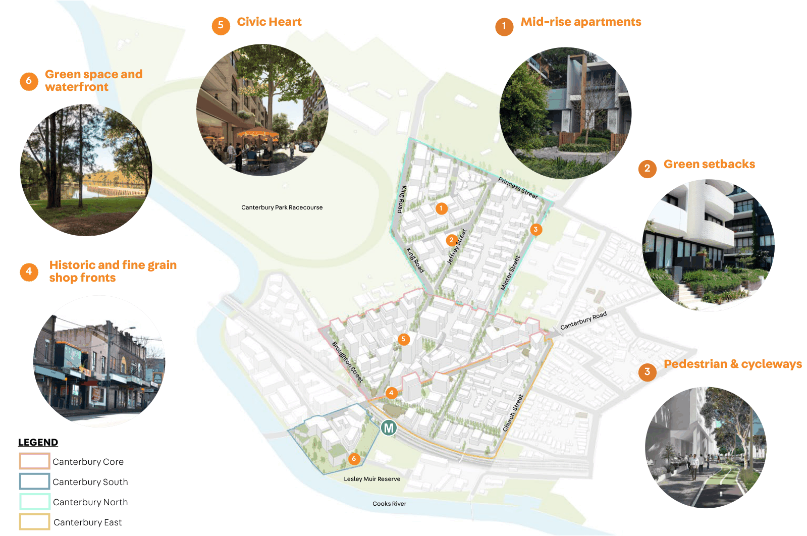

### 2.2 Character Areas and key

### street and lanes

The Local Centre comprises four distinct

character areas and a network of key

streets and lanes, each with specific

existing and desired future qualities.

Applicants must identify the character

area of their development site and

demonstrate how their proposal responds

to both the surrounding context and the

future vision for that area and its street

interface. A context and site analysis plan

must be submitted with any Development

Application to support this.

A site analysis plan that demonstrates a

context and site analysis is required with a

Development Application to demonstrate

understanding of the manner a  site

integrates with the desired character area. The Local Centre is comprised of key

streets with different desired future

characters. The hierarchy, typology and

character of streets will provide guidance

as to how the building interface should

be designed. As part of a Development

Application, applicants must be cognisant

of the desired future character of the

street interface.

> [Picture on page 12: a map, saved as a picture (images/ch-07-05-canterbury-page-12-1.gif, 150 dpi); the street names and other small labels are on the picture.]
> Words printed on the picture (title and legend, copied from the PDF):
> Canterbury Park Racecourse
> Lesley Muir Reserve

Green space and

waterfront

#### Historic and fine grain

shop fronts
