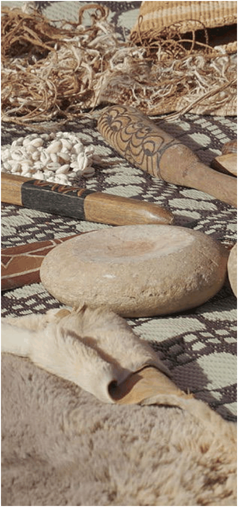
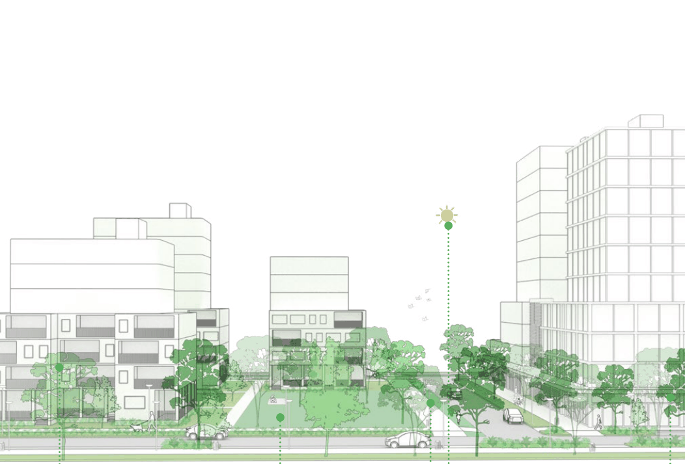

### 2.3 Connecting to Country

#### Objectives

O1. To take a Country centred approach and thinking that is

in the Local Centre consistent

values in the design of proposed

O3. To encourage development to respond to the physical and cultural connection of the local Aboriginal community to the land.

#### Design Guidance

G1. For development where clause

6.15 of the Canterbury-Bankstown Local Environmental Plan 2023 applies, the development must demonstrate:

(a) how the design considers aspects of Country under Sections 3 and 4 of the Government Architect NSW ‘Connecting with Country framework’;

(b) how the design gives regard to the culture and heritage of the traditional custodians of the land, the Darug People, on which the development is proposed, including;

(c)  connecting design with existing site topography, natural environment including the Cooks River and landscape setting,

(d) incorporating sustainable practices by using natural building materials.

For development where

Design Excellence clause of the Canterbury-Bankstown Local Environmental Plan 2023 applies, the development must determine the appropriate scope of engagement with the Aboriginal community and its representatives, whether it be high, medium or low as outlined in Section 3.1 of the Government Architect NSW ‘Connecting with Country framework’. If engaging with the Aboriginal community, development must:

(a) demonstrate the methods and outcomes from engagement with the Aboriginal community,

(b) adhere to protocols outlined in the NSW Government’s Practice Note ‘Engaging with Aboriginal Communities’ and ‘Aboriginal Cultural and Intellectual Property Protocol’.

G3 If significant items such as ancestral remains or artefacts are discovered during subsoil investigations, excavation, demolition or other earthworks, the applicant must engage with the Aboriginal community to determine culturally appropriate handling, repatriation or reburial.

G4. Development that proposes open space and landscaping should demonstrate consideration of ‘walking Country’ which reflects Aboriginal cultural practices, artefacts, artwork and narratives. Aspects involving the senses of seeing, hearing, touching, smelling and tasting, should be included.

G5. Design aspects of each development should give regard to the culture and heritage of the traditional custodians of the land, the Darug People, on which the development is proposed. The following design opportunities should be considered to ensure a Country-centred approach:

(a) Connect design with the natural environment and landscape setting, being: people, animals, resources and plants equally.

(b) Acknowledge shared history between Aboriginal and colonial settlers to promote healing and reconciliation by incorporating storytelling and knowledge of the past.

(c) Incorporate sustainable practices by using natural building materials that have a cultural and heritage significance.

(d) Incorporate Aboriginal place names, as guided by the Geographic Names Board, to foster understanding and raise awareness.

(e) Focus on details and patterns to insert cultural meaning.

G6. All work prepared to address the Connecting with Country objectives and design guidance must address the NSW Indigenous Cultural and Intellectual Property Protocol, to ensure applicants are aware of their duties with respect to the integration of this content.

> [Picture on page 25: a picture, saved as a picture (images/ch-07-05-canterbury-page-25-57.gif, 150 dpi).]

## SECTION 3 DESIGNING THE PUBLIC DOMAIN

| 3.1 | Public domain strategy | 28 |
|---|---|---|
| 3.2 | Public space and publicly accessible space | 31 |
| 3.3 | Cycleways, laneways and arcades | 35 |
| 3.4 | Tree canopy and green cover | 43 |
| 3.5 | Solar access to public spaces and publicly accessible open spaces | 45 |
| 3.6 | The provision of shade and reduction of urban heat | 47 |

Chapter 7.5 Canterbury Local Centre 26

Public space includes streets, squares,

parks, through site links and laneways.

Public spaces are the enduring elements

of a city or place which people share as

social and cultural space. These civic

elements form the framework for the

Local Centre and work in cooperation with

the built form interface on private land to

enliven and create a unique place inclusive

to all people. To ensure for a high-quality

functioning Local Centre, a public domain

framework is essential, working together

with the built form interface to create

engagement, interest and elevating the

pedestrian experience.

' A humane city-with carefully designed

streets, squares and parks creates

pleasure for those who live, work and play

there every day, as well as visitors and

passers-by. Everyone should have the

right to easily accessible open spaces, just

as they have the right to clean water. Well-

designed neighbourhoods inspire people

to live in them.’ Richard Rogers.

> [Picture on page 27: a picture, saved as a picture (images/ch-07-05-canterbury-page-27-25.gif, 150 dpi).]
