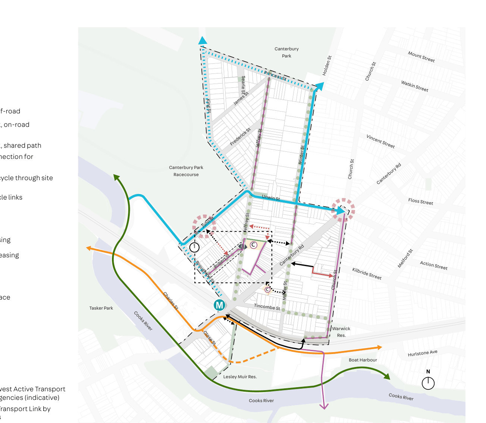
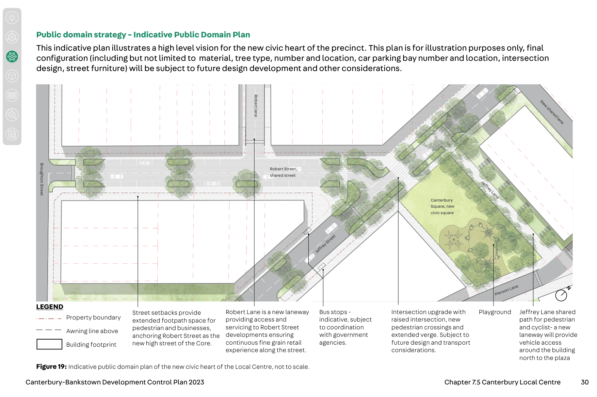

#### 7.	 Enhance pedestrian environment and

support business activity by widening the footpaths in the Center.

Legend

Study area

Primary shared path

Secondary quiet way

#### Public domain strategy

Proposed shared path links

#### LEGEND

Existing pedestrian and cycle links

Primary cycling network, off-road Proposed laneways

Secondary cycling network, on-road quiet way

Proposed pedestrian crossing

> [Picture on page 29: a map, saved as a picture (images/ch-07-05-canterbury-page-29-15.gif, 150 dpi); the street names and other small labels are on the picture.]
> Words printed on the picture (title and legend, copied from the PDF):
> Frederick St Jeffrey St
> Lesley Muir Res.

Secondary cycling network, shared path Cooks River Trail

Future primary cycling connection for investigation, off-road Proposed pedestrian and cycle through site links

Existing pedestrian and cycle links

Planned East-West Cycle Link by State Government

(indicative)

Proposed laneways

Existing laneway

Alternative route for East-West Cycle Link by State Govern-ment (indicative)

Proposed pedestrian crossing High priority street for

increasing canopy coverage

High priority street for increasing canopy coverage

c New civic space

Future primary shared path connection

New high street, shared space Active frontage

Future crossing upgrades

c New civic space

Study Area

New high street

#### 1

Refer to Indicative public domain plan

Metro station

M

Cooks River Trail

Future crossing upgrades Alternative route for Southwest Active Transport Link by State Government agencies (indicative) Planned Southwest Active Transport Link by State Government agencies

Figure 18: Public Domain Strategy Plan.

> [Picture on page 30: a map, saved as a picture (images/ch-07-05-canterbury-page-30-1.gif, 150 dpi); the street names and other small labels are on the picture.]
> Words printed on the picture (title and legend, copied from the PDF):
> Awning line above
> Bus stops -
> Street setbacks provide
> extended footpath space for
> pedestrian and businesses,
> anchoring Robert Street as the
> new high street of the Core.
> Robert Lane is a new laneway
> providing access and
> servicing to Robert Street
> continuous fine grain retail
> experience along the street.
> Intersection upgrade with
> raised intersection, new
> pedestrian crossings and
> extended verge. Subject to
> future design and transport
> New shared lane
> Playground Jeffrey Lane shared
> path for pedestrian
> and cyclist- a new
> laneway will provide
> around the building
> north to the plaza
> Chapter 7.5 Canterbury Local Centre 30

Figure 19: Indicative public domain plan of the new civic heart of the Local Centre, not to scale.

#### Public domain strategy - Indicative Public Domain Plan

This indicative plan illustrates a high level vision for the new civic heart of the precinct. This plan is for illustration purposes only, final configuration (including but not limited to  material, tree type, number and location, car parking bay number and location, intersection design, street furniture) will be subject to future design development and other considerations.
