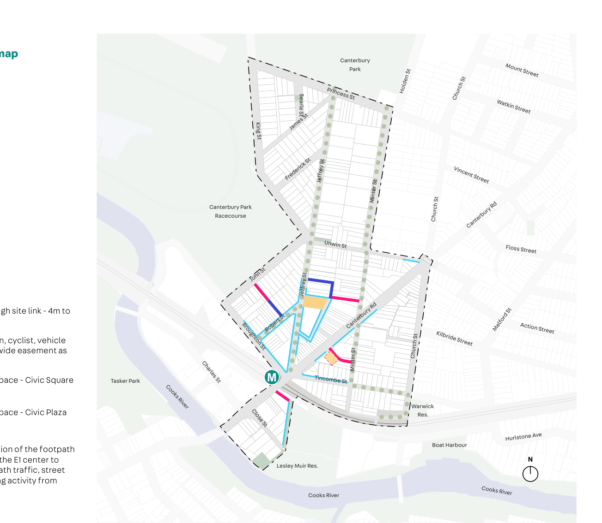

### 3.2 Public space and publicly

### accessible space

Public spaces are provided on public land and include squares, parks and streets, whereas publicly accessible space is located on private land and can be accessed by the public as a laneway, a square or a shopping arcade.

#### Objectives

O1. To ensure that the size, type, accessibility and program of open spaces accommodates the future number of residents, workers and visitors and their recreational and passive needs throughout the day and night.

To create new connections to open space to ensure residents, workers and visitors have easy, convenient access by walking and cycling to existing and proposed open space.

O3. To provide for inclusive and welcoming new open space and publicly accessible open space in underserved areas and upgrade existing open space. To ensure private development contributes to meeting the recreation needs of residents, workers, students and visitors.

O5. Ensure that any proposed privately owned publicly accessible space have a full public nature equivalent to the public domain.

O6. To ensure development contributes to a diverse network of quality and attractive open spaces comprised of well-connected parks and squares, green streets and laneways.

O7. To ensure open space has a high level of solar access and shade that is suitable to purpose.

To establish a vibrant and

attractive center where the network of streets, laneways and open space is supporting the increase in pedestrian movement and footpath trading activities from the growth in development.

#### Principles

P1. Provide equitable access and a variety of amenity and recreational options to accommodate different community needs.

P2. The design of new open space should use a palette of high quality and robust materials to maximise design lifespan and create beautiful places.  Landscaping treatments and material selections must respond to the local character of each space and contribute to a cohesive and unified public domain throughout the town centre.

P3. Create and enhance natural ecologies within the urban fabric through the use of diverse native landscape species.

P4. Paths of travel through public open space must respond to ‘desire paths’ and should be lit in the evening to improve safety and accessibility for users.

P5. In high activity area where street space and footpath are constrained, create a suitable environment for pedestrian movement and business activity by widening existing footpath into private land.

#### Controls

C1. Development must provide frontage and address to engage with open space and publicly accessible space. This can be achieved by but is not limited to:

(a) ground level active frontage,

(b) balconies addressing open space, and

(c) access from development sites and laneways to and from open space.

C2. Buildings, (except for awnings), and building basements, are not permitted to be located on, above or under any proposed new open space.

C3. Where development is required to provide widened footpath areas as per figure 20, the footpath area is to be designed and constructed as an extension of the existing footpath, unencumbered of physical obstacle to facilitate pedestrian movement, street tree planting and business activity.

C4. Public art must be integrated into

publicly accessible open spaces and located in accordance with the locations identified in Figure

20\. The design and placement of public art must contribute meaningfully to the character, identity, and activation of the public domain.

C5. Where required by Council, publicly accessible space must be provided in the locations identified in Figure 20. The provision of publicly accessible space is to be delivered in accordance with the specifications outlined in table 1.

Legend

Study area

Primary shared path

#### Publicly accessible spaces map

Secondary quiet way

Proposed shared path links Existing pedestrian and cycle links

Proposed laneways

Proposed pedestrian crossing

Cooks River Trail

Planned East-West Cycle Link by State Government

(indicative)

Alternative route for East-West Cycle Link by State Govern-ment (indicative)

#### LEGEND

> [Picture on page 33: a map, saved as a picture (images/ch-07-05-canterbury-page-33-19.gif, 150 dpi); the street names and other small labels are on the picture.]
> Words printed on the picture (title and legend, copied from the PDF):
> Frederick St Jeffrey St
> Lesley Muir Res.

New pedestrian and cycle through site link - 4m to 6m wide easement as per LEP.

High priority street for increasing canopy coverage Future primary shared path connection

New shared laneway (pedestrian, cyclist, vehicle access and services) 6m to 9m wide easement as per LEP.

Active frontage

New publicly accessible open space - Civic Square 1500m².

c New civic space

New publicly accessible open space - Civic Plaza 500m²

New high street

Metro station

M

Future crossing upgrades

Widened footpath area - Extension of the footpath as per street setback control in the E1 center to accommodate increased footpath traffic, street tree planting and outdoor trading activity from growth in development.

Figure 20: Publicly accessible space  map

| Map legend | Type of publicly accessible space Pedestrian and cycle through site link - 4m to 6m wide easement as per LEP. Shared laneway (pedestrian, cyclist, vehicle access and services) 6m to 9m easement as per LEP. Publicly accessible open space - Civic Square 1500m² Publicly accessible open space - Civic Plaza 500m² Widened footpath area - Extension of the footpath as per street setback control in the E1 center to accommodate increased footpath traffic, street tree planting and outdoor trading activity from growth in development. | Delivery mechanism LEP bonus incentive LEP bonus incentive LEP bonus incentive LEP bonus incentive Condition of consent | Ownership Through-site links are to be an easement on title. New shared laneways are to be dedicated to Council prior to a final Occupation Certificate being issued. Council reserves the right to not accept dedication and any proposed dedication must be discussed at a pre- lodgement meeting. Land owner with positive easement on title. Land owner with positive easement on title. Land owner with right of way | Asset management and maintenance Land owner Land owner or council Land owner Land owner Land owner or council | Accessibility Asset are to be designed to: a) Be fully accessible to the public 24 hours a day. b) Ensure that buildings or structures (other than awnings) are not located over any proposed through-site link. As above As above As above Asset are to be designed to be fully accessible to the public 24 hours a day. |
|---|---|---|---|---|---|

Table 1: Legend explanation of publicly accessible map of Canterbury.

Legend

Study area

Primary shared path

Secondary quiet way
