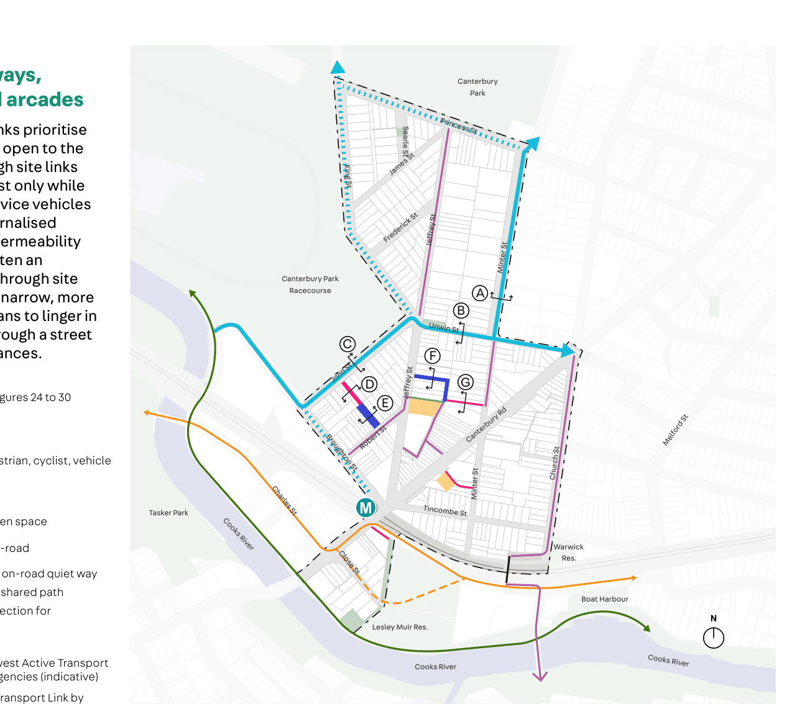
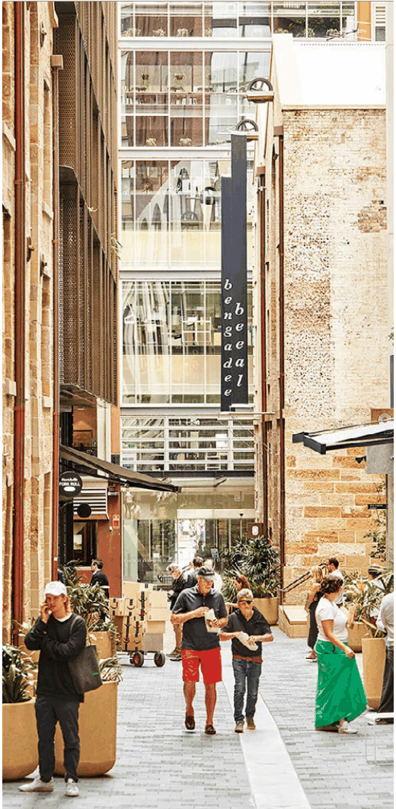
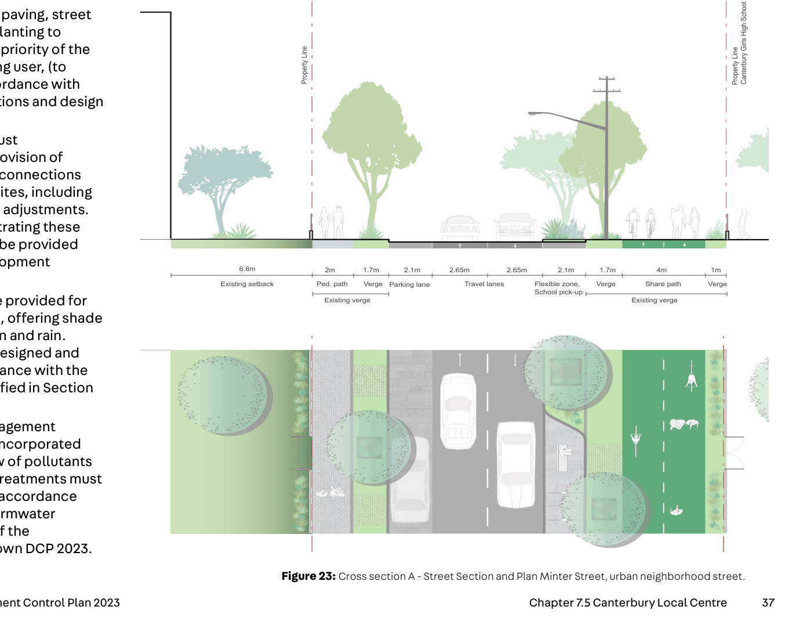
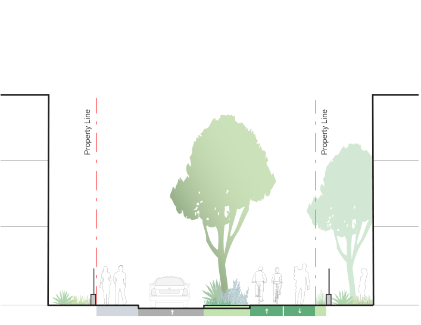
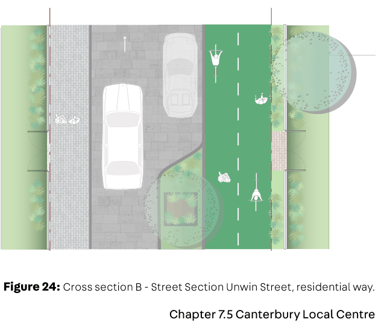
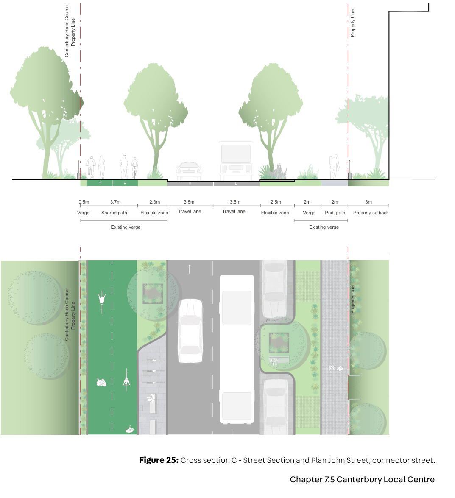
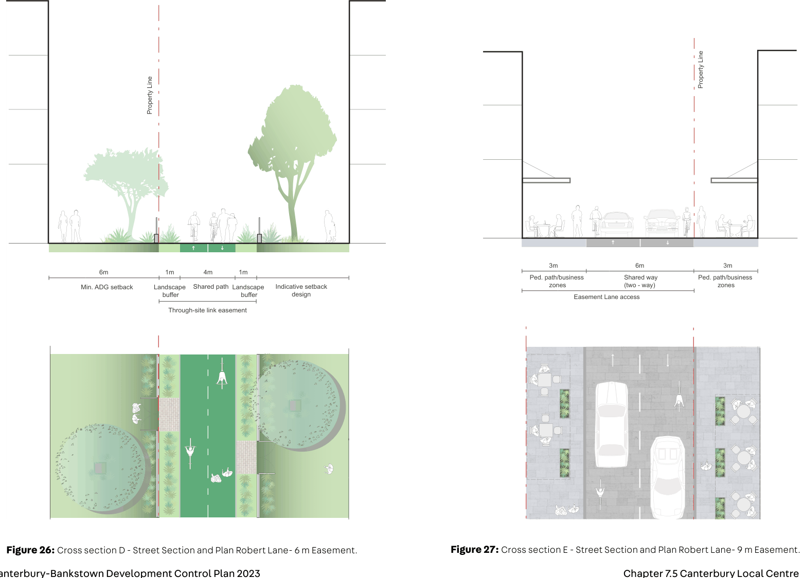
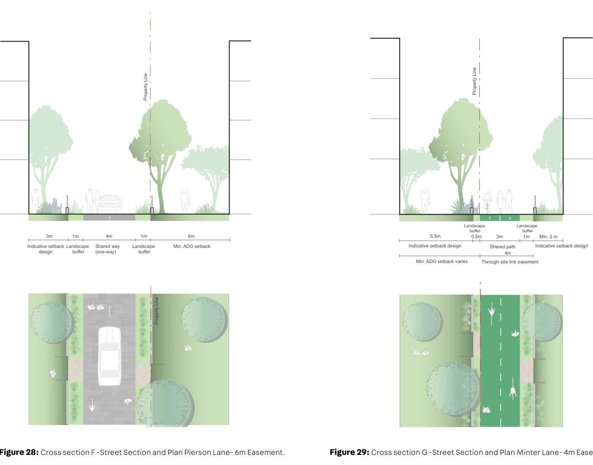
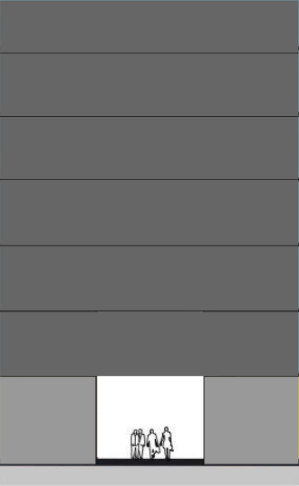
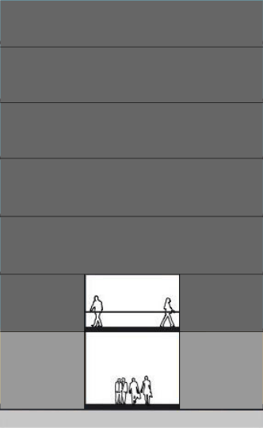

### 3.3 Cycleways, laneways,

### through site links and arcades

Proposed shared path links Existing pedestrian and cycle links

Proposed laneways

Proposed pedestrian crossing

Cooks River Trail

Planned East-West Cycle Link by State Government

(indicative)

> [Picture on page 35: a map, saved as a picture (images/ch-07-05-canterbury-page-35-16.gif, 150 dpi); the street names and other small labels are on the picture.]
> Words printed on the picture (title and legend, copied from the PDF):
> Frederick St Jeffrey St
> Lesley Muir Res.

Laneways and through site links prioritise pedestrians and cyclists, are open to the sky and have awnings. Through site links are for pedestrians and cyclist only while laneways are shared with service vehicles and access. Arcades are internalised retail ‘lanes’ which provide permeability through development and often an engaging retail experience. Through site links and arcades are usually narrow, more intimate spaces for pedestrians to linger in and provide a connection through a street block to reduce walking distances.

#### LEGEND

Alternative route for East-West Cycle Link by State Govern-ment (indicative)

Cross section reference - figures 24 to 30 New  through site link - 4m

High priority street for

increasing canopy coverage

New through site link - 6m New shared laneway (pedestrian, cyclist, vehicle access and services) 6m

Future primary shared path connection

New shared laneway 9m Active frontage

New publicly accessible open space

c New civic space

Primary cycling network, off-road New high street

Secondary cycling network, on-road quiet way Secondary cycling network, shared path

Metro station

M

Future primary cycling connection for investigation, off-road

Future crossing upgrades

Cooks River Trail

Alternative route for Southwest Active Transport Link by State Government agencies (indicative) Planned Southwest Active Transport Link by State Government agencies

Figure 21: Map of cycleways, laneways and through  site links.

#### Objectives

O1. To provide a high quality, safe, connected cycle network that enables the community to choose to ride to work, home or a destination.

To improve connectivity for pedestrians and cyclists between key destination points.

O3. To ensure laneways, through site links and arcades are accessible, attractive, continuous, well-lit, safe and where appropriate, open to the sky.

To provide amenity and safety to existing and proposed laneways, through site links and arcades, and active uses to engage pedestrians, where appropriate.

O5. To design laneways, through site links and arcades that provide an intimate space to linger within a fine grain spatial network.

O6. To provide for vehicular entries and servicing away from primary street frontages using service lanes.

#### Controls

C1. Where required by Council, laneways, through site links and arcades must be provided in the locations identified in Figures 21, as per figure 23 to 30. These connections must be designed to ensure permeability, safety, and integration with the broader movement network.

C2. Laneways and through site links are to be designed to:

(a) Have a minimum width of 4m and cater for the movement of pedestrians and cyclists in both directions.

(b) Ensure that buildings or structures are not located over any proposed laneway, other than awnings.

> [Picture on page 36: a picture, saved as a picture (images/ch-07-05-canterbury-page-36-47.gif, 150 dpi).]

Figure 22: Loftus Lane by Aspect, photo by Florian Groehn

Section G - Minter Street

Urban Neighbourhood Street

> [Picture on page 37: a picture, saved as a picture (images/ch-07-05-canterbury-page-37-3.gif, 150 dpi).]
> Words printed on the picture (title and legend, copied from the PDF):
> Property Line
> Canterbury Girls High School
> Property Line

(c) Provide lighting, paving, street furniture and tree planting to clearly indicate the priority of the pedestrian or cycling user, (to be provided in accordance with Council’s specifications and design standards).

(d) Development must demonstrate the provision of physical and visual connections with neighbouring sites, including any necessary level adjustments. Detailed plans illustrating these connections are to be provided as part of the development application.

(e) Awnings must be provided for weather protection, offering shade and shelter from sun and rain. Awnings are to be designed and delivered in accordance with the requirements specified in Section

4.3.2 of this DCP.

(f) Stormwater management measures must be incorporated to minimise the flow of pollutants from the laneway. Treatments must be implemented in accordance with Section 3 – Stormwater Drainage Systems of the Canterbury Bankstown DCP 2023.

6.8m

2.1m

2m 1.7m Parking lane

Ped. path

Existing setback

Verge

Existing verge

2.65m

1.7m

2.1m

2.65m

Flexible zone, School pick-up

Travel lanes

Verge

4m 1m Share path Verge

Existing verge

Figure 23: Cross section A - Street Section and Plan Minter Street, urban neighborhood street.

(g) Be clear of all obstructions, including stairs, escalators and columns and provide a clear line of sight from one end to the other for surveillance and accessibility, and

(h) Outdoor laneways and through site links will be open 24 hours a day, well-lit and adhere to the Crime Prevention Through Environmental Design (CPTED) principles.

(i) Where a development has the potential to create a laneway through block connection by extending an existing or proposed lane within its site, the lane should be completed or extended within the development site. If a development can deliver part of a lane or initiate a new lane, it should make provision for it.

C3. Through site links are to be an easement on title. New shared laneways are to be dedicated to Council prior to a final Occupation Certificate being issued. Council reserves the right to not accept dedication and any proposed dedication must be discussed at a pre-lodgement meeting.

> [Picture on page 38: a picture, saved as a picture (images/ch-07-05-canterbury-page-38-31.gif, 150 dpi).]
> Words printed on the picture (title and legend, copied from the PDF):
> Property Line
> Property Line
> 1.9m
> 3m
> 2.1m
> Property Line
> Property Line
> 3m 0.5m

1.9m

Ped. path Ped. path

3m

Travel lane Travel lane

2.1m

Flexible zone Flexible zone

3m 0.5m

Shared path Landscape buffer Shared path Landscape buffer

> [Picture on page 38: a map, saved as a picture (images/ch-07-05-canterbury-page-38-44.gif, 150 dpi); the street names and other small labels are on the picture.]

Figure 24: Cross section B - Street Section Unwin Street, residential way.

#### Section A - John Street

C4. The maintenance of the laneway and through site link in perpetuity including cleaning, repairing and replacing damaged or worn paving, furniture and the like and maintaining landscaping in a healthy condition is the responsibility of the land owner, not Council. A management plan must accompany any development involving the provision of a laneway. The plan is to demonstrate how ongoing access, maintenance, and functionality of the laneway will be ensured, including through any future changes in ownership.

(f) Be publicly accessible from 6am to 10pm each day.

> [Picture on page 39: a picture, saved as a picture (images/ch-07-05-canterbury-page-39-21.gif, 150 dpi).]
> Words printed on the picture (title and legend, copied from the PDF):
> Property Line
> Canterbury Race Course
> Property Line

0.5m Verge

2.3m

3.7m

3.5m

Flexible zone Travel lane

Shared path

Existing verge

2.5m

3.5m

Flexible zone

Travel lane

2m 3m

2m

Ped. path Property setback

Verge

Existing verge

> Words printed on the picture (title and legend, copied from the PDF):
> Canterbury Race Course

Figure 25: Cross section C - Street Section and Plan John Street, connector street.

### Section F - Robert Lane

> [Picture on page 40: a picture, saved as a picture (images/ch-07-05-canterbury-page-40-2.gif, 150 dpi).]
> Words printed on the picture (title and legend, copied from the PDF):
> Property Line

### Urban Residential Lane

### 9m easement

1m

1m

4m

6m

Indicative setback

Shared path Landscape

Min. ADG setback

design

buffer

Landscape

buffer

6m

3m

3m Ped. path/business

Shared way

(two - way)

Ped. path/business

zones

zones

Easement Lane access

> Words printed on the picture (title and legend, copied from the PDF):
> Through-site link easement

Figure 26: Cross section D - Street Section and Plan Robert Lane- 6 m Easement.

Figure 27: Cross section E - Street Section and Plan Robert Lane- 9 m Easement.

> [Picture on page 41: a picture, saved as a picture (images/ch-07-05-canterbury-page-41-1.gif, 150 dpi).]
> Words printed on the picture (title and legend, copied from the PDF):
> Property Line

#### Section H - Minter Lane

#### Pedestrian/Easement link

#### 4m easement

4m 1m

6m

3m 1m

Indicative setback

Landscape Min. ADG setback

design

buffer

Landscape

buffer

Shared way

(one-way)

Figure 28: Cross section F -Street Section and Plan Pierson Lane- 6m Easement.

buffer

5.5m

Min. 2 m

buffer

3m 1m

0.5m

Indicative setback design

Indicative setback design

Shared path

4m

Min. ADG setback varies Through-site link easement

Figure 29: Cross section G -Street Section and Plan Minter Lane- 4m Easement.

#### Controls (continued)

#### 2

storeys

#### 2

storeys

#### 6m

C5. Arcades within retail and commercial developments are to be designed to:

(a) Be two storeys in height or where proposed as a single storey ground level, have a minimum floor to ceiling height of 6m, (refer to Figure 30).

(b) Have Widths of 4m – 6m where the links are provided within a two storey height, or 5m – 8m wide where provided at a single floor level, (refer to Figure 30).

(c) Be located at ground level and lined with spaces to facilitate active uses.

(d) Be designed to have access to natural light.

(e) Be open at each end or, where air conditioned, provide entry doors that are glazed and comprise a minimum 70% of the width of the entrance,

#### 4m - 6m

> [Picture on page 42: a picture, saved as a picture (images/ch-07-05-canterbury-page-42-31.gif, 150 dpi).]

#### 5m - 8m

#### 3m 6m

> [Picture on page 42: a picture, saved as a picture (images/ch-07-05-canterbury-page-42-34.gif, 150 dpi).]

#### 4m - 6m

#### 6m

(f) Be publicly accessible from 6am to 10pm each day.

e t hrough site link

d through site link

c service lane

b shared lane

e

d through site link

Min.6m floor to

ceiling

#### Note:

#### Note:

#### Note:

#### Note:

Figure 30: Internal through site link minimum height and width requirements.

- pedestrian bridge optional

- pedestrian bridge optional

- pedestrian setback

- footpath with flush kerb

- shared service road

- seating

- footpath with flush kerb

- shared service road
