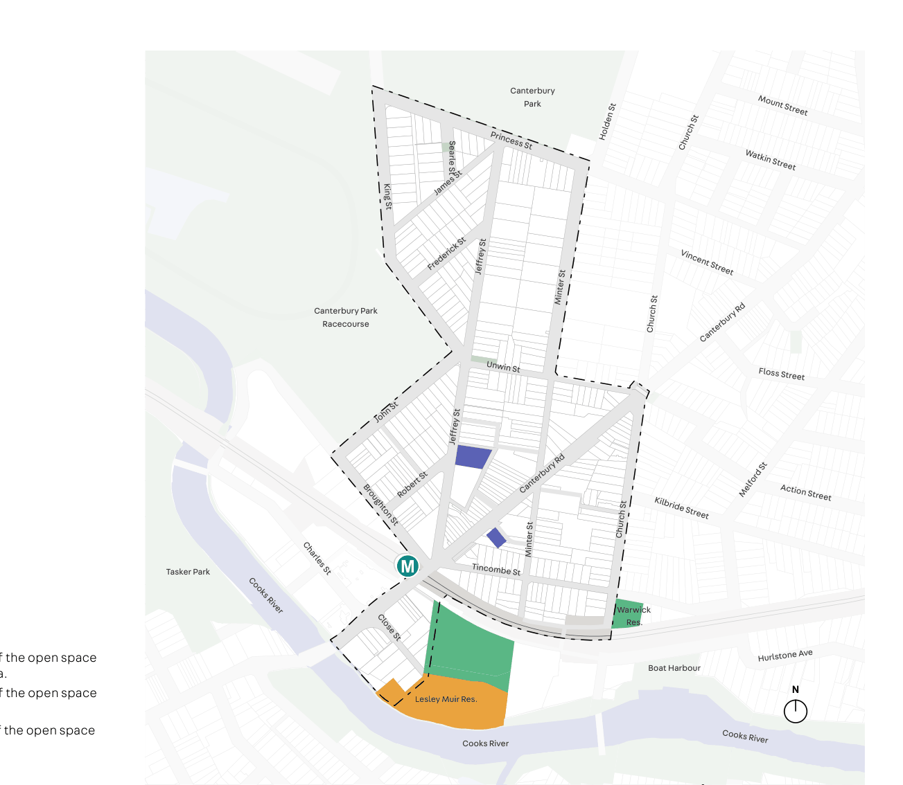

### 3.5 Solar access to public open

### space and publicly accessible

### open space

#### Objectives

O1. To ensure for solar access to parks and spaces for the enjoyment of residents and visitors. To balance sunlight access to the principal useable parts of public open space with shaded areas to enable a range of activities and the planting of a variety of trees and vegetation.

O3. To maintain or maximise solar access to public space during periods of the day when they are most used.

To ensure the successful growth and survival of trees and vegetation within parks and spaces.

#### Principles

P1. Provide high levels of solar access to ensure that tees and vegetation in public open spaces and publicly accessible open spaces thrive, amenity for the community and warmth in winter sun.

P2. Provide solar access on balance with shaded areas to ensure for amenity to all users all year around.

#### Controls

C1. Development Applications must demonstrate that the hours of solar access outlined in Figure 31 are maintained or preferably exceeded.

C2. Where overshadowing of parks and spaces is likely, a statement with supporting solar access studies must be submitted by a registered architect demonstrating that the proposed development mitigates overshadowing to the affected open space or publicly accessible space.

C3. Ancillary structures such as columns, pillars, spires, flag poles, public art, and architectural roof features including equipment for servicing the building, such as plant, lift motor rooms, fire stairs and the like, must not be excluded from any overshadowing analysis.

Note: Please refer to Section 6 Key Sites for more detailed controls for Jeffrey Street.

#### Solar access Map

#### LEGEND

> [Picture on page 46: a map, saved as a picture (images/ch-07-05-canterbury-page-46-3.gif, 150 dpi); the street names and other small labels are on the picture.]
> Words printed on the picture (title and legend, copied from the PDF):
> Frederick St Jeffrey St
> Lesley Muir Res.

Minimum 2 hours of sun for 50% of the open space in the winter solstice in Civic Plaza. Minimum 4 hours of sun for 50% of the open space in the winter solstice.

Minimum 5 hours of sun for 50% of the open space in the winter solstice.

Application of DCP

Figure 31: Solar access Map.
