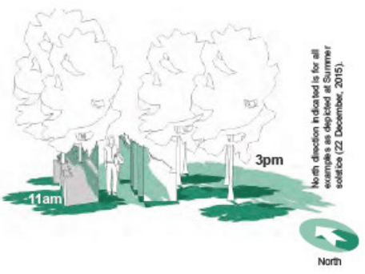
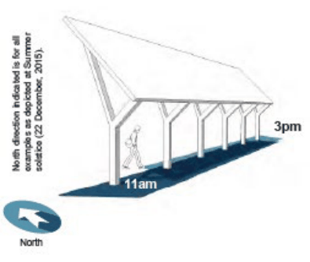
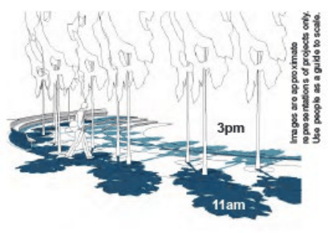
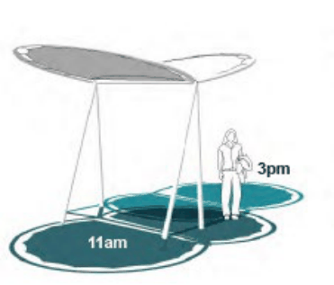
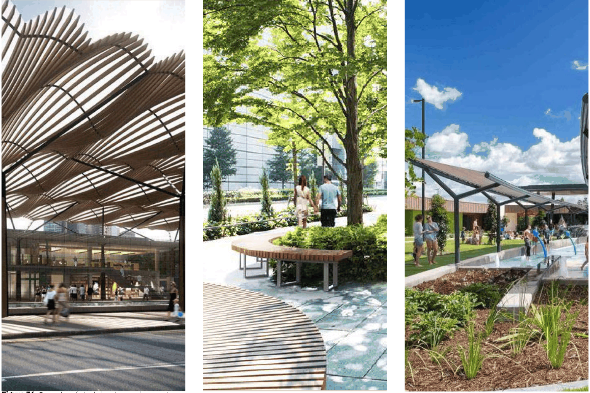

### 3.6 The provision of shade and

### reduction of urban heat

Canterbury experiences a relatively high urban heat island effect due to climate change and a low tree canopy cover. This means the combination of roads, other infrastructure and buildings without many trees and a hot climate result in the absorption of heat in the Local Centre which re-radiates and increases temperatures. Summer temperatures reach to over 35 degrees Celsius and have reached 45.9 degrees in the past. Australia has one of the highest incidences of skin cancer in the world.

Shade refers to areas shielded from direct sunlight, often provided by natural elements or structures and is crucial for comfort, UV protection and promoting social activity. Shade can work together with water, permeable paving, ground cover and material selection to reduce heat gain. Shade and seating, together, support healthy communities, socially and economically.

For the Local Centre to be pleasurable to all users, there needs to be a focus of the provision of shade, balanced with solar access, through imaginative design implemented in public space and publicly accessible space.

#### Objectives

O1. To ensure for refuge from hot summer sun in public and publicly accessible open space. To create imaginative responses for shade that integrate with playgrounds, water features and areas for the community to congregate in.

O3. To ensure for high amenity public and private spaces that are pleasurable to use. To reduce the contribution of new development to the urban heat island effect by retaining and providing design elements that store water, minimising impermeable surfaces to increase rainwater infiltration and allow for the improved cooling effects of evaporation.

O5. To improve user comfort in public domain and space accessible to the public.

#### Principles

P1. Create shade linkages through implementing shade structures, awnings to shop fronts and planting trees.

P2. Integrate water features such as misting, sprays and water fountains and the like where shade is provided in public and publicly accessible open space.

P3. Consider the location of trees and structures and the resultant shadow that will be created. Locate seating and areas where people can rest in these shaded areas.

P4. Maximise greenery throughout the Local Centre to reduce urban heat.

P5. Shade paved surfaces and walls where possible but also consider solar access in winter months

#### Controls

C1. Refer to Section 6- Key Sites for

shade requirements for Canterbury Square.

C2. Retain existing trees to maintain

> [Picture on page 48: a picture, saved as a picture (images/ch-07-05-canterbury-page-48-6.gif, 150 dpi).]

Figure 32: Incidental shade

> [Picture on page 48: a picture, saved as a picture (images/ch-07-05-canterbury-page-48-8.gif, 150 dpi).]

shade.

C3. Improve cooling by locating trees

to provide shade to exposed

building walls, hard surfaces and

pedestrian walkways.

C4. Use trees and shade structures in

combination with water features

to reduce temperatures in

public open space and publicly

accessible spaces.

C5. Store water in the landscape using fountains and water play features

and the like.

C6. If a dark roof is used, green cover

Figure 34: Sheltered linkages

must cover the roof form. Consider reflectivity in the choice of roof

material and the colour.

C7. Minimise the reflection of solar

heat from facades by selecting

appropriate materials.

> [Picture on page 48: a picture, saved as a picture (images/ch-07-05-canterbury-page-48-30.gif, 150 dpi).]

Figure 33: Planting and water misting

> [Picture on page 48: a picture, saved as a picture (images/ch-07-05-canterbury-page-48-32.gif, 150 dpi).]

Figure 35: Incidental shade considering 3pm shade to seating.

> [Picture on page 49: a picture, saved as a picture (images/ch-07-05-canterbury-page-49-1.gif, 150 dpi).]

Figure 36: Examples of shade in urban environment.

## SECTION 4 BUILDING LAYOUT, FORM AND DESIGN

| 4.1 | Minimum lot sizes, frontages and isolated sites | 51 |
|---|---|---|
| 4.2 | The building envelope | 54 |
| 4.3 | Building Interface | 71 |
| 4.4 | Visual Diversity, Articulation and fine grain of buildings | 76 |
| 4.5 | Materials and finishes | 78 |
| 4.6 | Rooftop and podium communal open space | 80 |

Chapter 7.5 Canterbury Local Centre 50
