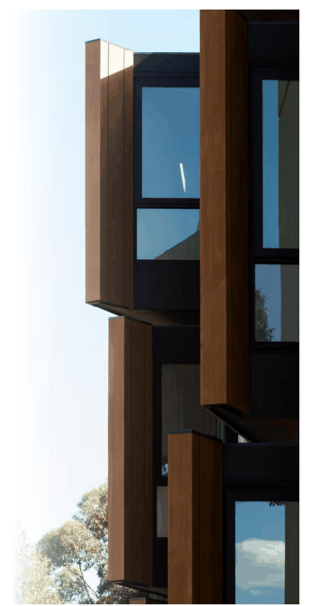
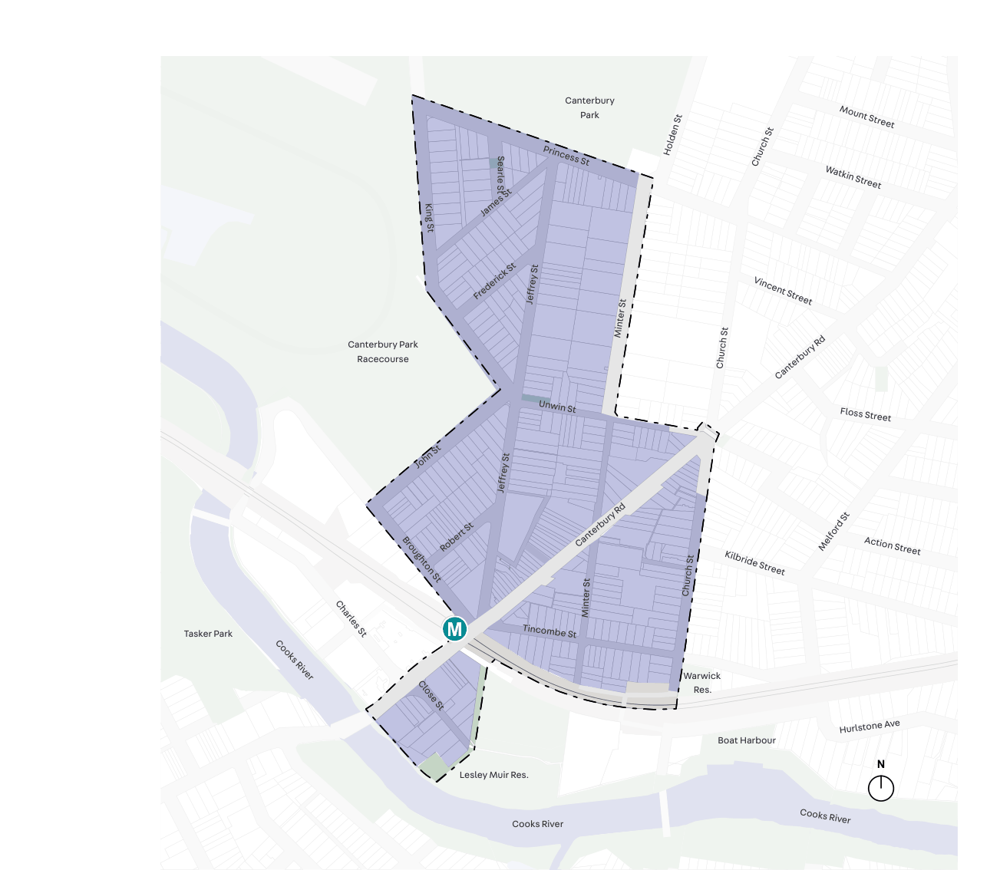

### 4.1 Minimum lot sizes and

### provisions for certain dwellings

A minimum lot size for certain residential dwellings is proposed to ensure lots are large enough to accommodate certain residential development, particularly residential flat buildings, and maintain adequate frontage and amenity.

#### Objectives

O1. Ensure lots for residential accommodation are large enough to accommodate proposed dwellings, setbacks to adjoining residential land, private open space and landscaped areas, driveways and vehicle manoeuvring areas,

O2. Ensure lots for non-residential accommodation are large enough to accommodate setbacks to adjoining land, private open space and landscaped areas, play areas, pedestrian access, set down and pick up areas, car parks, driveways and vehicle manoeuvring areas,

O3. Minimise the likely adverse impact of development on the amenity of the area,

O4. Require lot amalgamation to

achieve minimum lot frontage and

size requirements,

O5. Ensure lots are large enough

to protect special attributes,

including natural or cultural

features, heritage items, heritage

conservation areas, trees and

natural topographical features,

O6. Prevent fragmentation or isolation

of land.

> [Picture on page 51: a picture, saved as a picture (images/ch-07-05-canterbury-page-51-41.gif, 150 dpi).]

Figure 37: Shoutridge, Lindfield NSW, Architectus (Source: Brett Boardman)

#### Controls

C1 Development consent must not be granted to development above 8 storey on land specified in Column 1 of the table to this subclause for a purpose specified in Column 2 unless—

(a) the lot is at least the size specified in Column 3, and

(b) the width of the lot at the front building line is at least the width specified in Column 4.

| Column 1 | Column 2 | Column 3 | Column 4 |
|---|---|---|---|
| Zone E1 in Area 9 (except where a lot has a second­ ary frontage or access via a laneway) | Residential flat buildings | - | 30 metres |
| Zone E1 in Area 9 (except | Shop top housing | - | 30 metres |
| where a lot has a second­ ary frontage or access via |  |  |  |
| a laneway) |  |  |  |
| Zone E1 in Area 9 (except where a lot has a second­ ary frontage or access via a laneway) | Serviced apartments | - | 30 metres |

Table 4: Controls

Chapter 7.5 Canterbury Local Centre 52

#### Area 9 Map

#### LEGEND

Area 9

Application of DCP

> [Picture on page 53: a map, saved as a picture (images/ch-07-05-canterbury-page-53-5.gif, 150 dpi); the street names and other small labels are on the picture.]
> Words printed on the picture (title and legend, copied from the PDF):
> Frederick St Jeffrey St
> Lesley Muir Res.

Figure 38: Area 9 map.
