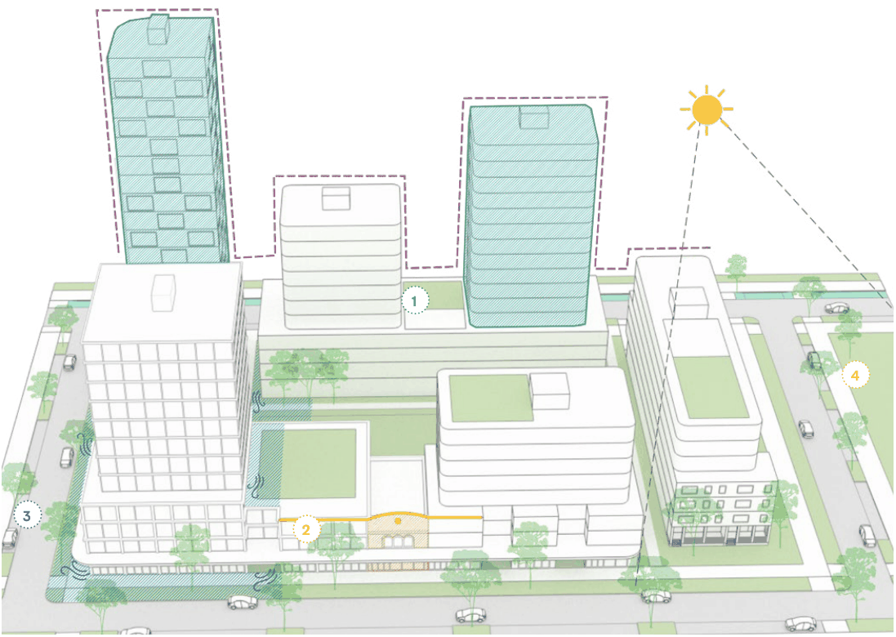
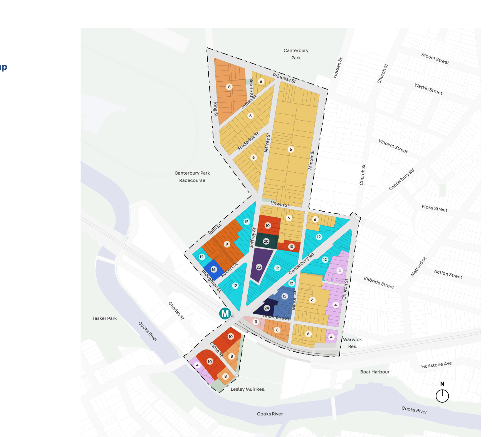

### 4.2 The building envelope

#### 4.2.1 Building height and storeys

The building heights in the Local Centre:

⚬Provide for the intensification of

development around the station to

maximise housing provision.

⚬Minimise overshadowing to existing

and proposed  open spaces.

⚬Provide for landmark buildings on

prominent corners to improve the

legibility of the Local Centre.

#### Objectives

O1. To design a distinctive and legible

skyline to define the core of the

Local Centre.

To design tall buildings that

allow for adequate provision of

sunlight to streets and squares for

pedestrians and to allow trees to

grow.

O3. To ensure that buildings are

> [Picture on page 54: a picture, saved as a picture (images/ch-07-05-canterbury-page-54-22.gif, 150 dpi).]
> Words printed on the picture (title and legend, copied from the PDF):
> 3
> 2
> 1
> 4

#### Slender, elegant towers

well separated

#### 1

#### Height and scale responds

designed in consideration of wind

impacts to the public domain.

To design elegant slender towers

that have considered views from

the Cooks River and the new

Canterbury Square.

to character and context

#### 2

Minimise wind impacts for

pedestrians in public domain

#### 3

Solar access for amenity

and plantings

#### 4

Figure 39: Key design guidance for building height and storeys.

O5. To ensure tall buildings express a strong architectural response defined by a clearly identified concept or idea to create a sense of place.

#### Principles

P1. Concentrate tall buildings around the Metro station and civic areas.

P2. Ensure that towers over 25m are setback above a podium to mitigate bulk and dominance of the street.

P3. Ensure the height and scale of new developments are site specific and developed in response to key features of the site and setting.

P4. Ensure wind conditions promote outdoor planting, including green roofs and other landscaping elements as well as tables, chairs and other furniture used by building occupants on balconies and outdoor areas on buildings.

#### Controls

C1. A wind impact assessment is required for:

(a) Buildings over 25m in height,

(b) Buildings without a podium on a

corner sites.

C2. Buildings without a podium are

permitted on corner sites. In cases

where a podium is not proposed,

the building is to:

(a) Be designed to mitigate down

drafts to the public domain in

accordance with a Wind Impact

Assessment report;

(b) Be designed ‘in the round’ (i.e.

consideration of the design quality

in relation to how the building

is viewed from within the Local

Centre, from the street level, from

within other buildings and from a

distance);

(c) Provide a high-quality ground

plane for pedestrians at street

level.

C3. Development must not exceed the

number of storeys shown for the

site on figure 40 Building Height in

Storeys Map.

#### Building height in storeys Map

#### LEGEND

3 storey

4 storey

6 storey

8 storey

9 storey

10 storey

12 storey

15 storey

16 storey

20 storey

23 storey

24 storey

Application of DCP

> [Picture on page 56: a map, saved as a picture (images/ch-07-05-canterbury-page-56-16.gif, 150 dpi); the street names and other small labels are on the picture.]
> Words printed on the picture (title and legend, copied from the PDF):
> King St 6
> Frederick St 6
> 9 Jeffrey St 10
> 24 Minter St
> Close St 8
> Lesley Muir Res.

Figure 40: Building height in storeys map.
