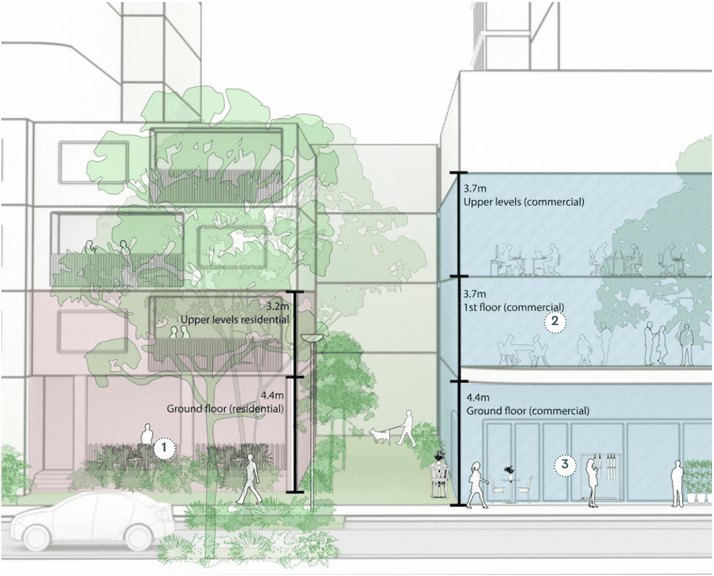
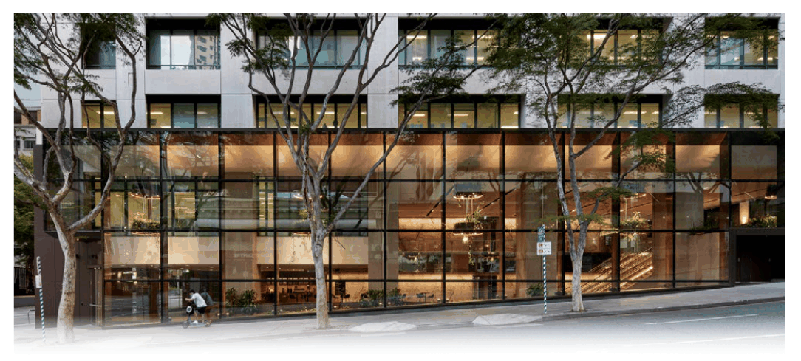

#### 4.2.2 Floor to floor heights Objectives

O1. Ensure that floor to floor heights

provide adequate amenity for

building occupants, support a

different range of uses and allow

for flexibility of uses over time.

To ensure the ground floor of

buildings have a consistent floor

to floor height to provide a well-

proportioned and quality interface to the public domain.

> [Picture on page 57: a picture, saved as a picture (images/ch-07-05-canterbury-page-57-13.gif, 150 dpi).]
> Words printed on the picture (title and legend, copied from the PDF):
> 1
> 2
> 3

Provide amenity for building occupants

#### 1

#### Enable adaptivity and flexibility

for changing uses

#### 2

#### Consistent ground floor height

along active frontages

#### 3

Figure 41: Key design guidance for floor to floor heights to ensure amenity, flexibility and a consistent street wall.

#### Principles

P1. The entire ground floor level should be at same floor to floor height to ensure for a consistent and attractive frontage.

P2. Notwithstanding the above, where a waste collection vehicle must entry from a mid block frontage, the finishing of the service cupboards and basement car park entry should be coordinated in dark recessive colours to minimise the visual impact on the public domain.

#### Controls

C1. Development must comply with the minimum floor to floor heights shown in Table 5. This control does not apply to dwelling house, dual occupancy, semi- detached dwellings or multi-dwelling housing development.

> [Picture on page 58: a picture, saved as a picture (images/ch-07-05-canterbury-page-58-23.gif, 150 dpi).]

Figure 42: No.1 Anzac Square, Brisbane, QLD, Architectus (Source: Christopher Frederick Jones)

| Floor-to-floor height (m) | Ground Floor | First Floor (Commercial) | Upper Levels | Other Rooftop elements |
|---|---|---|---|---|
| Residential | 4.4m | N/A | 3.2m | 3m |
| Commercial | 4.4m | 3.7m | 3.7m | 3m |
| Mixed Use Commercial/ Residential B2 e.g. shop top | 4.4m | 3.7m | 3.2m | 3m |

housing

Table 5: Minimum floor-to-floor heights.

For waste truck access – Heavy Rigid Vehicle (HRV) * 4.5m clearance for HRV

\*This includes ground level and podium level car parking. If a development has basement waste collection facilities, minimum clearance must comply with the controls established in Chapter 5.5 .Waste management.
