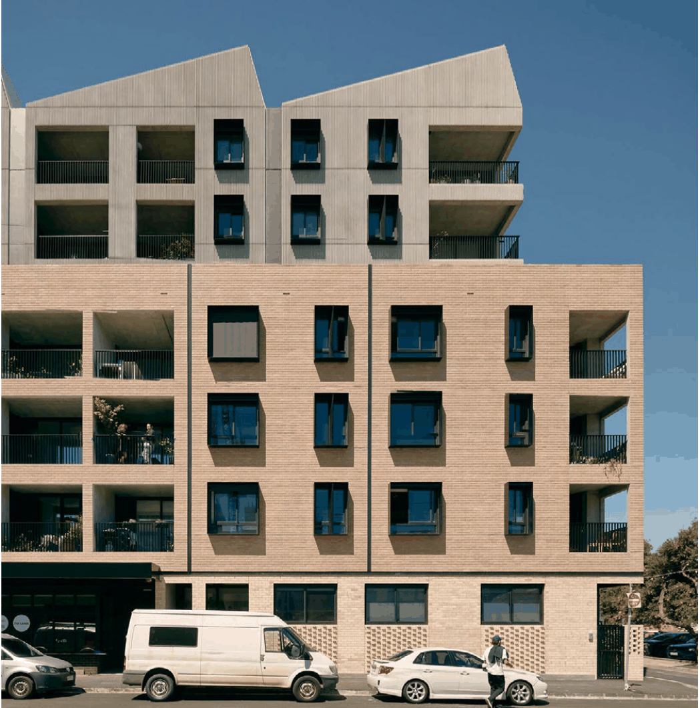
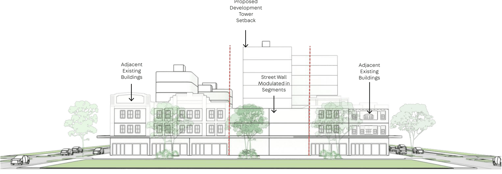
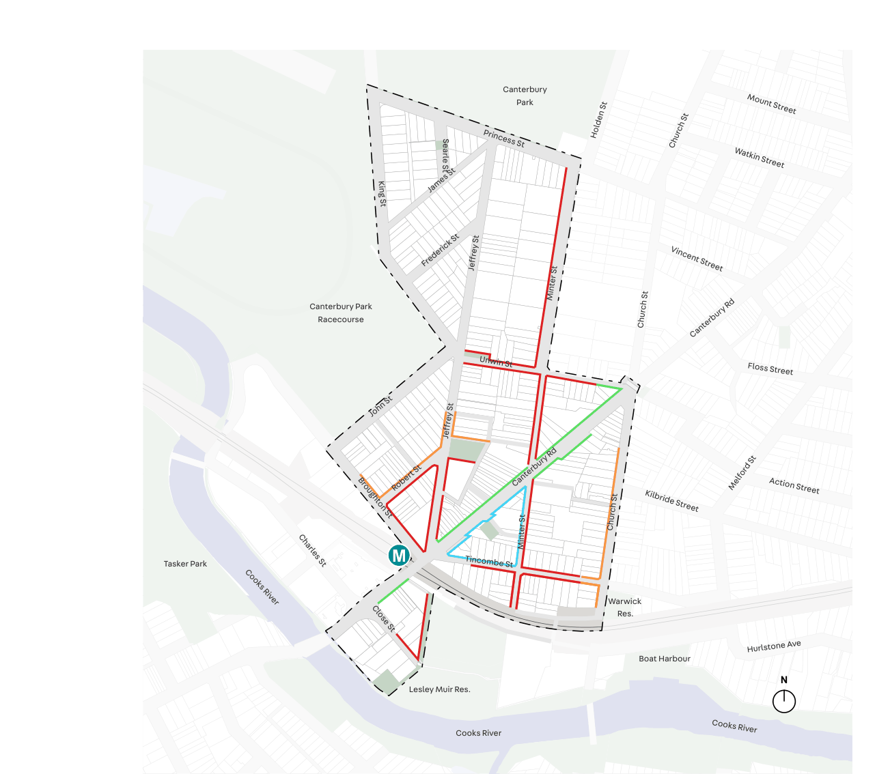

#### 4.2.3 Street wall

Together with the public domain, the street wall with active ground floor frontage is the built element that shapes the way most of the city is experienced. The street wall provides spatial enclosure and must operate in concert with other street walls or podiums to form a satisfying and rich experience of the public spaces of the city for the community. Interruptions or erosions of the street wall generally work to undermine the vitality and definition of the street wall and are not favoured.

#### Objectives

O1. To ensure that the visual relationship between the street and public space is reinforced. To design the street wall to achieve fine grain modulation to create visual interest and variety while ensuring for consistency in streetscape character.

O3. To create a vertical rhythm and visual interest to reduce the scale of building mass.

To implement an articulation zone within podiums and facades to allow architectural form to develop.

#### Principles

P1. Street wall design should reflect the context and interface with a particular street typology.

P2. Design the street wall to provides appropriate scale, material quality and detail.

P3 Minimise large expanses of inactive frontage.

P4. Retain and sensitively integrate existing heritage and historic shopfronts into new development.

#### Controls

C1. Street wall heights must be consistent with Figure 45. For Council to consider a variation to a street wall height a development application must include a streetscape analysis that demonstrates a more appropriate street wall height. Submissions must include:

(a) The street wall elevation at 1:500 scale in context showing existing buildings on the block;

(b) A detailed street wall elevation at 1:200 scale including the buildings immediately adjacent.

C2. Where a street frontage length of an individual building exceeds 45m in length, it is to appear broken into two or more buildings each with different architectural characters. This outcome could be achieved through the following articulation design considerations or through other alternative design considerations to the reasonable satisfaction of Council:

(a) Podiums measuring greater than 45-70m in length are divided into two or more vertical elements.

(b) Vertical elements must be separated by indentations at a scale legible in the street and use a varied architectural expression and materiality.

(c) In cases where there is a range of heights in a street wall, prioritise the lower range along laneways, pedestrian links, and areas with high pedestrian activity.

C3. Where there are existing historic pre 1950 shopfront street walls, such as along the Canterbury Road frontage, these shopfronts should be sensitively be integrated into new development to the satisfaction of Council.

C4. Where the adjacent built form context is lower-scale and not anticipated to change,development must provide a transition to the lower scaled built form and include appropriate articulation to fit with the context.

C5. For sites including or adjacent to heritage items, development must transition the scale and height of the development and provide adequate separation and appropriate articulation to respect the scale established by the historic or existing context.

> [Picture on page 60: a picture, saved as a picture (images/ch-07-05-canterbury-page-60-23.gif, 150 dpi).]

Figure 43: A four storey street wall defines the street edge, Breese by Breathe architects, photo by Tom Ross

C6. Datums derived from listed heritage buildings on the site or on an adjoining property — that is, the heights of the main ridgelines (or parapets in the case of commercial buildings), top plates/eaves level (or awnings of commercial buildings) and ground floor levels (street or natural ground levels)—must be used to ensure composition of height and scale is visually harmonious.

> [Picture on page 61: a map, saved as a picture (images/ch-07-05-canterbury-page-61-13.gif, 150 dpi); the street names and other small labels are on the picture.]

Figure 44: A street wall elevation is to be prepared to demonstrate how the proposed development fits with the existing neighbouring buildings in the block.

#### Street wall height Map

#### LEGEND

2 storey

3 storey

4 storey

Range:

2 to 3 storey

Application of DCP

> [Picture on page 62: a map, saved as a picture (images/ch-07-05-canterbury-page-62-9.gif, 150 dpi); the street names and other small labels are on the picture.]
> Words printed on the picture (title and legend, copied from the PDF):
> Frederick St Jeffrey St
> Lesley Muir Res.

#### Map to be updated based

on the 3D Model

Figure 45: Street wall height map.
