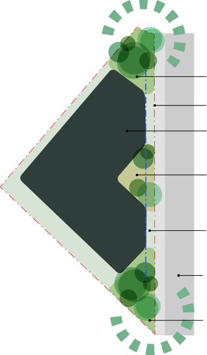
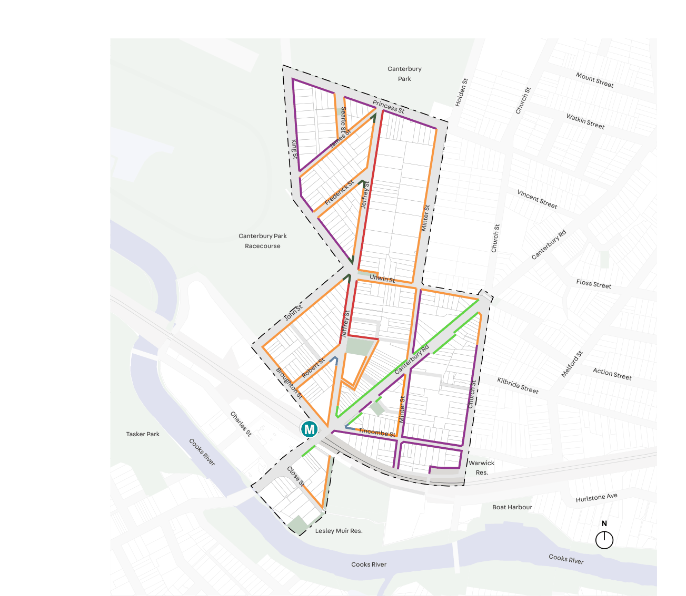

#### 4.2.4 Front setbacks Objectives

O1. To define streets, public spaces and key elements that including heritage and landscape features. To allow flexibility in setbacks where appropriate, minimising impacts on surrounding properties and the public domain.

O3. To enable sensory engagement with the street.

To encourage setbacks that reinforce the desired future character of the area.

O5. To utilise front setbacks to provide privacy and amenity.

O6. To create a lively destination in the centre  that caters for the growth in population and provides space for outdoor trading and dining, lingering, and increased tree canopy.

#### Principles

P1. Reinforce the Central Core by creating a defined urban street edge.

P2. To allow flexibility in response to context only where amenity and environmental impacts are minimal.

P3 Provide opportunities for landscaped 'nodes’ for medium and large trees at the corners of triangulated sites and courtyards at street frontages that will provide increased tree canopy and implement the Government Architect NSW ‘Biodiversity in Place’ principles.

P3 Set back the buildings in the buildings in the centre to widen the footpath area .

#### Controls

C1. Front setbacks are to be consistent with Figure 47.

C2. For landscape nodes shown at 9m from a corner on Figure 47, the setback should be taken from the midpoint of that corner.

Landscape node

Triangular site

Building footprint

Courtyard

Front Setback

Street - public domain

Landscape node

> [Picture on page 63: a picture, saved as a picture (images/ch-07-05-canterbury-page-63-57.gif, 150 dpi).]

Figure 46: Diagram illustrating landscaped nodes and courtyard in triangulated sites with a L-shaped building typology - Not at scale.

#### Front setbacks Map

#### LEGEND

0 m

3 m

5 m

6 m

9 m

9 m- landscape node

Application of DCP

> [Picture on page 64: a map, saved as a picture (images/ch-07-05-canterbury-page-64-10.gif, 150 dpi); the street names and other small labels are on the picture.]
> Words printed on the picture (title and legend, copied from the PDF):
> Frederick St Jeffrey St
> Lesley Muir Res.

#### Map to be updated based

on the 3D Model

Figure 47: Front setbacks map.
