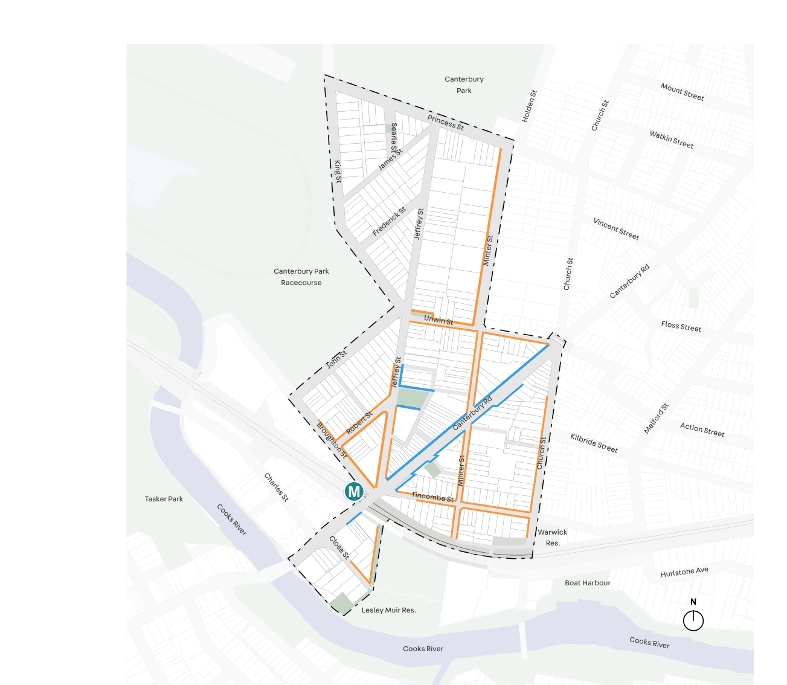

#### 4.2.5 Upper storey setbacks Objectives

O1. To ensure buildings are setback above street walls to reinforce the scale of streets, mitigate wind down drafts to pedestrians and mitigate dominance of the public domain.

To ensure that upper storey setbacks allow for the enjoyment of sun and daylight within public spaces, provide for views of the sky and allow trees to grow.

O3. To provide for appropriate transition and sympathetic response to lower-scaled buildings and significant elements within the local context.

To create opportunities for tree canopy, planting and outdoor open space on podiums.

#### Principles

P1. Clearly delineate the street wall and create a visual break in tall building facades.

P2. Encourage green cover and useable spaces on podiums and rooftops

P3. Promote generous commercial, communal and residential balconies on upper storey setbacks

P4. Buildings above the podium are setback from the street in a way that is sympathetic to surrounding development and does not detract from the human scale of the streetscape.

#### Controls

C1. Upper storey setbacks are to be consistent with Figure 48.

C2. Where there is no upper storey setback shown on the map, the upper-storey setback of existing development immediately adjoining the site must be adopted. Where there is insufficient existing development adjoining the site, the applicant is to demonstrate why the proposed setback is appropriate giving consideration to the Principles and Objectives of this Chapter.

C3. Building envelopes may require a deeper upper storey setback to protect sunlight and limit shadowing of neighbouring streets, properties, parks, and open space. A deeper upper storey setback may also be required for heritage items to ensure heritage significance is not compromised.

C4 Upper storey setbacks are to be measured from the edge of the street wall, as per figure 78, page 109 in the appendix.

#### Upper storey setbacks map

#### LEGEND

3 m

5 m

Application of DCP

> [Picture on page 66: a map, saved as a picture (images/ch-07-05-canterbury-page-66-6.gif, 150 dpi); the street names and other small labels are on the picture.]
> Words printed on the picture (title and legend, copied from the PDF):
> Frederick St Jeffrey St
> Lesley Muir Res.

#### Map to be updated based

on the 3D Model

Figure 48: Upper storey setbacks map.
