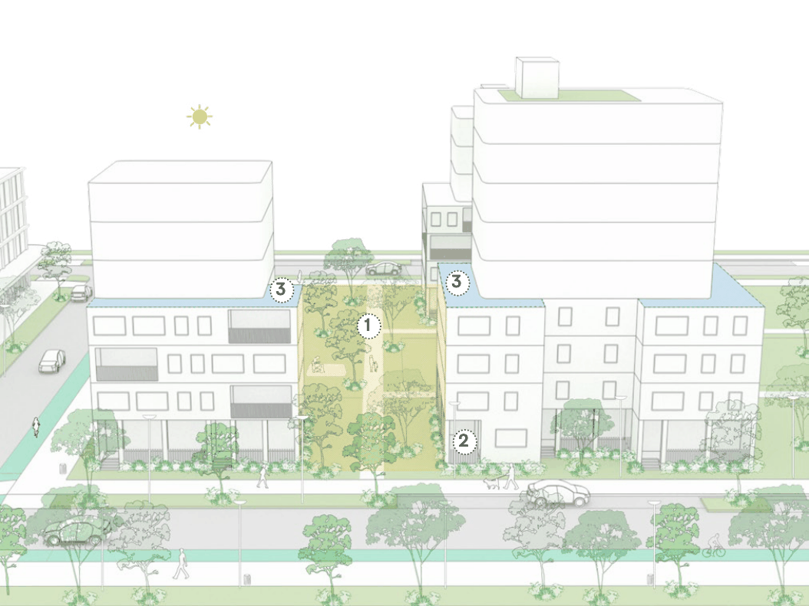
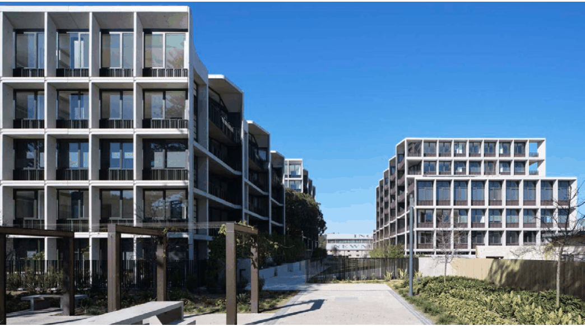

#### 4.2.6 Building separation Objectives

O1. To ensure sunlight penetrates through to street level to protect the amenity of pedestrians and allow street trees to grow. To ensure that taller buildings are not overwhelming and overcrowded and appear as distinct elements within the skyline with space around them.

O3. To provide adequate privacy, access to light, air and outlook to the sky for the occupants of buildings, neighbouring properties and future buildings. To ensure development does not unfairly limit the re-development potential of adjoining sites in the future.

#### Principles

P1. Building design should avoid using multiple upper-level setback ‘steps’ that result in a ‘wedding cake’ or a ‘ziggurat’ appearance.

> [Picture on page 67: a picture, saved as a picture (images/ch-07-05-canterbury-page-67-26.gif, 150 dpi).]
> Words printed on the picture (title and legend, copied from the PDF):
> 3
> 3
> 1
> 2

#### 1

#### Ensure sunlight

for amenity and

plantings.

#### Views and privacy

as well as air flow

#### 2

#### 3

#### Appropriate upper

setbacks to provide

desired building

separations

Figure 49: Key design guidance for building separation to ensure amenity, visual privacy, views, air circulation and sunlight.

P2. Maintain adequate separation distances between buildings on the same site to protect access to sunlight and sky views and improve air circulation between buildings.

P3 Provide separation to enable a building to be seen from all sides and to allow for articulation that responds to orientation.

#### Controls

C1. Minimum building separation distances for non-residential uses are outlined in Table 6.

> [Picture on page 68: a picture, saved as a picture (images/ch-07-05-canterbury-page-68-14.gif, 150 dpi).]

Figure 50: Building separation with high amenities in public domain (Source: Newmarket, NSW by Smart Design Studio).

| Storeys | Up to 4 Storeys | 5-8 Storeys | 9+ Storeys |
|---|---|---|---|
| Non-residential uses | 3m | 6m* | 9m (or 12m for tall buildings of 25m or more) |
| Commercial developments adjoining single purpose residential uses** | 6m | 9m | 12m |

Table 6: Minimum building separation for non-residential uses

Note: In high streets where there are blank party walls, no separation is required.

\**Commercial developments include business premises, childcare centres, educational establishments and places of worship. Single purpose residential uses include residential flat buildings, boarding houses, multi-dwelling housing and single dwelling houses.

For residential apartment development, please refer to the Apartment Design Guide(ADG).
