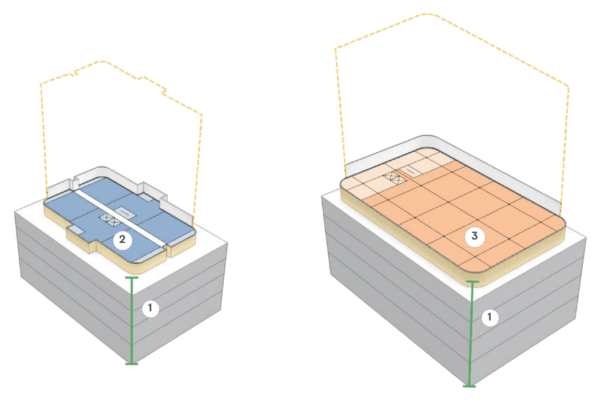
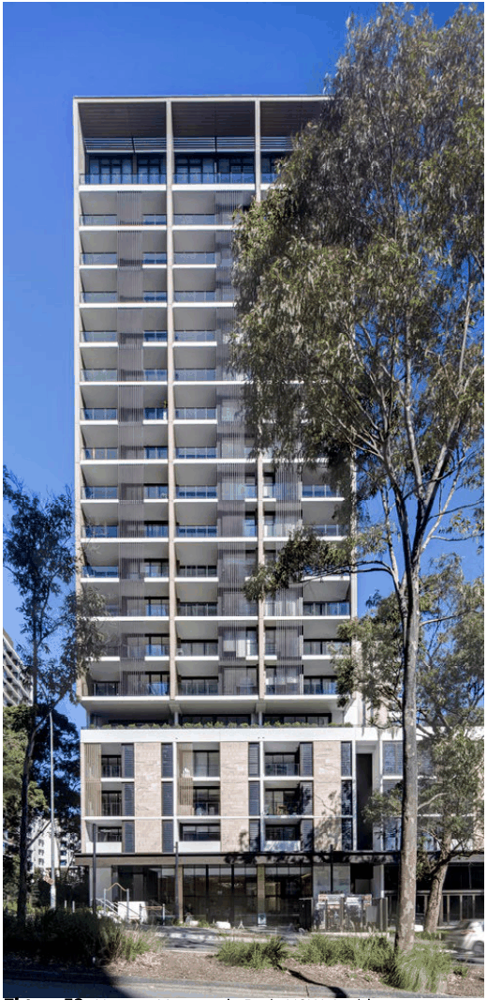

#### 4.2.7 Maximum floorplate area

#### Objectives

O1. To ensure towers are not bulky, provide good amenity to building occupants and appear slender, elegant and well-proportioned when view from streets and from distance.

To allow for views to the sky from streets and lanes.

O3. To reduce building bulk and minimise its impact on streets, public spaces, and street trees by mitigating adverse effects such as overshadowing and urban heat gain.

To ensure floor plates are limited to a certain area and configuration in accordance with use.

#### Principles

> [Picture on page 69: a picture, saved as a picture (images/ch-07-05-canterbury-page-69-21.gif, 150 dpi).]
> Words printed on the picture (title and legend, copied from the PDF):
> 2
> 1
> 3
> 1

Above 25m floorplate

controls apply

#### 1

2 Slender towers  for

residential buildings with a

maximum of 800m² of GFA

3 Non-residential towers for

commercial buildings with a

maximum of 1.500m² of GFA.

Figure 51: Floorplate controls for towers seek to ensure good functionality, circulation, amenity, solar access and maximise views to the sky.

P1. Tall commercial towers must prioritise daylight access and minimise solar heat load.

P2. Shallow floorplates and glazing to south facades are favourable for providing excellent natural daylight.

P3. Achieve living and working environments with good internal amenity and minimise the need for artificial cooling and heating.

#### Controls

C1. The maximum floor plate area for any levels above 25m above ground level must be:

(a) 800m² GFA for residential flat buildings, residential accommodation within shop top housing, serviced apartments and self-contained hotels.

(b) 1,500m² GFA for non-residential.

c) Larger floor plates that exceed the above may be considered by Council where the proposal demonstrates consistency with the Objectives and exhibits Design Excellence, in accordance with Clause 6.15 of the CB LEP 2023, where applicable.

> [Picture on page 70: a picture, saved as a picture (images/ch-07-05-canterbury-page-70-30.gif, 150 dpi).]

Figure 52: Natura, Macquarie Park, NSW, Architectus.
