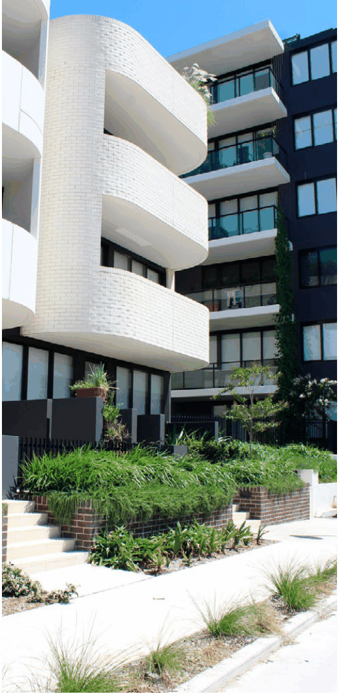

### 4.3 Building interface

#### 4.3.1 Residential ground floor frontage Objectives

O1. To establish new canopy trees within setbacks that contribute to the character of the street and provide residents amenity and privacy.

To provide ownership and identity to residents by providing individual entries along the ground floor frontage out to the public domain.

O3. To provide for surveillance of public and publicly accessible space.

To encourage detailed attention to the design and to selection of materials at the lower level of residential buildings.

#### Principles

P1. Provide individual courtyards to ground floor apartments.

P2. Existing and proposed tree canopy should be contained within front setbacks to provide residents amenity and privacy.

#### Controls

C1. The front setback area must allocate a minimum of 3 metres from the boundary for deep soil landscaping. Canopy trees must be planted in this area 2.5 metres away from structures to achieve at least 12 metres mature height and spread, at the rate of 1 canopy tree for every 12 lineal metres of frontage

C2. Where a front setback is 3 metres width, the basement car parking must sit under the building footprint to allow for the deep soil zone. Where the setback is 6 metres, the basement can encroach 2 metres into the front setback.

> [Picture on page 71: a picture, saved as a picture (images/ch-07-05-canterbury-page-71-46.gif, 150 dpi).]

Figure 53: Eve Street, Erskineville (Source: Architectus)
