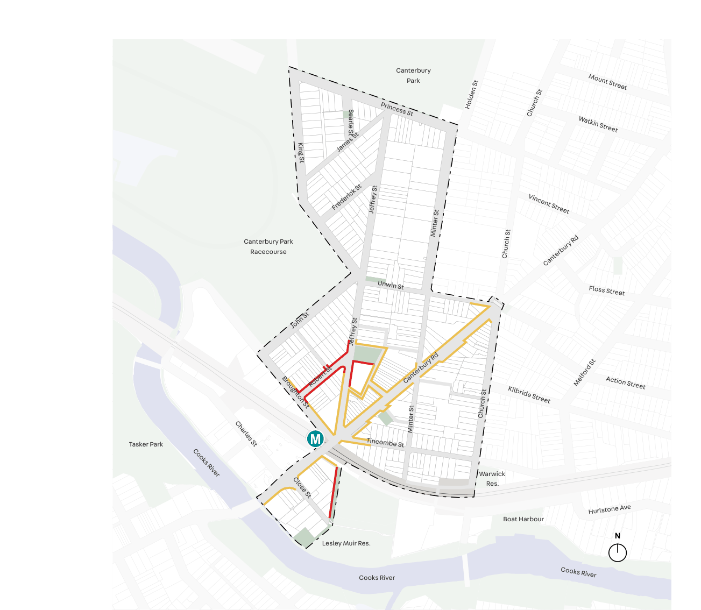
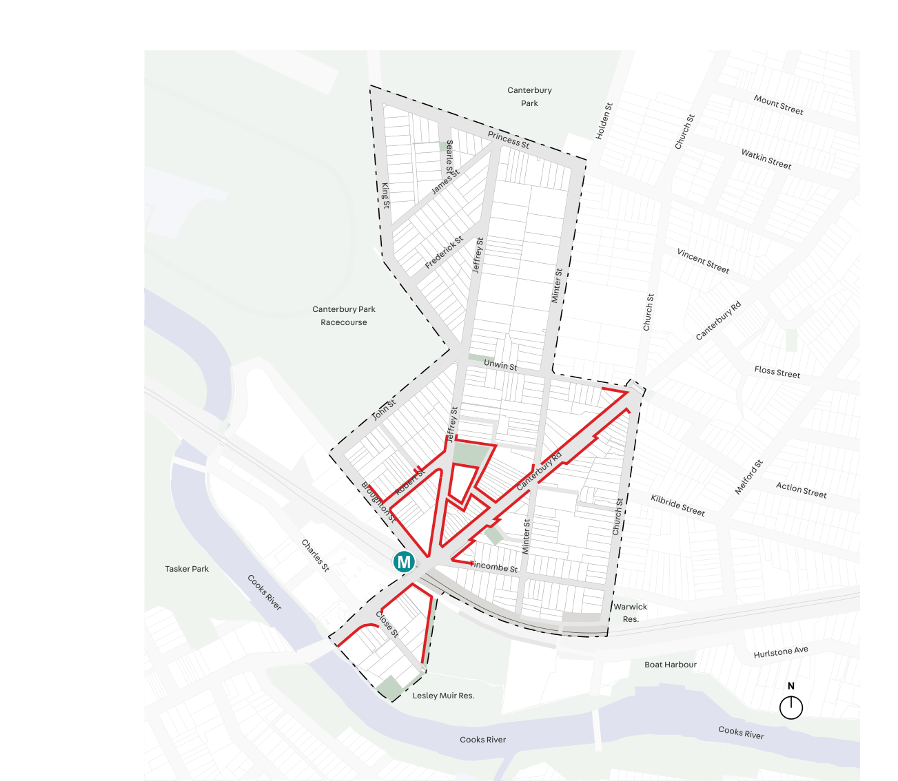

#### 4.3.2 Active Street frontage and edges

There are three areas where active street frontages are located within the Local Centre. These include Robert Street, Canterbury Square in Jeffrey Street South and the active edge in Canterbury South onto Lesley Muir Reserve. These active street frontage are identified in the LEP. Separately to the active street frontages are active edges. An active edge is secondary to an active street frontage.

Active street frontages must have a character similar to a traditional ‘high street’ and have many individual narrow shopfronts with services located away from the frontage. There are no large format stores and there is an intensity of activity.

Active uses include retail, customer service areas, cafes and restaurants, and other uses that involve pedestrian interest and interaction. Outdoor dining areas may also contribute to active street frontages in appropriate circumstances.

The active edges located on Canterbury Road could be business uses and have less activity than an active street frontage. Pierson Lane uses are more active as they are located on the edge  of Canterbury Square.

#### Objectives

O1. To encourage finer grained narrow frontages to create varied experiences that provide views into and out of shops. To ensure that Robert and Jeffrey Street South have a high quality and engaging public realm.

O3. To ensure that the interface and amenity of Canterbury Road is improved for pedestrians. To encourage people to linger and enjoy public space.

O5. To ensure that building services do not dominate the pedestrian experience and are designed as an integrated part of the building form.

O6. To ensure ground floor active street frontage and edges are pedestrian oriented, have a high standard of design and add vitality to streets.

O7. To create opportunities to enjoy the positive aspects of climate and shield people from the negative such as wind, rain and heat.

To provide secondary edges that create vitality and interest.

#### Principles

P1. Vehicle entries are located away from key pedestrian areas.

P2. Awnings are to be used along active street frontages and edges.

P3. Shopfronts utilise lighting in the evenings when people are using public space for safety and activation.

#### Controls

C1. The location of active street frontages and active edges are shown on the Figure 54.

C2. Active edges should be provided on Canterbury Road and Pierson Lane.

C3. Vehicle access and loading should be located away from active street frontages and primary pedestrian areas. Service lanes priorities vehicles over pedestrians between the hours of 10pm to 7am.

C4. Awnings are to be provided to active frontages and extend 3m over the footway to provide protection from weather and hot

sun. Awnings must:

(a) Integrate with the built form;

(b) Not be double height;

(c) Be non-reflective and not glazed

(d) Be harmonious with adjacent awnings and gutters and ensure downpipes and lighting are recessed and integrated with the building.

| Minimum active street frontage required for each frontage facing the public domain | 70% of the width of each public domain frontage |
|---|---|
| Active uses facing the public domain | Entries or display windows to shops and/ or food and drink premises or other uses, customer service areas and activities which provide pedestrian interest and interaction. |
| Minimum ‘grain’ of shop front tenancies | 8 tenancy entries per 100m. Where a single or larger tenancy is proposed with a single entrance, the facade must give the appearance of being visually broken up into finer grain tenancies and allow for sepa­ rate tenancy entrances in the future |
| Provision of awnings | Awnings are to be provided to all active frontages including Broughton Street at the edge of the B2 Zone. |

Table 7: Active street frontage design guidance

Active street frontages and

active edges map

#### LEGEND

Active street frontage

Active edge

Application of DCP

> [Picture on page 74: a map, saved as a picture (images/ch-07-05-canterbury-page-74-7.gif, 150 dpi); the street names and other small labels are on the picture.]
> Words printed on the picture (title and legend, copied from the PDF):
> Frederick St Jeffrey St
> Lesley Muir Res.

Charles St M Tincombe St

Figure 54: Active street frontage and active edges map.

#### Awnings map

#### LEGEND

Awnings

Application of DCP

> [Picture on page 75: a map, saved as a picture (images/ch-07-05-canterbury-page-75-5.gif, 150 dpi); the street names and other small labels are on the picture.]
> Words printed on the picture (title and legend, copied from the PDF):
> Frederick St Jeffrey St
> Lesley Muir Res.

Charles St M Tincombe St

Figure 55: Awnings map.
