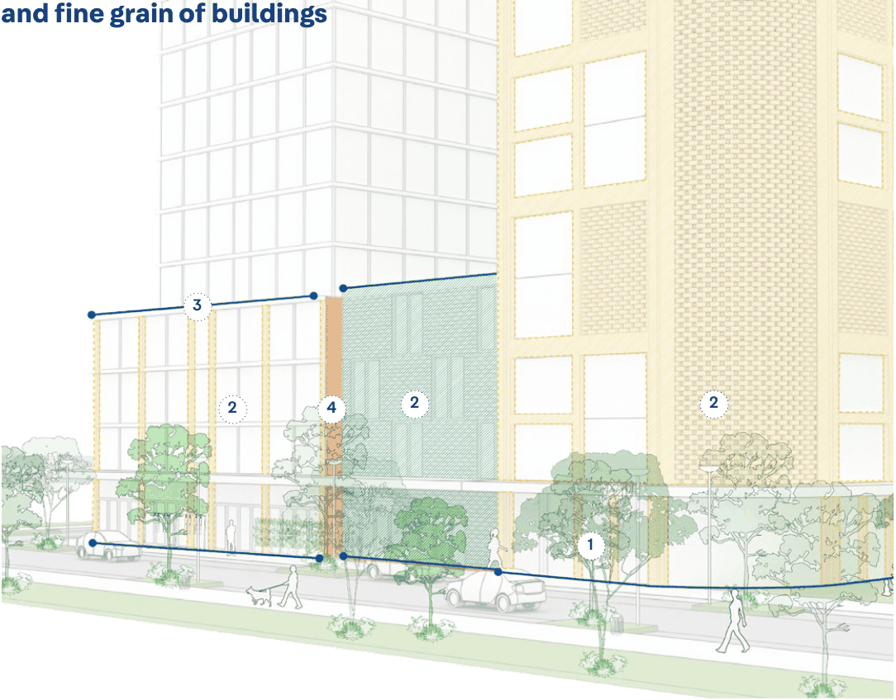

### 4.4 Visual diversity, articulation and fine grain of buildings

#### Objectives

O1. Encourage variety in architectural design and character to provide a fine grain which enriches and enlivens the Local Centre’s public realm.

Ensure building mass is reduced by articulating building envelopes into smaller components.

O3. Ensure that the scale, modulation and façade articulation of

development responds to the heritage character within the Local Centre.

To use architectural character to provide visual interest, texture and engagement.

#### Principles

> [Picture on page 76: a picture, saved as a picture (images/ch-07-05-canterbury-page-76-20.gif, 150 dpi).]
> Words printed on the picture (title and legend, copied from the PDF):
> 3
> 4
> 2
> 2
> 1
> 2
