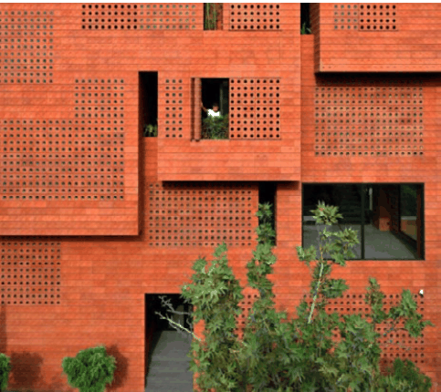
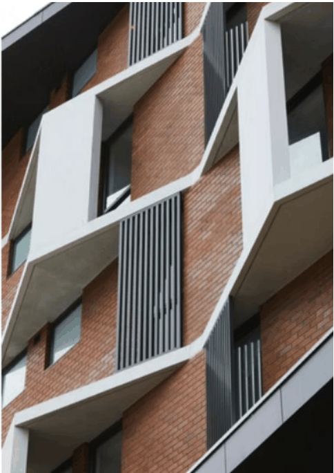

#### 3 Long podiums visually

broken  to create

variety and ensure

human scale

4 Articulation zone to

provide depth for

design of building

façades

Figure 56: Design guidance on building façades to ensure visual diversity, articulation and fine grain.

P1. Where large buildings are proposed, they are to have a contextual variety of architectural character to provide individual identity to residents.

P2. Reduce the scale of building mass through vertical or horizontal articulation and using depth in façades.

P3. Use articulation zones in podiums to reduce mass, provide outdoor space and greenery and create depth and shade.

P4. Strive for simplicity of and not complexity in articulation.

#### Controls

C1. Ensure for articulation of buildings into vertical bays and the integration of landscape to all elevation that are seen from public space.

C2. An articulation zone with a 1.2m depth should be included in the street wall to allow architectural form to develop. Outdoor space within this zone can be applied to all building uses for amenity, surveillance and to add depth to facades.

> [Picture on page 77: a picture, saved as a picture (images/ch-07-05-canterbury-page-77-30.gif, 150 dpi).]

Figure 57: Brick wall interfacing open space.

C3. Facades facing the street or public space should be articulated with depth, relief and shadow as in C2. A minimum relief of 150mm between the masonry finish and glazing face should be utilised to provide depth and shadow.

> [Picture on page 77: a picture, saved as a picture (images/ch-07-05-canterbury-page-77-39.gif, 150 dpi).]

Figure 58: Glyde Bautovich Via Apartments
